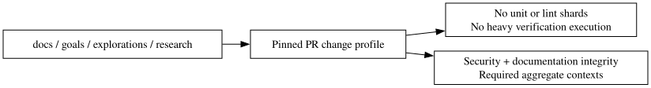

# Documentation-only CI routing acceptance

This acceptance exercises the folder policy introduced by PR #2999 against
hosted CI. It includes this report plus Graphviz source, an accessible SVG and
a temporary rendering helper under a goal
packet's asset directory. Those goal figures reproduce the file formats that
caused PR #2993 to be classified as product work.



## Regenerate the diagram

Install [Graphviz 10.0.1 or later](https://graphviz.org/docs/outputs/svg/) for
`svg_inline` and the repository dependencies, then run:

```sh
bun goals/compute-profile-gate-routing/assets/render-ci-docs-only-routing.ts
```

The helper uses inline SVG output, adds an accessible root title and applies the
repository SVG checks. This avoids Graphviz XML declarations that the SVG lint
parser does not accept. With the same installed tool versions, regeneration is
byte-for-byte deterministic. This temporary packet helper also exercises the
policy that goal helpers do not trigger product verification.

## Why allocation matters

PR #2993's Check run [42576338410](https://github.com/beep-effect/beep-effect/actions/runs/42576338410)
classified its documentation and goal figures as `docs_only=false`. Thirteen unit
shards actually executed, totaling 11,881 job-seconds, with the longest lasting
1,879 seconds. Those numbers are summed job duration and an observed maximum,
not a billing estimate, wall-clock saving, or controlled performance benchmark.

A passing green check alone does not prove that unnecessary work was avoided.
This acceptance requires the job and step records below.

## Acceptance requirements

| Surface | Required observation |
| --- | --- |
| Change Profile | Successful pinned-diff classification with `docs_only=true` |
| Unit-test shards | No runner allocated and no test steps executed |
| Lint shards | No runner allocated and no lint steps executed |
| Heavy verification | No runner allocated to the six verification bodies |
| Heavy Admission | Documentation fast path; monorepo checkout/install skipped |
| Labs, property laws, Fallow advisory | No runner allocated and no lane body executed |
| Lint and Test Unit aggregates | Successful retained required contexts |
| Security, secrets and SAST | Existing checks retained and successful |
| Repository integrity | Applicable documentation/metadata checks retained |

The hosted receipt is recorded in the acceptance PR discussion with the exact PR
head, run IDs, job IDs and allocation/step evidence. Keeping the receipt there
allows recording the completed run without another source push that would start
a new CI run. Missing records, unknown classification or a failed retained gate
are not acceptance.

## Policy boundaries

Changes confined to `docs/`, goal packet folders (`goals/<packet>/`),
`explorations/` and `research/` use the
planning/documentation route, including temporary goal helpers and verifier
inputs. Root goal governance baselines, leases, promotions and compiler
configuration retain verification. Standards Markdown is documentation; standards inventories and
configuration are verification inputs. Mixed product-code or CI-configuration
changes retain applicable checks. Security checks are retained for every route.
