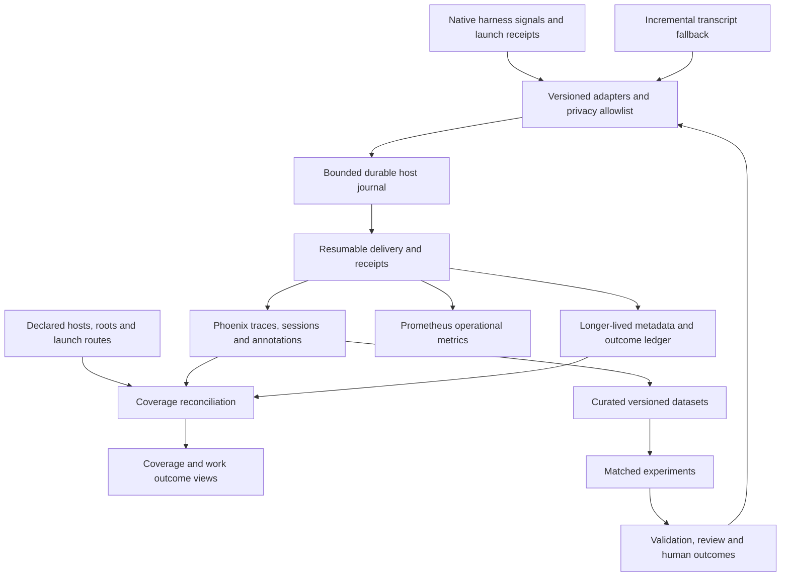

# Trustworthy agent observability — proposed design

2026-10-27. Adopted direction grounded in [RESEARCH.md](./RESEARCH.md). This is a research deliverable, not a claim that the replacement is implemented or deployed. The operator selected **metadata plus curated examples**, then **adopted this direction and requested implementation packets**. Detailed engineering choices remain subject to the packets' proof gates.

## Problem and appetite

The current system measures a partial stream of harness activity. It cannot answer which work was missed, which repository or task much of the work belongs to, why an agent struggled, or whether a harness change improved accepted results. More spans would not solve those problems. Phoenix remains useful: its session, annotation, dataset, experiment and dashboard surfaces are largely unused.

Design the replacement from the questions the operator wants answered. Replace the fragile source-discovery and projection path incrementally while keeping trustworthy existing identity/privacy/export components. First implementation appetite: one host, one public repository, one CLI surface and one desktop surface, synthetic failure fixtures, and five curated task examples. Expansion to all seven requested harnesses is required work, but starts only after the same contract survives that first slice. No calendar or cost estimate is represented as measured.

## What the user should see

The first view should answer **what work happened, whether it helped, and whether the evidence is complete**. Use the existing Phoenix surfaces wherever they can express the contract; add a small coverage/report layer only for missing functions.

| View | Useful contents | What an empty value means |
| --- | --- | --- |
| Coverage | Host × harness × surface, declared route, last source receipt, last visible event, backlog age, exclusions and collection state | Unknown, unsupported, excluded, idle, stale and failed are distinct states |
| Work outcomes | Curated task label, repository, harness/surface, model claim, accepted/failed/abandoned/open, validation, rework and interventions | No outcome judgment yet; never automatic success |
| Task detail | Attempts and handoffs, sessions/turns, tools, critical path, blocked time, corrections, evidence links | Missing timing or lineage remains visible |
| Friction | Repeated failed searches, inaccessible tools, instruction conflicts, flaky gates, authentication waits and context recovery | Lack of evidence is not zero friction |
| Experiments | Dataset and environment version, baseline/change, paired outcomes, uncertainty, quality guardrails and cost basis | Insufficient comparable runs is not a winning result |

A proposed row might read “Fix failing schema test · beep-effect · Codex CLI · validation passed · acceptance pending · collection complete for declared route.” This is illustrative copy, not an observed task. Useful display names come from curated labels and bounded task categories; never from arbitrary prompt text. Static span names retain the architecture's `Concept.action` convention, with variable identifiers in attributes.

## The architecture

### 1. Declare the population before counting it

Maintain a host/root/route inventory independent of the exporter. Git root discovery is evidence of a checkout, not a session. Launcher manifests are evidence of known launches, not all launches. Server receipts are evidence of received events, not all activity. Publish those three denominators separately.

Each route declares harness, application surface, adapter version, signals supported, privacy policy, destination, owner and expected freshness. An uninstrumented desktop app is `unsupported` or `unverified`; it never appears as “0 successful tasks.” Inventory records birth, last seen, retirement and lease expiry separately. Retired worktrees remain in historical windows and keep their identity after their directories disappear.

Known-event reconciliation retains append-only facts such as local persistence, collector acceptance, backend visibility and rejection. These facts overlap and must never be added together. Derive one mutually exclusive current delivery state per logical event (pending, accepted-unverified, visible, rejected, or unresolved), with policy-excluded events accounted separately before collection. Inventory uncertainty is outside that accounting and displayed separately. A transport acknowledgment does not imply durable Phoenix storage; backend visibility checks strengthen evidence but also need bounded cost and retention rules. Canaries prove route health, not complete real-work capture. “Complete” is permitted only for a named instrumented run and an explicit expected-ID set at a declared boundary; it never describes all agent activity.

### 2. Keep identity concepts separate

| Concept | Meaning |
| --- | --- |
| Repository | Stable repository identity, independent of clone path |
| Clone and worktree | Physical checkout identity and parent relationship, retained after retirement |
| Task | Intended unit of useful work, possibly spanning sessions, providers and PRs |
| Attempt/run | One bounded execution attempt, with parent/handoff links |
| Source session | Harness-issued conversation identifier, namespaced by producer |
| Turn/trace | A causal execution segment; use native trace topology where valid |
| Span | A measured operation with defensible timing and parentage |
| Event occurrence | One observation in one source file or transport |
| Logical event | Stable meaning across retries/copies; linked occurrences preserve provenance |

Do not deduplicate by timestamps alone, raw file path alone, or fuzzy prompt similarity. Preserve existing stable IDs for existing exports and introduce a versioned correlation layer for cross-path/native-versus-reconstructed observations. Do not merge ambiguous records. Each field carries provenance: observed, configured, inferred, human-annotated or unavailable.

Keep harness (`claude-code`), surface (`desktop`, `cli`, `managed-subagent`), requested route (`muse`), reported model and verified upstream identity separate. A configured model alias never proves upstream identity. Subagents and retries contribute to their task once, while remaining individually inspectable.

### 3. One bounded collector per host, with explicit producer adapters

Prefer documented native metadata where it provides reliable timing and lifecycle. Add launch/result receipts for managed Grok/Cursor/other routes. Use incremental source parsing as a compatibility fallback, never as an assumption that one JSONL directory contains all tools. Ordinary cloud conversations with no local supported feed remain explicitly out of scope/unobserved until a legitimate adapter exists.

The host journal persists sanitized events before sending, with fair per-source offsets, file rotation/truncation detection, partial-line handling, schema versioning, resource limits and visible dead letters. Distinguish event time, observation time, ingestion time and export time. Unknown duration stays absent; historical replay preserves event time and has a backfill marker. A whole large file must not be dropped just because it grew beyond a cap.

Native OTLP must be deliberately routed through the local intake for this durability claim to apply. The first slice must prove a bounded local receiver that sanitizes the envelope before durable append and documents the exact acknowledgment boundary, or an equivalent validated persistent-queue design. Existing direct-to-dankserver senders remain on their current weaker route until migrated. SDK memory before intake is a separate loss window. Test partial-success/rejection responses and ambiguous acknowledgments; never close every event in a batch because the HTTP status alone is successful. Invalid records enter a bounded metadata-only quarantine with a named owner and replay/disposition policy.

Use bounded at-least-once delivery with idempotent event identities. Reclaim acknowledged journal segments according to an explicit durability/retention policy, not an unbounded wait for every historic record to be query-visible. Install a persistent collector queue across the network hops, preserving state outside disposable containers. Measure queue age/capacity, refused records, retry exhaustion and disk pressure. Do not weaken or remove the existing workstation recovery hold just to make counts rise.

### 4. Normalize useful semantics, with provider-specific accounting

Define versioned adapters for native token fields, model/provider, tool status, latency, cancellation, retry and session identifiers. For Claude, validate the relationship between uncached input, cache-read input, cache creation and completion before deriving Phoenix prompt/total fields. Never sum cache tokens twice. Zero, absent and unsupported are distinct.

Keep API list-price estimates, subscription usage and actual billing separate. Preserve original reported model names and prices/version used for an estimate. Do not turn API-equivalent pricing into a claim about the operator's actual spend.

Count elapsed task time, model time, tool time, blocked time and parallel child time independently. Use interval unions/critical paths where appropriate; summing overlapping spans inflates elapsed work. Latency per trace is not time to an accepted result. Error spans may be recovered retries, and successful spans may still produce rejected work.

A source turn can contain several traces, or lack valid trace boundaries; preserve that relation rather than forcing one-to-one identity. Publish critical-path and blocked-time calculations only when measured intervals and causal links are sufficient. Otherwise show partial timing and the missing evidence.

### 5. Metadata everywhere; content only in curated examples

The operator selected this boundary on 2026-10-27. Default envelopes exclude prompt/response bodies, command arguments, tool output, file contents, secret values and personal identifiers. Use declared low-cardinality fields for metrics and opaque identifiers for traces. Account IDs, process owner and other unnecessary PII should not ride downstream merely because email is scrubbed.

Dataset examples are separately reviewed and sanitized, with provenance, inclusion reason, permitted use and version. Do not bulk-convert raw traces into examples. Raw local archives, if retained by the old system, remain outside this new metadata contract and are not implicitly migrated or uploaded.

Set separate retention budgets for journal, dead letters, stable identity/outcome metadata, annotations, datasets and Phoenix spans. Deleting a short-lived trace must not silently erase the provenance of a retained outcome; mark the link expired and preserve its minimal receipt. Exact durations are implementation decisions constrained by measured resource use and the metadata policy.

### 6. Annotate outcomes, then run experiments

Start with typed, independently interpretable annotations: task acceptance, validation outcome, rework, intervention reason, evidence completeness, and friction category. Record annotator and rubric version. Human acceptance is authoritative for acceptance; deterministic tests establish their narrower properties; LLM judgments remain fallible supplemental assessments.

Keep the task/outcome ledger authoritative because a task may span multiple Phoenix sessions. Project annotations onto a supported span/trace/session target with the task ID and rubric revision, and explicitly link multi-session outcomes. Verify those mutation and update semantics against 20.23.0 before relying on them. The token-mapping qualification fixture must reconcile native cache categories through normalized export, persisted query results and visible Phoenix totals; report unavailable pricing separately.

Use a pinned 10–20-example dataset after proving five hand-curated examples. Cover navigation, bug diagnosis, focused implementation, review, and recovery/handoff. Preserve a hidden holdout and separate evaluator calibration fixtures. Select successes and failures; keep abandoned and timed-out runs in analysis.

First experiment: does a bounded context/navigation change reduce time to a validated patch without reducing correctness? Run repeated paired tasks on identical revisions/environment and approved model/effort, counterbalance execution order, declare cold/warm cache treatment, cap concurrency/resources, and report paired differences with uncertainty. Existing subscriptions only; no new paid endpoints or unattended judge spend. Broad model rankings are premature.

## Project organization and cleanup

Keep `harness-otel` for native operational evidence during migration. The existing `beep-agent-effectiveness` writer has an implemented purpose; its empty state is consistent with the intentionally held derived feed, not proof of an actively failing writer or a disposable project. `default` currently contains the deployment canary. First give canaries an explicit operations destination and make the old project ownership clear. Retire a project only after its producers are migrated, a bounded backup/export exists, references are removed and deletion behavior is verified. No project deletion occurred in this audit.

Do not create a project for every clone/worktree. Use a small purpose-based project registry and attributes for root/task identity. Experiments already have a native dataset/experiment surface. Keep production work, synthetic probes and historical reconstruction distinguishable in every query.

## Reuse, replacement and ownership

- Reuse/refine `packages/tooling/library/ai-metrics`: identity registry, salt guards, bounded snapshots, deterministic export IDs, chunk acknowledgments and pending watermarks. Its discovery, current-root attribution and historical span projection need replacement.
- Reuse `packages/drivers/phoenix` for the backend boundary; verify API/schema support before adding calls. Phoenix remains a projection and evaluation surface, not the only durable source of truth.
- Reuse hook evidence and managed CLI driver surfaces where supported; add explicit capability adapters for missing harness/surface combinations. Presence in an enum is not adapter support.
- Own host infrastructure in dankserver Ansible, preserving the deployed label-collision repair in its source before any reconciliation. Keep metrics operational health in Prometheus/Grafana.
- Follow `standards/architecture/12-observability.md`: static span names, bounded metric attributes, typed schema-first records and explicit driver/tooling boundaries. No new generic foundation package without the reuse/promotion gate.

## Rabbit holes and no-gos

Avoid a big-bang rewrite, blind unmask/backfill, deleting empty projects as a substitute for fixing their writer, collecting every runtime span again, one project per worktree, unbounded WALs, fuzzy cross-harness identity merging, universal productivity scores, and automated grading without calibration. Do not enable Phoenix assistant/code execution merely because it exists. The previous 94%-noise incident argues for better signal contracts, not wholesale filter removal.

## Admission evidence for implementation

Before live rollout, require synthetic regressions for multi-root attribution, fair backlog progress, copied/rotated files, timestamps, missing fields, privacy filtering, resource ceilings and crash/ack windows. Then exercise marked canaries through main/clone/worktree and CLI/desktop routes against a disposable backend. Expand one route at a time, preserve rollback and compare both coverage and semantic completeness. Historical repair is separately bounded and never makes imported work look current.

The deployment hold's original cause remains unproven. Other-host, effective worker-runtime and closed desktop coverage must be qualified explicitly; the worker-login follow-up found no user-level telemetry enrollment, and this audit has not proven every source is accessible.
