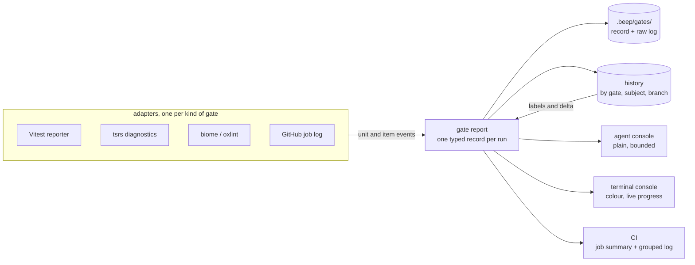

# Brief: Agent-Legible Verification Output

Shaped 2026-11-18 from [`CAPTURE.md`](./CAPTURE.md),
[`RESEARCH.md`](./RESEARCH.md) and [`DECISIONS.md`](./DECISIONS.md).

## Problem

A gate (test, check, lint, build, docgen, quality, a Yeet lane, a CI job)
answers one question: did it pass, and if not, what exactly failed. Today
every gate answers by streaming whatever its underlying tool prints. The
reader is usually an agent, and the agent has learned not to read the stream:
it pipes more than nine runs in ten through `tail`, `head` or `grep` and
hopes the answer is in the slice it kept.

Seven days of transcripts put numbers on that
([`research/transcript-audit.md`](./research/transcript-audit.md)):

- One agent turn in five runs a gate. A turn re-reads 418k tokens of context
  on average, so a wrong guess about which slice to keep costs far more than
  the output it avoided.
- 9% of gate runs are followed by a turn spent digging through the captured
  log.
- A green run of 273 tests printed 13,450 characters through Turbo and 282
  when Vitest could see it was talking to an agent. Turbo's strict
  environment hides that fact from Vitest.
- 701 lines of one TypeScript error, one cause. Gate-table rows re-polled
  every four minutes. JSON envelopes on stdout that no program reads.

The reader's question has a known shape. The output does not have that shape
because no gate owns one.

## Appetite

The whole design, graduated as six goal packets and sequenced so that each
ships something an agent feels on its own. Two goals have no dependency and
start at once. The model and its first slice follow. The remaining three
build on the model in parallel. A packet holds at most three open PRs.

The scope bound is the gates the repo owns. Output of commands an agent
chooses for itself (`rg`, `cat`, `git`) is out, and is recorded in
`explorations/INBOX.md`.

## Solution sketch

### One record, three projections



A gate never prints its tool's stream. An adapter turns the tool's output
into events; the events reduce to a **gate report**; the report is written
to disk beside the raw log; every console is a projection of the report.
Under Turbo the report is a declared task output, so a cache hit restores
the report and the console is rendered from it.

### The model

Three levels, the same for every gate:

| Level | Test gate | Check gate | Lint gate | CI gate |
| --- | --- | --- | --- | --- |
| Gate | `test` | `check` | `lint` | a workflow run |
| Unit | package, then file | package, then file | package, then file | job |
| Item | test case | diagnostic | diagnostic | step |

An item has an outcome from a closed set (passed, failed, warned, skipped), a
stable key (test full name; file, rule or TS code, and message shape), an
optional location (file, line, column) and an optional detail (first message
line, diff). A report has totals, a run reason (passed, failed, errored,
cancelled) and an outcome (all pass, some fail, warnings only, policy
violation, interrupted).

The port lands here. Upstream's report tree, run events and render state are
widened along the eleven seams named in
[`research/vitest-agent-core.md`](./research/vitest-agent-core.md) section 7;
its dispatch table (run shape by outcome, one cell each), its history
classifier, its honest-count rules and its failure signature move over as
pure functions on the widened types.

### The console contract

What the agent projection prints, in order:

```text
check @beep/glob: FAILED  2 errors in 1 file  4.1s  introduced on this lane
  src/Glob.ts:41:7   TS2322  Type 'string' is not assignable to type 'number'.
  src/Glob.ts:88:3   TS2345  Argument of type 'Option<string>' is not assignable ...
since last run: 1 fixed, 2 still failing, 0 new
log 18 KB .beep/gates/check/<run>.log   record .beep/gates/check/<run>.json
check @beep/glob: FAILED  2 errors in 1 file
```

```text
test @beep/glob: PASSED  273 tests in 29 files  6.0s
```

The laws of the contract:

1. **Verdict first and last.** The first and the last line are the same
   verdict line: gate, subject, outcome, counts. A harness that keeps only the
   head and the tail of a long output keeps the answer twice.
2. **Silent on success.** A green run is one line.
3. **Failures only, bounded.** Each failure is one line plus at most its
   first message line and diff. The list is capped; the cap is stated
   (`... 37 more in the record`). The whole console fits the smallest harness
   excerpt window.
4. **Honest counts.** Zero items collected is never green. Timeouts, load
   failures, unhandled errors and a cancelled run are failures with their own
   counts.
5. **Labels from history.** Each failure carries one label: introduced on
   this lane, already red on main, persistent, flaky, recovered.
6. **Delta on re-run.** The second run on a lane says what changed since the
   first.
7. **Causes fold.** Items that share a root cause print once with a count and
   the cause, and the fix when one is known.
8. **A path, with its size.** The raw log and the record are named by path.
   The console is the summary; the log is the record of what happened.
9. **Next steps are commands.** Never a tool name, never an instruction to
   read documentation.
10. **Rendering never waits.** A failure to write history or the record
    degrades to a console without labels. It never hides the verdict.

The terminal projection is the same structure with colour and a live
progress line. The CI projection is a GitHub job summary rendered from the
same report, plus a grouped log.

### History

Every report is recorded with its gate, subject, branch and head. A label
compares an item against two series: the lane's own earlier runs and main's
latest hosted results. Upstream's single shared window becomes a partition
by branch with main as the baseline. One rule decides flaky, and a runner's
own retry flag feeds it.

### Long gates and status commands

A gate that outlives a threshold prints one heartbeat line at a fixed
interval: the step, elapsed time, time since last activity. Status commands
(gate table, job wait, the readiness monitor) gain a mode that blocks until
state changes and prints only the rows that changed.

### Where an agent goes for more

Files and a planned `gate` command family on the repo CLI: show a run, show
one item in full, list a subject's history. No MCP tools and no hooks.

### Measurement

The census that produced the baseline becomes a repeatable command that
emits aggregates only. Each goal's acceptance names the rows it moves:
characters per green run, share of runs piped through a guessed filter, log
digs per run, turns per verdict.

### What ships first, without the model

Six located fixes need no new design and land as their own goal: the agent
signal reaches tools through Turbo; Turbo prints errors-only task logs
under an agent; `--help` stops reprinting global flags;
lane envelopes stay in their file; a package-local check probes for unbuilt
dependencies before it compiles; the monitor's submit line stays in its log.

## Rabbit holes

- **The Vitest reporter lifecycle.** Upstream's is 3,141 lines because it
  strips other reporters, patches logger streams and manages coverage. The
  adapter here reads Vitest's reporter events and builds a report; it does
  not take over the reporter chain. A reporter runs in Vitest's main
  process, which is Bun under `bunx --bun vitest run` and Node under the
  coverage commands, so the adapter loads on both and imports nothing that
  needs `bun:`.
- **Root-cause inference.** Cause folding starts as a table of known
  cascades keyed on diagnostic codes (TS6305 first). General inference is not
  attempted.
- **Hosted results on a laptop.** The main baseline needs main's reports to
  reach a lane. CI uploads them; the lane fetches the newest for its merge
  base. The existing per-task outcome records and the Turbo remote cache are
  the candidate carriers; `ci-gate-reports` picks one in its first phase and
  the history goal consumes it.
- **History under a dozen writers.** One SQLite file per repository with a
  branch column, write-ahead logging and one transaction per run. Upstream's
  untyped failure on a concurrent first open is fixed with a typed retry.
- **The terminal live view.** Upstream's Ink view is not ported. Live
  progress is one rewritten line through `@beep/cli-kit`.
- **Package ceilings.** A tooling library may not import a test kit, and
  upstream's engine imports its in-memory filesystem at runtime. The store
  here does not.
- **Yeet as a consumer.** Yeet already has a verdict, an issue index and lane
  reports. They become consumers of gate reports; they are not rewritten in
  the first slice.

## No-gos

- No `@vitest-agent/*` or `@effected/*` dependency.
- No port of the TDD-session workflow, the Ink live view, the Claude Code
  hooks, the sidecar binary or the MCP server.
- No MCP tools and no hooks added to any harness.
- No wrapper around commands the repo does not own.
- No SARIF or CTRF emitter until a consumer exists; the model stays
  projectable to both.
- No console that renders from a tool's raw stream.
- No transcript text in any tracked file or command output.
