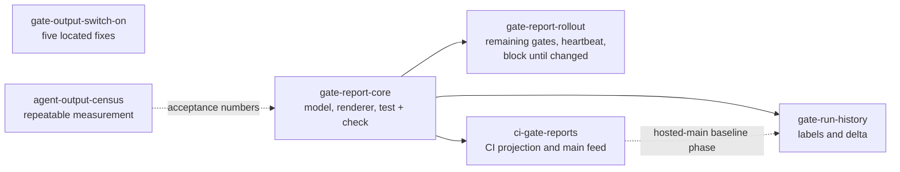

# Map: Agent-Legible Verification Output

Decomposed 2026-11-18 from [`BRIEF.md`](./BRIEF.md). Six candidate goal
packets, all promised now (decision `graduation-breadth`). Citations for
every existing brick are in
[`research/in-repo-inventory.md`](./research/in-repo-inventory.md); upstream
citations are in
[`research/vitest-agent-core.md`](./research/vitest-agent-core.md).

## Sequencing

- `gate-output-switch-on`, `agent-output-census` and `gate-report-core` have
  no dependency and start at once.
- `gate-run-history`, `gate-report-rollout` and `ci-gate-reports` require
  `gate-report-core` and then run in parallel.
- `gate-run-history` ships lane history and the fix-loop delta first. Its
  hosted-main baseline phase waits for the report upload in
  `ci-gate-reports`.
- `agent-output-census` gates nothing. Goals that finish before it cite
  output-size fixtures; goals that finish after it also cite census rows.

**First vertical slice:** `gate-report-core` phase P1 through P3: the model,
the agent projection, and `test` plus `check` for one package printing the
contract end to end (decision `first-slice`).

## Candidate goals

### 1. `gate-output-switch-on` — Gate Output: Switch On What Exists

**Mission:** Land the located fixes that need no new model, so agents get
shorter gate output this week.

**Work:**

1. Pass the agent signal through Turbo. Add the `std-env` agent variables
   (`AI_AGENT`, `CLAUDECODE` and the rest of the table `@beep/runtime-env`
   copies) to Turbo's global pass-through list, and have the task path export
   `AGENT=1` to children when an agent is detected so Bun's quiet mode also
   switches on under Codex.
2. Under a detected agent, the task path asks Turbo for errors-only task
   logs, so a cached green task replays nothing.
3. `--help` prints the global-flag block on the root command only
   (`globalFlags: "summary"` on the formatter).
4. Lane envelopes (`[beep-quality-task-lane-run]`,
   `[beep-github-check-run]`) are not written to stdout when a durable copy
   exists. Only the lane-run envelope has one today; the check-run envelope
   gets its own file first.
5. The readiness-monitor submit step keeps its JSON line in the step log.
6. A package-local `check` probes for unbuilt upstream declarations before it
   spawns the compiler and prints one line naming the count and the fix.
   Package `check` scripts call `beep:check` directly, so the probe also has
   to reach the generated script.

**Depends on:** nothing.

**Acceptance sketch:** a green `test` task for one package under an agent
variable prints under 600 characters through Turbo (13,450 today); a fresh
lane's package-local `check` with unbuilt dependencies prints one line, not
one per reference; every `--help` below the root is free of the five global
flags.

**Capabilities:** Turbo pass-through list, `turbo.json` (extend).
`@beep/runtime-env` agent table (reuse). `CliOutput.defaultFormatter`
option in `effect/cli`, wired through `@beep/cli-kit` `CliColor` (extend).
`assertCheckCensusTreeBuilt` in `Quality/CheckCensus.ts` (reuse). Lane report
emit in `Quality/Tasks.ts` and the monitor submit step in
`Yeet/internal/Planner.ts` (extend). Nothing NET-NEW.

**Decisions carried:** `scope-gates-only`, `record-is-the-source` (the
durable file is the record; stdout is not).

### 2. `agent-output-census` — Agent Output Census

**Mission:** Make the transcript census a repeatable command so every other
goal is judged with the instrument that set the baseline.

**Work:** a planned `census` command on the repo CLI that reads local Claude
Code and Codex transcripts for this repository's checkouts and prints the
tables in [`research/transcript-audit.md`](./research/transcript-audit.md):
output by class, carried cost, filter habits, turn classes, chars per token.
Aggregates only. A tracked baseline file holds the 2026-11-18 numbers and
each later run.

**Depends on:** nothing.

**Acceptance sketch:** the command reproduces the 2026-11-18 tables within a
stated tolerance on the same window; no transcript text, command text or
path outside the repository appears in its output; schema-typed report.

**Capabilities:** `yeet economics` report and schemas in
`Yeet/internal/Economics.ts` (reference for a census-shaped command).
`@beep/repo-ai-metrics` transcript sweep and intake,
`packages/tooling/library/ai-metrics/src/transcript-sweep.ts` and
`transcript-intake.ts` (extend: the library finds and pages transcripts but
drops tool payloads by design, so reading tool calls and results is new). `@beep/jsonl` (reuse). Tool-result
classification and carried-cost accounting: NET-NEW.

**Decisions carried:** `census-is-the-acceptance-instrument`.

### 3. `gate-report-core` — Gate Report Core

**Mission:** Build the gate-neutral report model and its renderer by porting
vitest-agent's core into `@beep/*`, and prove it on `test` and `check`.

**Work, in design order (schema, service contract, implementation):**

1. **Model.** A `foundation/modeling` package, working name
   `@beep/gate-report`: the report schemas (gate, unit, item, outcome,
   location, totals, run reason), the event union an adapter emits, the
   reducer, the shape and outcome classifiers, the honest-count rules, the
   failure signature, the cause-folding table, and the dispatch table of
   render cells producing a neutral document. Ported from upstream `sdk` and
   the pure half of `ui`, widened along the eleven seams. Projectable to
   SARIF and CTRF without loss (decision `interchange-projections`).
2. **Services.** A `tooling/library` package, working name
   `@beep/repo-gate-run`: a recorder that writes the report and the raw log
   under `.beep/gates/`, a console service with the agent and terminal
   projections on `@beep/cli-kit`, audience selection on `@beep/runtime-env`,
   and the text-tool adapter for the type checker (`tsrs`) built on the
   existing diagnostic parser.
3. **Vitest adapter.** A `tooling/test-kit` package or a module of
   `@beep/test-runner`, wired once in `vitest.shared.ts`. It reads Vitest's
   reporter events and emits gate events. It does not manage the reporter
   chain.
4. **Wiring.** `test` and `check` on the repo CLI task path print the
   console contract and declare the report as a Turbo task output.
5. **Query.** The planned `gate` command family: show a run, show one item
   in full.

**Depends on:** nothing. `agent-output-census` supplies acceptance numbers
when it lands first.

**Acceptance sketch:** the ten console laws hold as tests, including a
property test that the verdict line is the first and last line for any
report and that the agent console never exceeds its budget; one renderer
serves both gates; a Turbo cache hit renders the same console as a miss; the
packages carry the dual-copyright `LICENSE` and README provenance; no
`@vitest-agent/*` or `@effected/*` manifest entry.

**Capabilities:** `@beep/cli-kit` `Doc` and `Render` (reuse).
`@beep/runtime-env` (reuse). `@beep/github-reporting` GFM writer (reuse, for
the neutral document's Markdown form). `IssueParser.ts` TypeScript
diagnostic parser (extend: move behind the adapter). `OutputBound` in
`@beep/repo-cli-kit` (reuse). `CiCoverage.reporter.ts` (reference for the
Vitest reporter seam). `@beep/test-runner` (extend or sibling). Gate-report
model, gate-run services, Vitest adapter: NET-NEW, and challenged against
`YeetVerdict`, `QualityIssueIndex` and `QualityTaskLaneRunReport`, which are
run-level and lane-level records without unit and item structure; they
become consumers in goal 5.

**Decisions carried:** `port-not-import`, `port-breadth`, `agent-surface`,
`audience-three-projections` (agent and terminal), `core-enhancements`
(cause folding, head-and-tail verdict, runnable next steps), `first-slice`,
`record-is-the-source`, `vocabulary-gate-report`, `tdd-workflow-no-go`,
`interchange-projections`.

### 4. `gate-run-history` — Gate Run History

**Mission:** Record every gate report by branch and label each failure
against the lane's own runs and main's hosted results.

**Work:** a history store in the gate-run library on `@beep/sqlite`, one
file per repository, keyed by gate, subject, item key and branch; one flaky
rule with runner retries folded in and the window as configuration; labels
(introduced on this lane, already red on main, persistent, flaky,
recovered); the fix-loop delta line; history queries in the `gate` command
family; reconciliation with flake quarantine incidents. The hosted-main
baseline phase reads the reports `ci-gate-reports` uploads.

**Depends on:** `gate-report-core`. The hosted-main phase also needs
`ci-gate-reports`.

**Acceptance sketch:** a red on one lane never changes a label on another;
a re-run prints fixed, still failing and new counts; a failure already red
at the lane's merge base on main is labelled as such; a store failure
degrades to an unlabelled console and never hides the verdict; a dozen
concurrent writers lose no run.

**Capabilities:** `@beep/sqlite` (reuse, narrow operational adapter).
`@beep/agent-memory-store` (reference for a tooling library on that driver).
`@beep/xdg` (reuse for the store location). `FlakeQuarantine.ts`
(reconcile). Upstream `classifyTest`, history tracker and persist
transaction invariant (port). History store keyed by gate, subject and
branch: NET-NEW.

**Decisions carried:** `history-baseline`, `core-enhancements` (fix-loop
delta), `agent-surface`.

### 5. `gate-report-rollout` — Gate Report Rollout

**Mission:** Put every remaining gate on the contract and remove the reasons
agents poll.

**Work:** adapters for biome, oxlint and the repo's own lint lanes; build
and docgen; `quality package-verify` and the Yeet lanes render per-lane
verdicts from gate reports, with `YeetVerdict` and the issue index consuming
them; a heartbeat line on any gate past its threshold; a block-until-changed
mode on the gate table, job wait and the readiness monitor that prints only
changed rows; agent guidance (`AGENTS.md`, the yeet skill) updated to say
gates are read whole and never piped through a filter.

**Depends on:** `gate-report-core`.

**Acceptance sketch:** every gate id on the quality task path emits a gate
report, enforced by a conformance test over the lane catalog; an unchanged
gate table prints one line; a gate with no activity for its threshold shows
a heartbeat; the census shows the share of gate runs piped through a guessed
filter falling from the 2026-11-18 baseline.

**Capabilities:** `GateTableReport` in `Yeet/internal/GateTable.ts`
(extend). `ProofJobRecord` and job wait in `Yeet/internal/ProofJob.ts`
(extend). `YeetVerdict`, `QualityIssueIndex`, lane-run reports (extend as
consumers). Biome and oxlint structured reporters (reuse; both emit
machine-readable diagnostics). Heartbeat and block-until-changed: NET-NEW.

**Decisions carried:** `core-enhancements` (heartbeat, block until
changed, cause folding extended), `scope-gates-only`.

### 6. `ci-gate-reports` — CI Gate Reports

**Mission:** Render GitHub Actions output from gate reports and make a
failing job's cause one command away.

**Work:** the CI projection (a job summary plus a grouped log) rendered from
reports; reports uploaded for every hosted run over a carrier chosen in the
goal's first phase, which is the feed for the main baseline in goal 4; a planned command that prints the
isolated failing region of a job by run or PR, built on the existing
isolator; a CI-job adapter that turns a job's steps into gate items.

**Depends on:** `gate-report-core`.

**Acceptance sketch:** a hosted red job's summary shows the same verdict
and failure list a local run prints; an agent reaches the failing region of
a job with one command and no manual `head` or `grep`; main's newest
reports are fetchable for a given merge base; the census shows CI-log
fetches per red job falling.

**Capabilities:** `isolateYeetMonitorJobLogFailure` in
`Yeet/internal/MonitorLoop.ts` (extend: expose). `@beep/github-reporting`
check documents and GFM writer (reuse). Per-task outcome records,
`Ci/CiTaskOutcomes.ts` (extend or sibling). Turbo summary to step summary,
`Ci/Ci.command.ts` (extend). The failed-job log read in `MonitorLoop.ts`
(`readFailedJobLog`) and the REST recipe in the yeet skill (reuse). Upstream
GitHub summary and grouped log (port onto `@beep/cli-kit`). CI-job adapter:
NET-NEW.

**Decisions carried:** `audience-three-projections` (CI), `history-baseline`
(the hosted feed), `agent-surface`.

## Inherited risks and open design points

Each is owned by the goal named and settled in that goal's first phase.

- Where the Vitest adapter lives (`@beep/test-runner` module or a sibling
  test kit): goal 3.
- Whether the model's home passes `foundation/modeling` review or lands as a
  tooling library: goal 3, with the architecture guardian.
- The carrier for hosted reports (workflow artifacts, the per-task outcome
  record, or the Turbo remote cache): goal 6, consumed by goal 4.
- Heartbeat transport for gates whose tool buffers its output: goal 5.

## Not on the map

- Shell search-and-read output: `explorations/INBOX.md`
  (decision `search-read-output`).
- The TDD-session workflow, Ink view, hooks, sidecar and MCP server
  (decision `tdd-workflow-no-go`).
- SARIF and CTRF emitters (decision `interchange-projections`).
- The out-of-repo session-start manual that recommends `zsh -ic`: it is
  injected by a user-level plugin, not by this repository. Reported to the
  operator at closeout.
