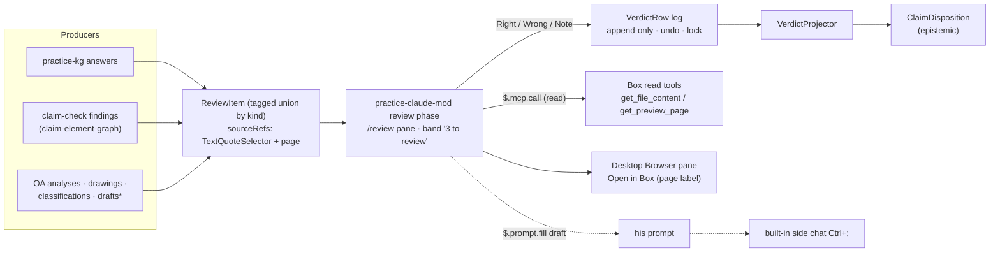

# Brief

<!--
Stage 3. The shaped pitch (Shape Up anatomy). Fat-marker fidelity: concrete
enough to evaluate and decompose, rough enough to leave design latitude to
the implementing goal packets. The exploration is shaped when the human says
this file matches the picture in their head.
-->

## Problem

Every earlier attorney review took him out of where he works:
- a token-guarded sitting page;
- a 100-plus-question deck;
- Copy / Open buttons that bounced between apps;
- correction emails the operator relayed by hand.

He called the result confusing, and verdicts reached the system only through relays ([RESEARCH.md](./RESEARCH.md),
R1–R11). Several producers now need his judgement at once:
- practice-kg answers;
- claim-check findings ([claim-element-graph](../claim-element-graph/README.md));
- office-action analyses;
- drawing sheets;
- document classifications;
- draft text.

Without one review surface, each producer will invent another page.

## Appetite

- One new goal, `review-verdict-envelope`: about three agent-days, plus one plain question to the
  attorney and about an hour of spikes on his PC.
- One written amendment, applied by the `practice-claude-mod` owner in their own packet: a
  review-queue phase on the plugin already planned.
- No new app and no new surface.

If spike S1 fails (no usable pane in his Desktop Code tab), the queue drops to verdict controls on
the answer rows. The packet reopens at decompose rather than buying a second surface.

## Solution Sketch

`*` Drafts go to Word instead if the one-hour Claude for Word check shows it can reach the firm's
knowledge. Never both.

What the attorney does:
1. The band says "3 to review". He types `/review` or clicks it.
2. The pane shows one item:
   - the plain answer or finding;
   - a label such as "examiner rejection" or "incomplete";
   - the source passage with the key words highlighted;
   - the location, for example "page 3, lines 12–18".
3. He chooses Right or Wrong. Wrong opens a one-line note. "Saved" appears, and Undo is offered.
4. Optionally:
   - "Open in Box" shows the whole document in the Browser pane, at page level at best (Box cannot
     jump to lines);
   - "Ask about this" drafts a question into his prompt;
   - Ctrl+; opens a side question.
5. Tab moves to the next item. At the end, Lock.

`review-verdict-envelope` provides:
- **Schema** in `@beep/law-practice-domain`:
  - `ReviewItem`, a tagged union by `kind`: `kg-answer`, `claim-finding`, `oa-analysis`,
    `drawing`, `classification`, `draft-text`.
  - `SourceRef`: `boxFileId`, an optional `page`, and a quote in the W3C TextQuoteSelector shape
    (exact, prefix, suffix).
  - `VerdictRow`: `itemId`, `verdict` (`right | wrong | partly`), an optional `note`, `revision`,
    and an optional `lockedAt`.
- **Service and projector** in `@beep/law-practice-use-cases`: `ReviewQueue` and `VerdictProjector`
  as `Context.Service` contracts. A `claim-finding` verdict maps to `ClaimDisposition`: `right` →
  `active`, `wrong` → `rejected` with the note as the reason.
- **The spike set** that gates the amendment (see Rabbit Holes and [MAP.md](./MAP.md)).

## Rabbit Holes

- **Windows Desktop pane placement and painting (S1).** Undocumented. This is the go/no-go for the
  pane. An unasked open needs 144 columns, but opening from `/review` counts as asked.
- **Box from the mod (S3).** Undocumented: the Box connector's server name on his PC, whether
  `get_preview_page` works outside a `get_file_preview` context, and latency.
- **Desktop images (S2).** No `Image` element on the desktop, so page images depend on an
  Svg-wrapped PNG path that may not paint.
- **Selection inside a pane (S4)** may return nothing, which would rule out highlight-to-note.
- **Early-access mod API drift.** Pin the minimum version; fall back to `next(e)` on unknown shapes.
- **Concurrency and size.** `$.store` get-then-set races across sessions; the tree is capped at
  100,000 characters, so long passages are windowed.
- **Running spikes on his PC.** Operator access and non-client test files only.
- **Sibling reconciliation.** claim-element-graph's finding-surface decision (a practice MCP read
  tool) stays as the computation path. The pane is where findings are rendered and judged.

## No-Gos

- No annotation-workspace core, no artifact or Doc review surface, no tailnet review pages. The
  only exception is the gated drawing-pin spike S7.
- No Box writes (comments, metadata) from review.
- No `$.prompt.submit` or `$.model.*` in this phase.
- No second surface for any one work-product type.
- No client files in spikes, fixtures or the repo.
- No edits to the `practice-claude-mod` packet from this exploration; its owner applies the
  amendment.
