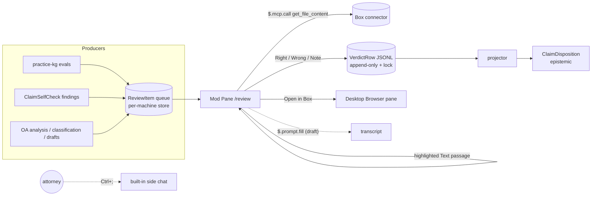
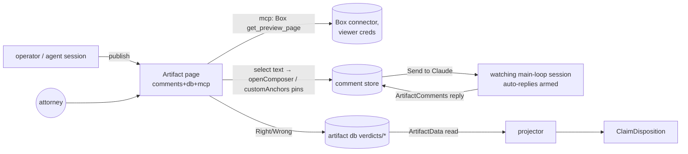
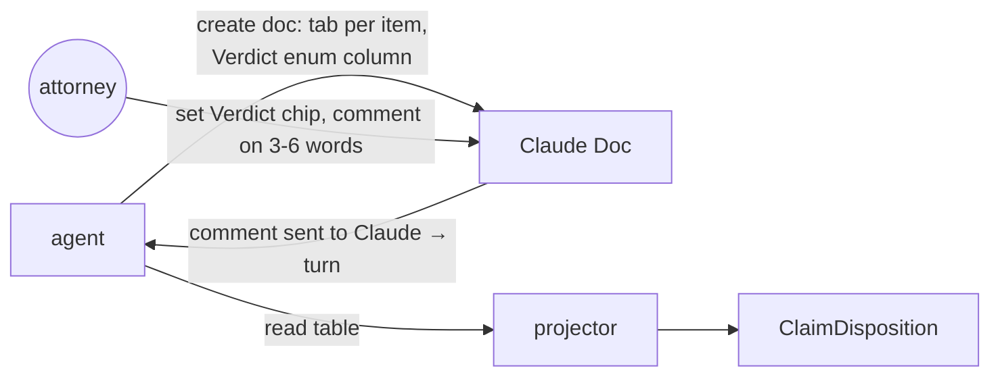
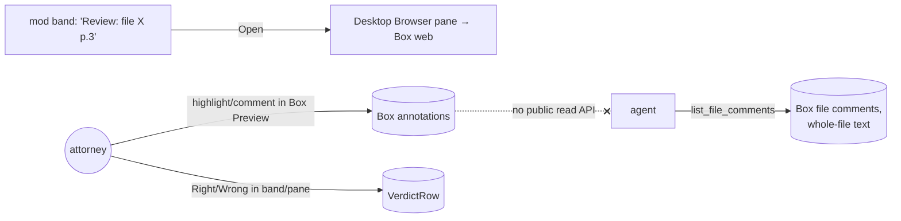

# Attorney review workspace: synthesis

Scope: one place where the attorney reviews AI answers, office-action analyses, claim-check findings, drawing reviews, document classifications and draft text. Date: 2026-10-14. Sources are the five facet findings plus the skeptic pass. Refuted claims are dropped, partly-wrong claims are corrected, and anything not confirmed is marked UNVERIFIED. No client content was opened. Box tools were inspected by schema only.

---

## 1. TL;DR

- **Pushback first: the bar is not an annotation app.** Ruling S15 retired the sitting app. Agents now run the evaluations, and only unresolved items reach the attorney, one question at a time (`goals/practice-kg-mcp/SPEC.md:43` D-29; `goals/practice-kg-mcp/history/p8/2026-10-09-attorney-session.md:72-76, 85-90`). Identification review is capped at about 20 hard cases (`goals/practice-document-identification/SPEC.md:145` D8, `:153` D16). The feature list asked for (annotation, highlighting, inline chat, side chat, tiling) is shaped by engineering habit. What the evidence asks for is a short queue, a plain answer, one highlighted source passage and a verdict that can be undone.
- **Most promising architecture: a review queue in a mod pane (Architecture A).** It is a phase of `practice-claude-mod` and runs in the Desktop Code tab.
  - A pane lists the open items.
  - Each item shows the plain answer, the source passage as highlighted `Text`, and Right / Wrong / Note controls.
  - Verdicts go into one typed envelope that projects into `ClaimDisposition`. Claim-element-graph has already chosen `ClaimDisposition` for confirm/dismiss.
  - Box text comes from `$.mcp.call(get_file_content)`. Page images are added only if a spike shows them painting.
  - Box at full fidelity opens in the Desktop's built-in Browser pane.
  - Side chat uses the built-in Ctrl+; at first, which needs no build.
- **Biggest unknown: how the Desktop Code tab seats and paints a mod pane on Windows 2.1.295.** Nothing documents whether it docks beside the transcript, can be resized, or can sit beside the Browser pane. Nothing documents whether an `Svg` wrapping a `data:` PNG paints. `claude plugin test` validates the tree but never paints it (mods facet; `types/claude-code.d.ts:10332-10338`). If the pane does not dock, Architecture A loses its claim to be "one place".
- **The two sibling packets disagree on verdict storage.** `practice-claude-mod` D8 stores verdicts as local JSONL. `claim-element-graph` stores them as a `ClaimDisposition` in the epistemic lifecycle (its DECISIONS "verdict-storage"). A review workspace needs one verdict envelope with one projection. Section 5 recommends one.
- **D9 has to widen.** Slice 1 allows only `$.ui`, `$.command`, `$.state`/`$.store`, `$.clock`, `$.mcp.call` (practice-kg read tools only) and `$.fs` (claude-mods-law-practice DECISIONS D9). The workspace needs `$.mcp.call` on Box read tools and `$.prompt.fill`. `$.prompt.submit` and `$.model.fork` should stay out until the built-in side chat proves too limited.
- **Artifacts are the strongest option for drawings, but they add a surface.** An artifact can have pins on a canvas (`customAnchors`), comments sent to a watching session, `db` verdicts and Box PNGs via its `mcp` capability. It lives in claude.ai or the artifact pane, though. Only the owner and non-view-only members of the same organization can comment, and replies need a live main-loop session that is watching with auto-replies armed. Keep it as a scoped exception, not the spine.
- **Box annotations cannot round-trip.** No public REST API reads annotation content; only `ANNOTATIONV2_*` events exist (`packages/drivers/box/src/_generated/Box.models.gen.ts:3081`). Connector comments are whole-file text of at most 1000 characters with no anchor (`create_file_comment` schema). If the attorney marks up in Box, Claude cannot read the markup. Architecture D therefore fails requirement R9.
- **Claude for Word is GA on paid plans.** It offers tracked changes and comment-thread replies inside Word (claude.com/claude-for-word, fetched 2026-10-14). It is a real candidate for draft text. Choosing it as well as a mod pane would bring back the multi-app problem, so it needs a deliberate ruling (Q7).

---

## 2. The ergonomic bar, from prior attempts

| # | Requirement | Evidence |
|---|---|---|
| R1 | **One surface.** Every failed attempt used several apps or a long deck. The fastest loop stayed in the app he already uses (email Q&A, answered about 25 minutes after sending). | `goals/practice-kg-mcp/history/p8/2026-10-09-attorney-session.md:10-15, :65` (UX-1 P1 "too confusing to complete"); `goals/design-figure-review-loop/SPEC.md:175`; `research/SOURCES.md:18` (reply came in the same mail thread) |
| R2 | **Machine first, few items, one at a time** (at most about 20). | `goals/practice-kg-mcp/SPEC.md:43` (D-29/S15); `goals/practice-document-identification/SPEC.md:145` (D8), `:153` (D16) |
| R3 | **Plain lawyer language.** No tool names, no JSON. | The first sitting deck shipped raw tool JSON in its expected answers (operator auto-memory `feedback-lawyer-facing-review-surfaces.md:50-52`) |
| R4 | **The answer first, then only the sources needed, with the passage highlighted.** Box links must open for this viewer. | `attorney-session.md:85-90`; Box links returned 404 without a collaboration (auto-memory `practice-box-onboarding-state.md:28-30, :75`) |
| R5 | **Label distinctions separately:** incomplete vs retrieval failure, examiner rejection vs applicant response. | `attorney-session.md:85-90`; `goals/practice-kg-mcp/SPEC.md:43` |
| R6 | **Visible "saved" confirmation, undo/reset, save while typing, a resume point.** | Box-ID page v1/v2 design (`goals/practice-box-onboarding/history/2026-10-06-pc-folder-migration.md:77-79`); S15 bar above |
| R7 | **Capture the verdict where the item lives.** It must be structured, append-only and lockable, with no relaying by the operator. | The append-only rows plus the lock made the tally reproducible (`goals/practice-kg-mcp/history/reflections/2026-10-09-codex.md:40-41`); relayed email rulings (`design-figure-review-loop/SPEC.md:181-186`) |
| R8 | **The prompt is exactly the question.** Operational guidance belongs in CLAUDE.md. | The first deck had a "log your work" prompt suffix (`feedback-lawyer-facing-review-surfaces.md:50-52`) |
| R9 | **Markup arrives structured** (anchored notes, not flattened ink). | Flattened PDFs with no `/Annots` forced the ink-coverage matcher T2 (`design-figure-review-loop/SPEC.md:104`). T1 intake is a separate mailbox concern (`:103`). Both are planned, not shipped. |
| R10 | **Evidence is collected out of sight** (transcripts, tool calls). | Sitting transcripts were pulled over SSH (`reflections/2026-10-09-codex.md`) |
| R11 | **Windows:** no protocol-handler prompts, no hand-off to Windows Terminal, one MCP config. | `claude-cli://` opens a terminal, not the desktop app (code.claude.com/docs/en/deep-links.md, "How deep links work"). Two practice-kg registrations caused retrieval failures (auto-memory `practice-kg-mcp-p7-matter-lookup-state.md:88-90`). |

Anti-patterns to ban outright:
- tailnet pages that need a token in the address;
- decks of 100 or more questions;
- Copy / Open buttons that bounce between apps;
- confusion between chat and Code deep links;
- raw JSON shown as a source;
- Box links to folders the viewer cannot open;
- flattened ink as markup;
- verdicts that only reach the system because the operator relays them;
- correction emails.

The quoted operator words are "Very clunky bad user interface" and "to verbose, long, confusing & not ergonomic" (sic), from auto-memory `feedback-lawyer-facing-review-surfaces.md:59-62`.

---

## 3. Capability matrix

Legend: **yes** means verified or clearly sourced; **partial**; **no**; **unknown** means UNVERIFIED.

| Need | Mod pane / band / rows | Artifact page | Claude Doc | Desktop built-ins (side chat, Reply, Browser/file pane, diff) | Box native |
|---|---|---|---|---|---|
| Annotation | partial: per-item Select/Input, no source anchors | partial: `openComposer({range})`, write-only verbs | yes: threads anchored on 3-6 quoted words | partial: diff line comments, code edits only | yes: highlight/comment/draw overlay, unreadable by API |
| Notes | yes: Input → `$.store`/`$.fs`, single line | yes: `db` docs via ArtifactData | yes: prose or tables with dropdown chips | no: side chat not saved to disk | partial: whole-file comment, ≤1000 chars |
| Highlighting | partial: `Text` backgroundColor spans, no selection event | partial: the page's own DOM, persisted in `db` | unknown: not documented | no: none documented | yes: highlight annotations in Preview |
| Inline chat | partial: `$.prompt.fill`/`submit`, D9 forbids both | partial: `sendToClaude` plus a watching main-loop session | partial: comment sent to Claude becomes a turn | unknown: Reply on selection undocumented (#70628) | no |
| Side chat | partial: `$.model.fork`, one shot, no tools | partial: `sample`, memoryless, viewer's usage | no: not documented | yes: Ctrl+; or `/btw`, not persisted | partial: Box AI Preview sidebar, plan unverified |
| Box rendering | partial: text yes; PNG terminal-only, desktop Svg UNVERIFIED | partial: `get_preview_page` PNG via `mcp`, connector-context caveat | partial: blob upload copies bytes to claude.ai | partial: Browser pane can load Box web; Box itself UNVERIFIED | yes: full Preview fidelity |
| Docking/tiling | unknown: Desktop placement undocumented | partial: artifact pane shows only this session's publishes | unknown: placement in the Code tab not documented | yes: drag/resize/pop-out panes, split sessions | no: separate web app |
| Verdict capture | yes: Buttons → JSONL (API sourced, not built) | yes: `db` collection with access rules | partial: dropdown enum column | no: no built-in control | partial: `set_file_metadata` exists (schema only) |
| Navigation/queue | yes: keyed buttons, Tab/arrows, `$.ui.focus`/`$.ui.scroll` | partial: the page's own UI | partial: tabs and tables | partial: deep links open a terminal | no |
| Sharing/access | partial: per machine; `$.store` shared across sessions | partial: comments for owner and org members only | partial: org share at view/comment/edit | partial: local only | yes: collaborations, but links 404 without one |
| Windows | unknown: pane painting unproven; WSL loads no plugins | unknown: web runtime, untested on his PC | unknown: untested | yes: Ctrl shortcuts documented | partial: Box Drive plus web (onboarding SPEC:9) |

Cell sources:
- **Mod:** `types/claude-code.d.ts:3802-3835` (Elements), `:10302-10338` (Pane), `:2586` (selection), `:2619-2656` (fork), `:2940-2949` (submit); docs mods/reference Limits; DECISIONS D9.
- **Artifact:** artifact-capabilities 0.2.77 `comments.d.ts:9-14, 228-239, 566-583, 680-707`, `db.d.ts:10-21`, `mcp.d.ts:6-8, 75-90, 296-300`, `sample.d.ts:332-333`.
- **Doc:** Claude Docs guide, topics comments/tabs/uploads/sharing/index.
- **Desktop:** code.claude.com/docs/en/desktop.md, sections "Arrange your workspace", "Ask a side question…", "Preview your app", "Browse external sites", "Review changes with diff view".
- **Box:** support.box.com 360048016153; developer.box.com/guides/embed/ui-elements/annotations; connector schemas.

---

## 4. Candidate architectures

### A. Mod-pane review queue, an extension of `practice-claude-mod`

**What the attorney does:**
1. Types `/review`, or the band shows "3 items to review".
2. The pane shows item 1: a plain answer, the quoted source passage with the key words highlighted, and labels such as "examiner rejection" or "incomplete".
3. He presses Right or Wrong. Pressing Wrong opens a one-line note. A toast says "Saved". Undo is available.
4. If he wants the whole document, "Open in Box" loads it in the Browser pane.
5. For a question, he presses Ctrl+;, or "Ask about this", which drafts the question into the prompt box.

**Strengths:**
- It is the only option that lives in the transcript he already uses: plain-language tool rows and verdicts on the answer rows themselves.
- Keyboard queue navigation is documented (docs mods/interface, "What each key does").
- The plugin skeleton, delivery path and verdict rows are already planned (`goals/practice-claude-mod/SPEC.md:9-22`).
- There is no sharing or organization model to get wrong.
- Claim-element-graph findings plug straight in: its "finding-surface" decision already puts findings in Claude Code.

**Failure modes:**
- The Desktop may seat the pane inline above the prompt rather than docked. An unasked open needs 144 columns (110 for an id the person has opened before), and below that `$.ui.open` returns `{isPlaced:false}` (`d.ts:7383-7389, 14115-14158`). Opening the pane from `/review` counts as an asked open.
- The desktop has no `Image` element, so page images rely on the unverified Svg path.
- There is no anchored annotation on the source.
- The 100,000-character tree cap forces windowing of long documents.
- `$.store` get-then-set races across sessions.
- `$.mcp.call` shows no permission prompt, so Box writes would be silent unless the mod confirms them.
- The API is early access and can drift between releases.

**Windows risk:** high until proven. Pane painting on Windows is unproven. WSL Desktop sessions load no plugins (docs mods/overview, "Where mods run"). `Image` needs a kitty-class terminal.

**Build cost:** low to medium. It is a phase on an already planned app, plus a ReviewItem/Verdict schema, a Box read adapter and a projector.

**Composition:**
- With `practice-claude-mod`: it reuses D6, D7 and D8 and amends D9 (Box read tools, `$.prompt.fill`).
- With `claim-element-graph`: findings become ReviewItems, and verdicts project to `ClaimDisposition` (active means confirm, rejected means dismiss with a reason).

### B. Artifact review page in the Code tab, with comments flowing to the session

**What the attorney does:**
1. Opens the artifact, either in the Code-tab artifact pane or on claude.ai.
2. Pages through the items. Box pages show as PNGs.
3. Selects a passage and comments on it, or places a pin on a drawing.
4. Taps Right or Wrong.
5. Uses Send to Claude for a question. A watching session replies in the thread.

**Strengths:**
- Real anchored annotation: a selected range becomes the quoted excerpt, and canvas pins work, which suits drawings.
- Durable shared `db` verdicts.
- Box PNGs come through without any token in the page.
- Inline chat lives in the threads.

**Failure modes:**
- **Account model.** `comments` is available only to the owner and to non-view-only members of the same organization. Anyone else, including an email-invited editor, gets `null` (`comments.d.ts:9-14`).
- **Live session.** Replies need a main-loop session watching with auto-replies armed. Otherwise the result is `no_session`.
- **Pane scope.** The artifact pane lists "the artifacts this session published" (`ccd_view show_pane` schema), so an artifact published by the operator may land in a browser tab.
- **Box tool context.** The connector's `get_preview_page` description assumes a `get_file_preview` context (UNVERIFIED from a page).
- **Asset uploads.** Uploading client PDFs exposes them to everyone the artifact is shared with.
- **Consent prompts.** Comments, `sample` and each connector ask separately at first use.
- **Sharing.** Declaring `mcp` bars public sharing.
- **Track record.** The earlier per-figure-notes artifact produced no evidence of any notes (UNVERIFIED).

**Windows risk:** medium. The runtime is web and platform-neutral, but it is untested on his machine.

**Build cost:** medium, plus account and organization setup.

**Composition:**
- With `practice-claude-mod`: none. It is a second surface.
- With `claim-element-graph`: only through the projector.

### C. Claude Doc per review batch

**What the attorney does:** opens a doc, reads the item, sets the Verdict dropdown, and comments on words, sending a comment to Claude if he has a question.

**Strengths:**
- Native, familiar document review: threads, tabs and enum chips.
- Export to Word, PDF or Markdown.
- Organization sharing.
- No code to run in the page.

**Failure modes:**
- No custom code: no PDF viewer, no pins on figures, no buttons.
- Images reach the doc only by uploading blobs to claude.ai.
- Placement in the Code tab is undocumented.
- Free-text comments still need interpreting (R7).

**Windows risk:** low to medium, untested.

**Build cost:** low.

**Composition:** weak with the mod; it is a second surface. It works for draft text and office-action analysis prose (Claude Docs guide topics).

### D. Box-native annotations plus a mod band

**What the attorney does:** clicks the band, Box opens in the Browser pane, he marks up there, then returns to the transcript to give the verdict.

**Strengths:** the best source fidelity, and Box's own tools, which he may already know.

**Failure modes:**
- Annotations cannot be read back. Only `ANNOTATIONV2_*` events exist, and "none were added recently" is UNVERIFIED (developer.box.com/reference index, fetched 2026-10-14).
- Box comments are whole-file only.
- The pane uses a clean browser profile, so there is a separate Box sign-in to manage (desktop.md, "Choose between the Browser and the Chrome extension").
- Uploader and Previewer roles cannot annotate.
- Work splits between Box markup and verdicts, which violates R7 and R9.

**Windows risk:** medium. Box inside the pane is UNVERIFIED.

**Build cost:** low. It reuses A's band.

**Composition:** an "Open in Box" escape hatch inside A, not a spine.

---

## 5. Recommendation

**Build A as the spine and treat D as A's escape hatch.** B is allowed only for drawing review, behind a gate. C is used only if Q7 rules draft text into a Doc rather than Word. Reasoning:

1. R1 and R2 dominate. A is the only option that keeps review inside the session where he already asks questions. Claim-element-graph already put findings there and rejected a per-draft review page (its "finding-surface" decision).
2. Settle the verdict-storage conflict now with one schema-first envelope:
   - `ReviewItem` is a tagged union by `kind` (`kg-answer | oa-analysis | claim-finding | drawing | classification | draft-text`), with `sourceRefs: Array<{boxFileId, page?, quote: TextQuoteSelector}>`.
   - `VerdictRow` has `itemId`, `verdict` (`right | wrong | partly`), an optional `note`, `revision` and `lockedAt?`. Rows are append-only and the store has a lock (R7).
   - A projector maps a `claim-finding` verdict to `ClaimDisposition`.
   - D8's JSONL stays the write path on his PC and D10's app-local schema stays valid. The projection is the second consumer that triggers D10's promotion.
3. Use the W3C TextQuoteSelector shape (exact, prefix, suffix) for source anchors. It is in the Recommendation (w3.org/TR/annotation-model). Fuzzy re-anchoring is not part of the spec, so do not claim it.
4. Render Box sources as text by default. `get_file_content` returns markdown or extracted text, and the highlighted `Text` span is verified to validate on both surfaces. Page images are an enhancement gated on spike S2. Full fidelity goes through "Open in Box".
5. Side chat starts as the built-in Ctrl+;, which costs nothing. Add `$.model.fork` only if he needs answers that persist.
6. Inline chat uses `$.prompt.fill` (a draft he sends himself), not `$.prompt.submit`. This keeps the D9 widening minimal.

**Spikes.** Each is small and measurable, runs on the operator's machine first (D1) and then on his Windows PC, and uses non-client test files only.

| Spike | Do | Pass when |
|---|---|---|
| S1 Desktop pane placement (Windows, 2.1.295) | Install the `hello-tabs` sample. Run `/hello-tabs` in a Code-tab session. Screenshot it. Drag the edge. Open the Browser pane next to it. | The pane renders. Its placement (dock or inline) is recorded. Resizing works or not, and that is recorded. The pane coexists with the Browser pane or not, and that is recorded. |
| S2 Svg-wrapped PNG paints on desktop | Embed `data:image/png` pages at 3 resolutions under 131,072 characters. | The page visibly paints, and a 10-pt claim line is legible at the largest size. Otherwise drop page images from desktop. |
| S3 Box connector reachable via `$.mcp.call` | From a test mod, call `get_file_content` and `get_preview_page` on a test file. Log the server name from `/mcp`, latency and bytes. | Both return. The image block is present. p95 is under 3 s per page. |
| S4 Selection inside a pane | Add a `/quote` command that calls `$.ui.selection()` after selecting pane text on the desktop. | It returns pane text, or undefined. Either result decides whether highlight-to-note can exist. |
| S5 Verdict round trip | Write VerdictRow fixtures, then project them to `ClaimDisposition` in a unit test, with lock and undo. | Projections are deterministic. Undo produces a superseding revision. A locked store refuses writes. |
| S6 Reply on selection (built-in) | Right-click selected assistant text in the Code tab on Windows. | Record whether "Reply" or "Attach selection as context" exists (#70628 was closed as completed; not documented). |
| S7 (drawings only) Artifact feasibility | As the attorney's own account, open an artifact it did not publish in the Code tab, watch it, place a `customAnchors` pin and send it to Claude. | The pin appears, the session wakes and the reply lands. If this fails, drawings stay in A with whole-sheet verdicts. |

S1 and S3 are the go/no-go gates for A. If S1 fails (no usable pane on the Windows desktop), fall back to verdict controls on the answer rows only, with no pane, and reopen B.

---

## 6. Align questions for the operator

1. **Is the review workspace a phase of `practice-claude-mod` or a sibling goal?** *Recommended: a phase (P-next).* It is one plugin and one release path, as D12 already argued against splitting.
2. **Should D9 widen to `$.mcp.call` on Box read tools (`get_file_content`, `get_preview_page`) plus `$.prompt.fill`?** *Recommended: yes, read tools only.* No Box writes, no `$.prompt.submit`, no `$.model.*` in this phase.
3. **Where does the canonical verdict live?** *Recommended: append-only VerdictRow JSONL plus a lock on his PC, projected into `ClaimDisposition` for claim findings.* Promote the schema out of the app when the projector lands (D10).
4. **What is the default source rendering?** *Recommended: text passage with a highlight, plus "Open in Box".* Page images only after S2 passes.
5. **Side chat: built-in or mod?** *Recommended: built-in Ctrl+; for now.* Add `$.model.fork` only if he asks for a record of what he learned.
6. **Drawing review: artifact or the mod?** *Recommended: whole-sheet verdicts plus a note in the mod. Run the artifact pins (S7) only if he keeps sending flattened markup.*
7. **Draft text: Claude for Word or the mod?** *Recommended: pick exactly one primary surface per work-product type and never both.* Run a one-hour check of whether Claude for Word reaches practice-kg or Box from its sidebar (UNVERIFIED) before ruling.
8. **Should Box comments be written from review?** *Recommended: no.* Connector comments are whole-file, visible to every collaborator and not anchored, and `$.mcp.call` shows no permission prompt.
9. **Which surface does he actually live in day to day?** *Recommended: ask him once, in one plain question, before S1.* If it is Outlook and not the Code tab, A is still a new place for him, and the docket pattern (verdict by Outlook category) deserves to be weighed.

---

## 7. Verified vs unverified

**Verified (source read and confirmed by the skeptic pass):**
- The Desktop element set is Box, Text, Button, Input, Select, Svg, Link, Code, Markdown and Client. Image and Raster are terminal-only, and the terminal has no Svg (`d.ts:3802-3835`).
- Panes share one slot: one is shown and the rest become tabs (`d.ts:10302-10304, 14178-14180`).
- Terminal dock placement in fullscreen starts at 110 columns. An unasked open needs 144 (110 for a pane opened before) and otherwise returns `isPlaced:false`. A size the user sets wins (`d.ts:7383-7455, 10332-10338, 14115-14158`).
- `$.ui.selection` asks attached clients that declare they answer selection reads (`reference.md:167-182`).
- `$.model.fork` is one tool-less completion over the session's own transcript. `$.prompt.submit` queues a turn once the session is idle. `asUser` sends the text as the user's words, but the transcript still names the plugin (`d.ts:2619-2637, 2940-2949, 9014-9025`).
- `$.http.fetch` returns text only, with 4 MiB, 30 s and 5-redirect limits (docs mods/reference Limits).
- `$.mcp.call` shows no permission prompt, and its result type includes image blocks (`d.ts:2697-2718, 5928-5945, 6017-6032`).
- Artifact `mcp` calls run with the viewer's credentials and never expose tokens. Declaring `mcp` bars public sharing. Host servers work for the owner only and only in the app (`mcp.d.ts:6-8, 75-90`).
- Artifact comment rules:
  - Only the owner and non-view-only organization members get comments.
  - Email invitees get `null`.
  - A Range becomes the quoted excerpt only within the platform's span bounds.
  - With `customAnchors`, the page reports pin positions and the shell draws the pins.
  - A thread activates for Claude through Send to Claude or @claude.
  - A sent comment wakes the session only while it is watching with auto-replies armed, and only a main-loop session can watch.

  Sources: `comments.d.ts`, ArtifactComments schema.
- The artifact pane shows "the artifacts this session published", and panes can pop out (`ccd_view` schemas).
- Claude Docs support threads anchored on 3-6 words, sent-to-Claude turns, tabs, enum chips, organization sharing and export (Docs guide).
- Desktop built-ins:
  - side chat (Ctrl+;, reads the main thread, not saved);
  - draggable and pop-out panes;
  - Ctrl+click split view;
  - PDF, image and HTML project paths open in the Browser pane;
  - the Browser pane allows sign-in but uses a clean profile, with an optional Keep cookies;
  - `claude-cli://` opens a terminal, and its handler lives in HKCU.

  Source: desktop.md, deep-links.md.
- `claude://code/new` opens the Desktop new-session page. `ssh_host` is required only for SSH links (desktop.md). Its full behavior with only a prompt is not spelled out.
- Box facts:
  - Box connector `create_file_comment` takes `{file_id, message ≤1000}` with no anchor.
  - `get_preview_page` returns one PNG per 1-based page.
  - `get_download_url` returns a single-use URL that expires after 60 s.
  - Box annotations are a Preview overlay. The only API trace is `ANNOTATIONV2_*` events.
- Prior-attempt facts: S15/D-29, UX-1, D8/D16, the four first-deck problems, the 25-minute email answer timing, flattened markup motivating T2 only.
- Claude for Word/Excel/PowerPoint is GA on paid plans and Outlook is in beta. It offers tracked changes and comment-thread replies.

**Unverified:**
- The Desktop Code tab's placement, resizing and tiling of mod panes, and pane painting on Windows.
- Whether an Svg with an embedded `data:` PNG paints on the desktop.
- Whether the Box connector is reachable from his Claude Code session, its server name, and whether `get_preview_page` works outside a `get_file_preview` context (from a mod or an artifact).
- Whether `$.ui.selection` returns text selected inside a mod pane, and whether the 2.1.295 Desktop client answers selection reads.
- Whether `$.mcp.call` can reach the `ccd_*` host servers, and whether Artifact/ccd tools exist on his machine.
- Whether his own session can open, dock and watch an artifact it did not publish.
- Whether pdf.js works in the artifact frame, and whether an iframe to app.box.com is blocked by CSP.
- Whether the Box web app's sign-in, annotations and Keep cookies work inside the Browser pane, and whether Box Drive paths open there.
- Whether Reply or "Attach selection as context" exists on Windows (#70628 closed as completed, #55772 is a user report).
- Whether the desktop side chat has tool access.
- The desktop fork control, and whether `/branch` works in the Code tab.
- Whether Box has added an annotations read API recently.
- Whether Claude for Word reaches practice-kg or Box, and its audit-log integration (single source).
- The per-cell UI details for Harvey and Adobe citation click-through (login-gated or returned 403).
- Whether the attorney left notes on the earlier drawing artifact, and whether he ever locked the Box-ID v2 page.

**Dropped or corrected by the skeptic pass:**
- "Most legal AI vendors use Word sidebars": an inference from a few vendors. Only Claude for Word's page says "sidebar".
- "Click-through to a highlighted passage is a baseline expectation": not supported by any source that could be reached.
- "Harvey cells are explicitly verified": overstated; verifying is an action, not a stored field.
- "Hypothesis uses XPath plus fuzzy re-anchoring": UNVERIFIED from the cited sources.
- "The Box widget feeds the page to the model": wrong. It sends context only, and `get_preview_page` must be called to get the page.
- "Pages draw their own pins": wrong. The shell draws them.
- "Comments reach Claude only via Send to Claude": @claude also activates a thread, and `read` sees every thread.

Sources read for this synthesis:
- `explorations/claim-element-graph/BRIEF.md` (lines 10-152) and `DECISIONS.md` (decisions finding-severity, finding-surface, verdict-storage) in the claim-element-graph worktree.
- `origin/explore/claude-mods-law-practice:explorations/claude-mods-law-practice/DECISIONS.md` (D1-D12) and `BRIEF.md` (Windows parity rabbit hole, lines 72-75; no changes to Desktop chat, line 101).
