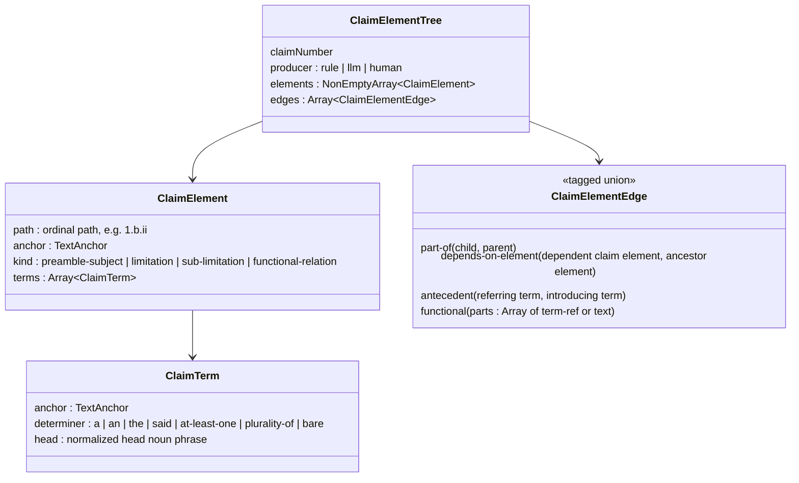

# Brief

<!--
Stage 3. The shaped pitch (Shape Up anatomy). Fat-marker fidelity: concrete
enough to evaluate and decompose, rough enough to leave design latitude to
the implementing goal packets. The exploration is shaped when the human says
this file matches the picture in their head.
-->

## Problem

beep-effect reads a patent claim down to its number, its parent claims, its preamble and its
transition phrase. Everything after "comprising" is one opaque string (`PatentClaim.body`). So
the platform cannot say which elements a claim recites, which earlier term "the sensor" refers
back to, or which element an examiner's citation is supposed to disclose.

Three pieces of work already assume that layer exists:
- the drafting ledger's ordered `ClaimLimitationSupportSet`;
- `Distinction.missing_limitation`, which is free text today;
- the routing gate R2-062 in the previous research synthesis.

The research ([RESEARCH.md](./RESEARCH.md)) adds a concrete reason to build it now. On 204 real
§112(b) rejections, 55% of the cases an automated checker missed were cross-claim or nested
antecedent-basis chains (ACE, arXiv 2604.04295). A typed element graph with antecedent edges is
exactly what catches that class, and deterministic rules can build most of it (FLAN-Graph, PHAGE).

## Appetite

One goal packet: about five agent-days, plus at most two attorney hours for the label
spot-check and the first findings. It follows the binding order: schema → `Context.Service`
contract → implementation → verify. The appetite excludes model training, retrieval, LLM
decomposition, chemistry and IPRally interop; each of those stays a `MAP.md` re-entry point. If the
deterministic floor measures badly, the goal stops at the measurement and reports it rather than
expanding scope.

## Solution Sketch

```mermaid
flowchart LR
  subgraph IN["inputs (existing)"]
    DRAFT["practice draft<br/>(Markdown pipeline)"]
    USPTO["public USPTO claims<br/>(@beep/uspto documents)"]
  end
  NORM["PatentDocument.normalizer<br/>(existing) → PatentClaim[]"]
  ADAPT["USPTO claims adapter<br/>→ PatentClaim[] (NET-NEW)"]
  DEC["ClaimElement.behavior<br/>pure decomposer (NET-NEW)"]
  TREE["ClaimElementTree[]<br/>spans via TextAnchor"]
  POL["Antecedent.policy<br/>pure checker (NET-NEW)"]
  FIND["AntecedentFinding[]<br/>(typed, advisory)"]
  SVC["ClaimSelfCheck service<br/>(use-cases)"]
  EPI["CandidateClaim + Evidence<br/>(epistemic, existing)"]
  MCP["practice MCP read tool<br/>findings as claim-finding ReviewItems"]
  PANE["review queue pane<br/>(practice-claude-mod review phase)"]
  ATT(["attorney in Claude Code"])
  VR["VerdictRow log<br/>(review-verdict-envelope)"]
  DISP["ClaimDisposition<br/>active / rejected + reason"]
  EVAL["eval harness: strict equality,<br/>FP rate on allowed claims"]

  DRAFT --> NORM --> DEC
  USPTO --> ADAPT --> DEC
  DEC --> TREE --> POL --> FIND --> SVC --> EPI
  SVC --> MCP --> PANE --> ATT
  ATT --> VR -->|"VerdictProjector"| DISP
  TREE --> EVAL
  FIND --> EVAL
  DISP --> EVAL
```

Element model at fat-marker fidelity. The names are not final. The goal's P0 settles them in
`@beep/law-practice-domain`, in a new `values/ClaimElement/` beside `values/PatentDocument/`:

The parts:
- **Decomposer** (`.behavior.ts`, pure). It splits `PatentClaim.body` on punctuation, `;`/`and`
  enumerations and `wherein`/`whereby` clauses, and uses `<claim-text>` nesting when the source
  is XML. It attaches each dependent claim to an ancestor *element* through preamble identity
  (FLAN-Graph). It extracts determiner-bearing terms (`a/an` introduces a term, `the/said` refers
  back). Every element and term carries a char-exact `TextAnchor`.
- **Antecedent checker** (`.policy.ts`, pure). It resolves each referring term against terms
  introduced earlier in the same claim or in its dependency ancestors, never in sibling claims. It
  emits a typed finding union in the style of `PatentClaimDependencyIssue`, for example:
  `missing-antecedent`, `ambiguous-antecedent` (two candidate introductions), `antecedent-outside-chain`
  (introduced only in a non-ancestor claim), and `number-mismatch` (a plurality introduced, a
  singular referred back to). Each finding cites the rule and both spans.
- **`ClaimSelfCheck` service** (use-cases). It runs decompose → check over a document and maps
  findings into `CandidateClaim` + `Evidence` the way `PatentClaimCandidate` does today. A practice
  MCP **read** tool exposes the findings as `claim-finding` `ReviewItem`s
  ([attorney-review-workspace](../attorney-review-workspace/README.md)). The attorney judges them in
  the `practice-claude-mod` review queue. His verdict is a `VerdictRow`, which the
  `review-verdict-envelope` projector maps to `ClaimDisposition`: `right` → `active`, `wrong` →
  `rejected` with the note as the reason.
- **Evaluation harness.**
  - Public USPTO claims via `@beep/uspto`: about 60 claim families labelled to element level by an
    extractor/critic agent loop, with the attorney spot-checking about 10%.
  - About 200 allowed claim sets scanned for false positives.
  - Strict structural equality is the primary metric. The IPRally training sample is a non-US
    smoke test.

## Rabbit Holes

- **Claim text quality.** USPTO documents may be PDF-only for some applications, which would mean
  OCR noise. Prefer full-text XML for granted patents and published applications; exclude
  OCR-only claims from the labelled set rather than repairing them.
- **"Allowed" does not mean "antecedent-clean".** Examiners miss antecedent issues, so allowed
  claims are weak negatives. A checker hit on an allowed claim needs adjudication on a sample
  before it counts as a false positive.
- **Determiner edge cases**:
  - "a plurality of X" followed by "each X" or "the X";
  - "at least one";
  - ordinals ("first", "second");
  - "said" vs "the";
  - generic terms reused with a different meaning.
  Each one is a rule with a fixture, not open-ended NLP. Unhandled patterns fall back to a
  `pattern-not-covered` finding, never a silent pass.
- **Cross-claim scope.** Antecedents resolve only through the dependency chain. A multiple
  dependent claim has several chains, and each must resolve.
- **The practice MCP's read-only posture is kept.** Verdicts are recorded through the shared
  review queue and `VerdictRow` log ([attorney-review-workspace](../attorney-review-workspace/DECISIONS.md)
  verdict-envelope and handoff), not through a new MCP write tool.
- **Epistemic federation invariant.** Authority is single-owner. Projections never write centrally.

## No-Gos

- No change to `PatentClaim`'s shape and no `shared/*` promotion of element types.
- No LLM decomposition in this goal. The port may be named, but no LLM implementation ships.
- No model training or distillation (the anchor's approach), and no prior-art retrieval or ranking.
- No chemical or Markush handling, no IPRally adapter, no DOCX parsing.
- No blocking gate: findings stay advisory until the false-positive rate is measured.
- No NC-licensed data (PANORAMA, PatClaimEval) in the repo or in shipped artifacts.
- No means-plus-function (§112(f)) analysis or claim construction.
