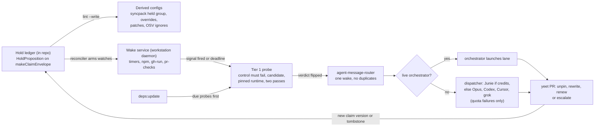

# Brief

<!--
Stage 3. The shaped pitch (Shape Up anatomy). Fat-marker fidelity: concrete
enough to evaluate and decompose, rough enough to leave design latitude to
the implementing goal packets. The exploration is shaped when the human says
this file matches the picture in their head.
-->

## Problem

The repo keeps "temporary" decisions that nothing re-checks: dependencies
held back in `syncpack.config.ts`, exact catalog pins, overrides, patches and
OSV exceptions. Each carries an exit condition in prose ("until vitest or
jsdom ships the fix"). The only re-check today is a manual census, recorded
in `goals/repository-simplification-residue/history/receipts/hold-register.md`.
It is run by a human-driven lane every few weeks with ignored helper scripts.

Between censuses a hold either outlives its reason, so the repo stays on old
versions and keeps workarounds it no longer needs, or loses its reason. The
statelyai pin landed in #2005 without one. Agents also sleep-poll for CI,
reviews and other sessions in several places. They have no way to say "wake
me when X happens".

## Appetite

Two goal packets, each a few PRs.

- **Holds:**
  - the schema and ledger;
  - the probe, admit, why and lint commands;
  - wave 1 for about 35 dependency-shaped sites;
  - the `deps:update` re-check.
- **Wake service:**
  - an Effect port of skulk's timer, npm, gh-run and pr-checks triggers;
  - delivery through the existing router;
  - the dispatcher;
  - the daemon and its dead-man check.

Anything beyond that, such as test skips, suppressions, more triggers or
adopting the wake service in `yeet`, is a later wave and not part of this
appetite.

## Solution Sketch

- **The hold record.**
  - A `HoldProposition` inside `makeClaimEnvelope` carries:
    - the subject: a package, a version range and its anchors in config files;
    - the assertion: the prose reason;
    - the falsifier: either `Scripted` (worktree recipe, command, pinned
      runtime, failure signature) or `Judgement` (a rubric and question);
    - the watch targets: npm version or dist-tag, GitHub issue or PR closed,
      GitHub release, or a deadline;
    - the exit action: `Unpin | Rewrite | EscalateToGoal`.
  - `validTime` is the lease, the `supersedes` chain is the renewal history,
    and `supportedBy` holds dated probe runs.
  - The default maximum lifetime is 180 days. The due-soon state opens at
    two-thirds of the lease, with jitter.
- **The ledger files.**
  - The ledger is append-only in the repo, following the research
    claims-plus-ledger laws.
  - `beep holds lint --write` renders the syncpack held group, overrides,
    patches and OSV ignores from the ledger. It also fails on any hold-shaped
    config entry that has no record.
  - A hold whose anchors are gone is tombstoned.
  - A re-introduced hold must cite its tombstone.
- **Probe verdicts.** A Scripted probe runs a control at the known-bad version
  and the candidate.
  - If the control passes, the verdict is `ProbeBroken`, which escalates and
    never unpins.
  - A flip takes two consecutive passing runs.
  - `deps:update` runs the due probes before syncpack bumps, and unpins holds
    whose probes flipped in the same commit.
- **The wake service.**
  - It is an Effect port of skulk in a new tooling library: schema-first
    `Condition` and `Watch` records, and skulk's rule that a failed check is
    never a change.
  - It checks the watch's condition before arming it, and keeps skulk's
    limits.
  - A reconciler arms one watch per live hold, re-arms watches when their
    14-day cap expires, and fails lint when a live hold has no armed watch.
  - Wakes are messages through `agent-message-router`. A wake goes to the live
    orchestrator. If none is live, a dispatcher launches a headless lane
    through `@beep/ai-provider-cli`:
    - Junie first, while JetBrains credits remain;
    - otherwise the quota-only chain: Opus, then Codex, then Cursor, then
      grok.
  - The lane's PR appends a new claim version (a renewal with fresh evidence)
    or a tombstone (an unpin).
- **The host.**
  - The wake service runs as a `systemd --user` service on the workstation,
    started with the `--refresh`-style unit rendering the repo already uses.
  - A daily GitHub Actions job opens an issue if the committed heartbeat goes
    stale.

## Rabbit Holes

- **A probe that has rotted can look like a fix.** The control run and the
  pinned runtime are mandatory, not optional.
- **Catalog resolution.** Probes have to resolve Bun `catalog:` references
  themselves. No off-the-shelf condition syntax does.
- **Lockstep families.** `@lexical/**`, and pairs like tsgo and tsrs, have to
  be bumped together. A hold's subject can be a group, and its probe tests the
  group.
- **Judgement holds can't be scripted.** A judge run on the `qa.judge` pin
  over the diff since the last version is their probe. A renewal still needs
  that diff-bound verdict.
- **GritQL limits.** GritQL can't read JSON keys or join against the ledger,
  so the completeness check is a TypeScript census inside `beep holds lint`.
- **No Junie adapter yet.** `@beep/ai-provider-cli` has none. Without one, the
  dispatcher starts with the fallback chain.
- **Router authority.** The dispatcher must not become a second orchestrator.
  It launches only hold lanes, under the same pins, evidence and gates as any
  lane.
- **Daemon lifetime.** Reboots, a dead user manager or expired proxy OAuth
  stop the daemon silently. The dead-man check is what catches this.

## No-Gos

- Test skips, `@ts-expect-error`, `biome-ignore` and fallow suppressions in
  this appetite. They would grow the inventory, against S31.
- A GitHub-issue or database ledger of record.
- Installing upstream skulk, or any OpenCode dependency.
- Adding Muse to the chain, or changing the fallback doctrine.
- Automatic merges outside the normal yeet gate. Hold lanes publish and merge
  like any other lane.
- Any new paid service, endpoint or quota purchase.
- Hosting the daemon on beep-worker, or running leader election, in this
  appetite.
