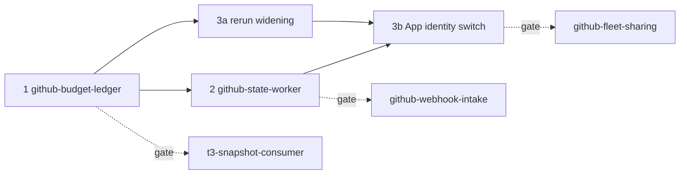

# Map — GitHub API Quota

## Candidate goals (promised now)

| # | Slug | Mission | Depends on |
|---|---|---|---|
| 1 | `github-budget-ledger` | Record every GitHub request's cost per identity, resource, command and host. Read the free `/rate_limit` for the true fleet-wide usage. Show it as a `github-headroom` parcel in `session open`. Publish the 15% reserve signal. | none |
| 2 | `github-state-worker` | A per-host systemd worker reads the tracked PR set: fingerprint-batched GraphQL, then ETag-revalidated detail reads only on change. It publishes atomic PR snapshots that monitor, ready, merge-gate, watch, gate-table, the orchestrator watchers and a `--cached` status read consume, with a direct-read fallback. | 1: reserve signal, attribution to size it |
| 3 | `yeet-monitor-app-identity` | Move the monitor's environment-only reruns into `rerun-runner-loss.yml` (`GITHUB_TOKEN`), so the monitor is read-only. Then run the worker's reads on the beep-fleet-orchestrator App installation token through `LoadCredential=`. Record the decision that reverses the 2026-10-31 ruling. | 2: for the identity switch. The rerun widening (3a) may run alongside 2. |

## Gated candidates (re-entry points, not promised)

| Slug | Gate | On fire |
|---|---|---|
| `github-webhook-intake` | After goals 2 and 3 land, the ledger still shows the user bucket above about 60% average use over 7 days, or event latency becomes the measured bottleneck | Reopen this packet at `decompose` |
| `t3-snapshot-consumer` | The ledger attributes more than the threshold set in goal 1 (a share of GraphQL points) to T3 Code | Reopen at `decompose`. This is a t3code fork change. |
| `github-fleet-sharing` | Per-host readers plus the App identity still leave combined fleet usage above 60%, and duplicate cross-host PR reads show up in attribution | Reopen at `decompose` |

## Sequencing and rationale

1. **The ledger goes first** (decision 2026-11-09 "measure first"). It explains the 430-vs-720–1,440 GraphQL
   conflict, sets the baseline that goals 2 and 3 are judged against, and carries the reserve signal that the worker
   obeys.
2. **The worker is the main saving.** It also creates the only process that can hold the App token without breaking
   ruling 39.
3. **Identity comes last.** The rerun widening (3a) is independent and can overlap goal 2. The switch (3b) needs the
   worker.

At most three open PRs at once across the three goals.

## First vertical slice

Goal 1, one end-to-end path:
1. The in-process GitHub transport records `x-ratelimit-*` (with resource) for every request made by
   `yeet monitor --until-ready`.
2. Rows go to a host-scoped ledger under `$XDG_STATE_HOME/beep/github/ledger`, tagged with identity, command and
   host.
3. A `/rate_limit` sampler adds fleet-wide `used`.
4. `bun run beep session open` prints a `github-headroom` line: per-resource remaining, reset time, and this host's top
   spenders.

This proves the record → persist → read path before attribution is widened to `gh` spawns and other commands.

## Capability check

| Component | Existing brick (cite) | Verdict |
|---|---|---|
| Header capture | `packages/drivers/github/src/internal/octokit.ts:282-285` (`transport.rateLimit`), `packages/drivers/github/src/Resilience.ts` (`RateLimitSnapshot`) | extend (add resource and identity) |
| `/rate_limit` read | `packages/tooling/tool/cli/src/commands/Yeet/internal/MonitorRateLimit.ts` (`readYeetGithubRateLimit`, #3032) | reuse |
| GraphQL budget probe | `packages/tooling/tool/cli/src/internal/github/GraphqlBudget.ts` | extend (read the ledger first) |
| Persisted snapshot pattern | `packages/tooling/tool/cli/src/commands/Palantiri/Palantiri.service.ts` (`writePrivateFile`, `retainLastGood`) | reuse |
| Parcel | `packages/tooling/library/palantiri/src` (`Parcel.models.ts`, `Freshness.ts`) | extend (`github-headroom`, later `pr-status`) |
| `gh` spawn attribution | `packages/tooling/tool/cli/src/internal/github/GhCommand.ts` (`ghOutput`), `internal/repo-run` (`runRepoCommandCapture`) | extend |
| Worker process | `packages/tooling/tool/cli/src/commands/AIMetrics/internal/ObservationWorker.ts`, `ObservationDeployment.ts` | extend (template) |
| systemd install | `packages/tooling/library/repo-cli-kit/src/systemd/SystemdUnit.ts` | reuse |
| Batched GraphQL | `packages/drivers/github/src/GraphQL.ts` (typed documents) | extend; the rollup/fingerprint documents are **NET-NEW** |
| ETag layer | `packages/tooling/tool/cli/src/internal/github/GithubIdentity.ts` (`GithubTransportFetch`), `TransportOptions.fetch` | extend; the conditional-request `fetch` wrapper is **NET-NEW** (port of Prow ghcache, Apache-2.0, with attribution) |
| ETag store | `.repos/effect` `packages/effect/src/persistence/KeyValueStore.ts` (`layerFileSystem`), `Persistence.ts` | reuse |
| PR snapshot | `packages/tooling/tool/cli/src/commands/Yeet/internal/Status.ts:1729` (`writeYeetStatusSnapshot`, already called every poll at `MonitorLoop.ts:2131`) | extend (host scope, keyed by PR, atomic, head SHA + generation) |
| Tracked PR set | `packages/tooling/tool/cli/src/commands/Yeet/internal/PrSessionRegistry.ts` | reuse |
| Snapshot readers | `ReadyGate.ts`, `MergeGate.ts`, `WatchMode.ts`, `GateTable.ts` in `commands/Yeet/internal` | extend |
| Read-only monitor | `.github/workflows/rerun-runner-loss.yml`; the signatures in `MonitorLoop.ts:213-245` | extend |
| App token minting | `packages/drivers/github/src/GitHubApp.ts` (cached installation tokens) | reuse |

Nothing in the map needs a new workspace package. If goal 2's SPEC decides the worker deserves its own package, it
goes through `bun run beep create-package`.

## Inherited risks

- **Snapshot staleness gating a merge.** Mitigated by the no-go: merge always re-reads authoritatively, pinned to the
  head.
- **Dead worker.** Readers fall back to direct reads, which is the current behaviour, so the worst case is today's
  cost.
- **GraphQL detail-query cost** is unmeasured. Goal 2 measures `rateLimit { cost }` before fixing the shape.
- **Secondary limits** are keyed in undocumented ways. The worker caps concurrency and spaces requests (ghproxy
  spacing pattern).
- **Ruling reversal.** Goal 3 records it as a decision file with a reversal path: point the worker back at the user
  token.
