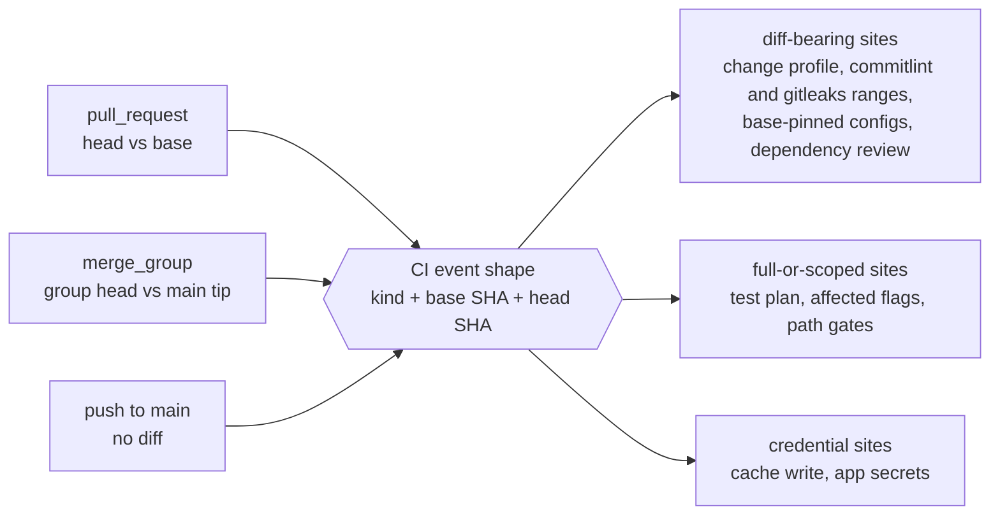

# Brief

<!--
Stage 3. The shaped pitch (Shape Up anatomy). Fat-marker fidelity: concrete
enough to evaluate and decompose, rough enough to leave design latitude to
the implementing goal packets. The exploration is shaped when the human says
this file matches the picture in their head.
-->

## Problem

Reds reach `main` and stay there. Over the 14 days to 2026-11-09, 50 of 217
tested `main` commits had a failing required context, and 39 of those sat in
a red that persisted across consecutive tested commits. Each episode costs
the fleet an attribution pass, one consolidated unblocker, cancelled runs and
a round of "merge `main` once" across every open lane. Seven in ten `main`
runs are cancelled before they say anything.

The repo already runs a merge queue by hand. Since 2026-11-05 the gate merges
finals one at a time and tells the siblings to merge `main` between merges.
And it already runs the opposite doctrine beside it: S11 lets a final merge
over failing required checks, because waiting for green was slow and
unreliable, and those merges are part of why `main` is red.

The spend is already committed. `ten-minute-certainty` decision D7 buys one
full hosted run for every non-docs `main` commit, after it lands. A merge
group is that run before it lands. Placed there, the verdict stops a red
instead of reporting one.

Why now: the operator scheduled the packet on 2026-11-09, D7 is being
decomposed the same day, and seven packets defer a gate, a design or a merge
path to this one.

## Appetite

- **The first goal is one week and touches nothing shared.** A lab branch, a
  toy required check, about three pull requests. It never edits `check.yml`,
  `heavy.yml`, the `main` ruleset or any Yeet merge code.
- **Parity is two weeks, after its gate opens.** It starts when
  `ten-minute-certainty`'s `route-soundness-repair`, `heavy-pool-diet` and
  `hosted-setup-tax` have merged.
- **No money.** A larger heavy pool, a higher hosted concurrency tier and any
  third-party queue are purchases and go to the operator.
- **The lab may end the packet.** If a lab observation breaks the design (the
  merging identity cannot enqueue, or the landed commit is not the tree the
  group proved and the post-merge run cannot shrink), the packet parks or dies
  on that finding. It does not grow a workaround.

## Solution Sketch

**Three events, one shape.** Every scoping site in the workflows asks one
question today: is this a pull request? A merge group is a third case with a
base and a head of its own. The design derives the answer once and lets the
sites read it:

| Event | Proves | Scope | Cache and secrets |
| --- | --- | --- | --- |
| Pull-request head | the change, for its author | scoped, as today | read-only |
| Merge group | the tree that will land | full for a code entry; passes without work for a docs-only or goals-only group | read-only until the cache-writer question is settled |
| Push to `main` | nothing required once the queue is live | cache writes and non-required lanes | write |

The shape is a schema in `@beep/repo-cli` beside `HeavyAdmissionEventName`,
decoded once from the event payload, so adding the third event is one decode
branch and a table, not thirty new `if:` arms.

**A lab queue before anything real.** A dedicated branch with its own ruleset
and a `merge_queue` rule.

- *Phase 1, semantics.* A toy required check that can be told to pass, fail,
  skip, cancel or hang. A script drives synthetic pull requests through the
  queue and records what GitHub does. It settles the undocumented behaviours
  in `research/github-semantics.md`: rerun after ejection, cancelled checks,
  bypass merges and base moves, the landed SHA, the post-merge push event,
  the squash message, secrets and token scope on a group run, which
  identities may enqueue and jump, and the queue-state fields Yeet would read.
- *Phase 2, parity.* The real `check.yml` and `heavy.yml` arms run on lab
  entries. All 15 required contexts must report and prove what they prove on
  a pull request. A workflow-lint rule keeps it that way.

**Measuring the gate without paying for it twice.** The gate is parity, p90
wall time at or under 15 minutes, and false ejections at or under 5% over at
least 100 entries. A hundred full lab runs would cost about 40,000
runner-minutes. Once parity shows a group run and a `main` push run are the
same job set, first-attempt results of `main` push runs count toward the
hundred, read from `ten-minute-certainty`'s scorecard; the lab supplies a
smaller sample that confirms the two behave alike.

**The queue itself.** Squash, one build at a time, group size 1, every entry
must pass. Enqueue stays behind `yeet merge-gate`, which keeps the review
window and the thread re-read; GitHub enforces neither.

**Yeet under a queue (gated).** `merge-gate` enqueues instead of merging.
Enqueued and building become wait reasons, ejection becomes a terminal reason
with an inbox row, and the post-merge actions move to a merged-event handler.
Queue state is read through `goals/github-state-worker`'s snapshots.

**Activation (gated).** Add the rule to the `main` ruleset, retire S11,
rewrite the merge doctrine in `AGENTS.md` and the orchestrate and yeet skills,
and shrink the `main` push run. An unblocker lands by pause, jump, resume.

## Rabbit Holes

1. **The landed commit may not be the proven one.** If the queue rewrites the
   squash commit at merge time, checks on the group SHA are not checks on
   `main`, and the post-merge run cannot shrink. Lab, phase 1.
2. **Who writes the cache.** Cache-write credentials are push-only. If a group
   run cannot write, the post-merge run must redo the work to fill the cache,
   and the "same spend" claim fails. Options are a protected environment that
   admits queue refs, or the push run restoring the group's outputs.
   Patched as a phase 2 design question with a kill condition.
3. **The squash message is the queue's.** `merge-gate` sends an explicit
   linted title and body; a queue ignores them. Either the prediction matches
   the queue's composition or group Commitlint becomes the proof. Lab, phase 1.
4. **A Spot eviction is an ejection.** Three required heavy lanes run on Spot
   with a two-runner cap, and the runner-loss rerun declines `merge_group`.
   Candidate patches: retry inside the job, re-enqueue on runner loss,
   on-demand runners for group runs (money). Inherited by the parity goal.
5. **A skipped required job passes.** Every `if:` on a job that reports a
   required context is a hole until the lint rule exists.
6. **The hosted job ceiling is a guess.** About 60, never read from the admin
   side. One build at a time depends on it.
7. **The peak day is at the edge.** Fifteen minutes gives 96 entries a day
   against about 95 code merges on the measured peak. A burst queues for
   hours.
8. **The merging identity.** Whether the orchestrator App can enqueue, jump,
   and enqueue pull requests that touch workflow files is undocumented; it
   cannot merge workflow pull requests today.
9. **`heavy.yml` is called at `@main`.** Each merge-group arm in it is two
   pull requests, and the EC2 runner group's acceptance of a queue-ref caller
   is unproven.
10. **A queue does not fix textual conflicts.** An entry that conflicts with
    one ahead of it is ejected. The three-open-pull-requests cap and the
    merge-`main` rule stay.
11. **The docs-only verdict inherits the selector.** `ten-minute-certainty`
    D8 found it unsound; a quarter of merges would ride it.
12. **A second queue ruleset on a lab branch may be refused.** Fallback: a
    public scratch repository in the organization.

## No-Gos

- No `merge_queue` rule on `main` from anything but the activation goal.
- No change to S11, the review window, the three-pull-request cap or
  `merge-gate` before activation.
- No slimming of pull-request head proof at activation.
- No strict-status-check flip, now or as a step.
- No global `concurrency` group as a stand-in for a queue.
- No groups larger than one entry and no `HEADGREEN`.
- No edits to the shared scoping sites in `check.yml` or `heavy.yml` before
  `ten-minute-certainty`'s route-soundness and job-removal goals have merged.
- No third-party queue product and no purchases.
- No stacked-pull-request routing through the queue; that stays with
  `explorations/stacked-pr-adoption`.
