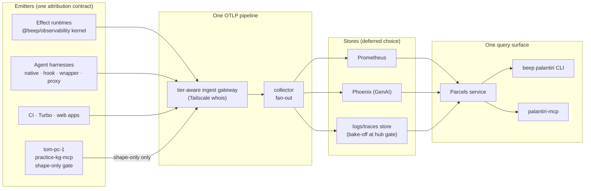

# Brief

Stage 3, 2026-10-14. Shaped from [`CAPTURE.md`](./CAPTURE.md),
[`RESEARCH.md`](./RESEARCH.md) and [`DECISIONS.md`](./DECISIONS.md).

## Problem

Nothing the operator runs can be observed from one place, and no agent can
ask "what is happening" without reading logs by hand.

- **The parts exist but aren't wired.** Effect v4 ships OTLP export for all
  three signals and `@beep/observability` wraps it, but only two runtimes
  mount an exporter. Of 124 package exports, about 14 have outside consumers.
  Three wiring defects mean even those lose data: DevTools hides OTLP traces,
  DevTools spans never end, and several loggers drop the log-to-span bridge.
- **Nothing joins.** Claude Code and Codex export to dankserver under a
  `beep.*` contract that lives only in prose and a zsh wrapper. Cursor, Grok
  and Muse emit nothing attributable. Codex metrics can't say which checkout
  they came from. Proxy sessions lose trace context in Bash.
- **The most sensitive machine is the least instrumented.** `practice-kg-mcp`
  on the attorney's workstation (`tom-pc-1`) has no telemetry. It also has no
  fence that could guarantee none of the attorney's content ever leaves.
- **The fleet is half-monitored.** Prometheus scrapes only dankserver. An
  unauthenticated OTLP port is open to the whole tailnet. No host but the
  bot box is tagged. A laptop's offline backlog can't be backfilled.
- **The dashboards that exist mislead.** OpenClaw's totals reset on every
  update, and the host dashboard is pinned to one machine.

Why now: the agent fleet (four providers, several accounts each, lanes in
parallel) has outgrown "read the transcript". Quota loss, lane reds and host
pressure are found late. Meanwhile the attorney PC rollout needs a privacy
fence before anything ships from it.

## Appetite

A program, not one goal: **six goal packets**, each one to two weeks of agent
time, sequenced so each lands something usable on its own. The hard bound is
**no spend** (D9): nothing here buys a SaaS backend, Vercel drains, Grafana
Cloud above free, or Tailscale paid tiers. A second bound is that **the store
choice stays deferred** (D1). Every goal must work against today's dankserver
stack and move unchanged to the hub host later. Anything that needs the hub
waits behind the MAP gate.

## Solution Sketch

Seven elements, at fat-marker fidelity:

1. **Kernel and catalog.** `@beep/observability` splits its kernel (signal
   schemas, `TelemetryTier`, the tier gate, the instrumentation catalog) from
   its `/server` wiring. The three defects get fixed, and so do two more
   found in research (`layerConsoleLogger`'s type; the exporter pinning its
   own serializer).
   - The **instrumentation catalog** declares every span, metric, event and
     attribute once, across six axes (DECISIONS "naming contract" and its
     families-and-hosts amendment). The doctrine page, lint, tier allowlists
     and dashboard specs are generated from it.
   - Names are context-free (`Concept.action` in every family, globally
     unique, never interpolated). `beep.package`/`beep.family` are enriched
     from the catalog's name→package map rather than stamped at call sites.
   - Where a record ran is an `EmitterContext` tagged union (`Workstation |
     Server | StrictDesktop | CiRunner | CloudVm | Serverless | Browser`) with
     per-variant semconv fields, a tier ceiling, and
     `beep.identity_source = vouched | self_claimed`. The gateway vouches for
     tailnet senders from `whois`.
   - `standards/architecture/12-observability.md` is regenerated to match.
2. **Attribution contract v2.** The `beep.*` keys become an Effect Schema in
   the catalog's attribute registry. Each key belongs to a metric-safe set or
   a span-only set.
   - New keys: `beep.harness`, `beep.provider`, `beep.provider_account`
     (salted), `beep.route`, `beep.model_role`, `beep.privacy_tier`,
     `beep.emitter`, `beep.package`, `beep.lane`.
   - One computed value travels three ways: `OTEL_RESOURCE_ATTRIBUTES`,
     `X-Beep-*` headers, and hook env. A `beep otel attrs` command produces
     it, replacing the zsh function.
3. **Strict tier on `tom-pc-1`.** A custom `OtlpSerialization` gate runs
   inside the exporter. It rebuilds every record from a closed per-tier
   schema rather than filtering input.
   - **Shape-only spans are allowed.** Span names come from the tool enum,
     timestamps are rounded, and ids can't link batches. Events, links,
     status messages and log bodies are always dropped.
   - Every drop is counted.
   - Correlation ids use an HMAC salt that never leaves the PC.
   - Stderr is pinned to a shape-only logger.
   - Output goes to an encrypted local spool.
   - Tiers fail closed: untagged or unreadable means shape-only. The looser
     tiers are the ones that carry tags.
   - Proof: canary tokens through every tool handler, golden allowlist
     snapshots, and mutation tests of the gate. No attorney review gate.
4. **Fleet on the tailnet.**
   - Always-on Linux hosts are scraped. Intermittent hosts push OTLP through
     a `file_storage` queue.
   - One `host.name` comes from MagicDNS.
   - Tags and grants go in as proposals, with the exact commands.
   - The open `:8448` ingest closes behind the tier-aware gateway, and the
     Serve routes move under Ansible.
   - "Fully enrolled" becomes a checkable 16-point gate, which is also the
     D1 trigger.
   - A fleet overview with a per-host "busy / safe to restart" signal.
5. **Harness emitters.** Every harness gets an emission point:
   - Claude Code: native, plus `CLAUDE_CODE_PROPAGATE_TRACEPARENT=1` for
     proxy sessions.
   - Codex: native, plus the resource-attribute probe.
   - Cursor: hooks plus a wrapper span.
   - Grok: transcript ingest.
   - Muse: native OTLP plus collector enrichment.
   - CLIProxyAPI: a span per request.
   
   A completeness check reports which expected emitters are silent.
6. **Parcels: the agent-facing Palantiri.**
   - A `Parcels` `Context.Service` of schema-typed, pre-staged answers with
     read-time `Freshness = Fresh | Unknown{reason}`.
   - One HttpApi serves `beep palantiri …` (CLI-first, because it nests under
     the agent's `TRACEPARENT`) and `palantiri-mcp`.
   - Responses are budget-capped with "N of M" receipts.
   - The first parcels: account headroom (the `AccountsUsage` quota gauge,
     D5), lane reds, host pressure, app error classes, and "since my last
     check". They are pushed at `beep session open`.
7. **Web, CI and dev loop.**
   - `@vercel/otel` owns the provider in both Next.js apps, and Effect joins
     through `OtelTracer.layerGlobal`. Export happens in-function only; no
     drains (D9).
   - CI spans come from the Turborepo summary JSON.
   - Locally, `docker-otel-lgtm` is the dev-loop sink, with Tempo MCP.
   - WebStorm is research-only.

Dashboards are generated from the catalog and tested. They must survive
restarts, guard against no-data, stay within a label budget, and include
staleness alerts. None is copied from the existing ones.

## Rabbit Holes

- **The store bake-off.** It's tempting to pick a backend now. D1 forbids
  it. Every goal targets OTLP plus today's dankserver stack.
- **The OTLP serializer is marked unstable.** The gate depends on a module
  Effect may change. Pin it with a test, and keep the gate synchronous
  (`Bun.CryptoHasher`, not Web Crypto).
- **Scrubbed spans still link.** Even with values removed, span sequences
  can reveal activity patterns. Ids must not link across batches, timestamps
  are rounded, and minimum counts per window need choosing.
- **DPAPI from bun on Windows.** The spool key has to be wrapped with DPAPI,
  either through FFI to `crypt32` or via a PowerShell fallback. This is
  unproven on `tom-pc-1`.
- **Windows collector cost and install.** Every agent needs admin and no
  cost has been measured. The floor is self-reported telemetry from the MCP
  binary, and any collector install is optional.
- **Out-of-order backfill.** Prometheus measures its window from the newest
  sample in the whole database. A long window costs memory, so cap the
  replay horizon explicitly.
- **Harnesses we don't control.** Cursor and Grok output formats can change
  under us. Muse's native export is unverified. Five cheap probes come first.
- **Cardinality.** `beep.lane`, `beep.branch` and session hashes on metrics
  would explode series counts. The registry's cardinality class enforces
  where they may appear.
- **Vendor cloud VMs can't reach the tailnet.** Their records are
  self-claimed and have no path home today; parcels mark them
  `Unknown{unreachable}` until a spool-and-upload path exists.
- **Lineage drift.** The Palantiri must not absorb developer-AI analytics
  (ai-metrics), cache policy (turborepo-cache-trust) or CI forensics
  (ci-step-watchdog).
- **dankserver is Ansible-managed.** Every collector or Serve change lands in
  that repo, or the next run erases it.

## No-Gos

- No spend of any kind (D9). That includes Vercel drains and any public
  ingress that costs money.
- No backend/store selection before the hub gate fires (D1).
- No mutation of dankserver, the tailnet policy, `tom-pc-1` or any host from
  these goals without the operator applying the proposed command.
- `tbk-ubuntu` and its security-sensitive VM are out of every goal. The VM is
  never instrumented or reachable.
- No content from the attorney's PC ever leaves it: no tool arguments or
  results, URIs, paths, prompts, error messages or log bodies.
- No collector-side redaction as the primary privacy fence. The collector is
  the second fence, never the first.
- No developer-AI semantics in `@beep/observability`, no cache policy, and
  no OTel in CI step forensics (lineage boundaries).
- No dashboards hand-built in the Grafana UI, and none copied from the
  existing generated ones.
- No mass codemod of span names.
- No session replay, form capture or user identifiers on oip.law.
- No parcel-gated yeet actions in the first goals. That is a later unlock.
