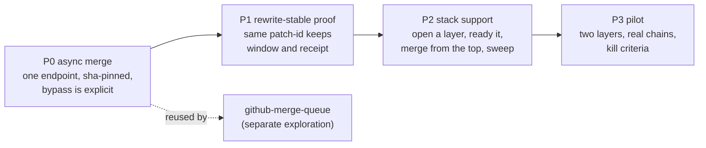

# Brief

<!--
Stage 3. The shaped pitch (Shape Up anatomy). Fat-marker fidelity: concrete
enough to evaluate and decompose, rough enough to leave design latitude to
the implementing goal packets. The exploration is shaped when the human says
this file matches the picture in their head.
-->

Shaped 2026-11-10 from the reground ([`RESEARCH.md`](./RESEARCH.md),
2026-11-09 section) and the stack test
([`research/stack-test-2026-11.md`](./research/stack-test-2026-11.md)).

## Problem

Lanes build on each other's unlanded work five to seven times a week and
have no honest way to say so.

- In 14 days, 18 parent/child PR pairs were live: the child opened while
  its parent was unlanded. Each child targeted `main` and carried the
  parent's commits, which the dependent-lane rule forbids. Review bots then read the parent's diff twice, and the child
  cannot land before the parent without landing both under one title.
- GitHub's native stacks express exactly that dependency, and the test
  showed they work here: every layer got the required checks, a thread on
  any layer blocked the merge, and two layers landed in one push.
- Yeet cannot use them. It merges through an endpoint that cannot merge a
  stack. `yeet ready` pushes a commit that breaks a stack. Its receipt and
  its review window are tied to a head that GitHub rewrites: twice in 30
  minutes during the test, for a diff that never changed.
- The same endpoint gap blocks a merge queue, and 43% of merges bypass the
  ruleset as a side effect of who holds the token, not as a recorded choice.

## Appetite

One week of agent time, in four phases, each a PR that stands alone.

- The first two phases must pay off with stacks switched off. If the budget
  runs out after them, the goal stops there and still closes.
- Routine stacks are capped at two layers.
- At most three PRs open on the goal packet at once (ruling B3).
- No workflow, ruleset or admission change. A change that needs one is out
  of this goal.
- The pilot has kill criteria (below). Failing them ends stack support at
  the two general phases and records why.

## Solution Sketch

Four elements, in landing order.



**P0. Async merge.** `yeet merge-gate` and `yeet merge` send
`PUT pulls/{n}/merge-async` and poll the result.

```ts
// fat-marker shapes, not final names
AsyncMergeRequest = {
  pullRequest: number
  sha: string                      // the gate's pinned head
  action: "direct_merge" | "merge_queue"
  method: "squash"
  bypassRules: boolean             // false in strict mode
  title?: string; message?: string // direct merges only
}
AsyncMergeOutcome =
  | Merged { sha }                 // the last PR's merge commit
  | Enqueued                       // queue only; not used in this goal
  | Failed { message }             // GitHub's own sentence, becomes the hold reason
  | Pending { uuid }               // poll again; 409 means one is already in flight
```

- Strict mode sends `bypassRules: false`. Only `--relaxed`, the S11 mode,
  may send `true`, and only with the attributed reds the gate already
  records. A bypass becomes a decision somebody made.
- The gate's own checks stay as they are and run before the request.

**P1. Rewrite-stable proof.** A head move is classified before it voids
anything.

```ts
HeadMove =
  | LanePush                                   // the lane pushed: restart everything
  | GithubRewrite { patchIdsUnchanged: true }  // cascade or restack: keep window and receipt
  | GithubRewrite { patchIdsUnchanged: false } // treat as a push
```

- The review window keeps running across a GitHub-initiated rewrite whose
  patch-ids match (decision `review-window-on-cascade`).
- The final-check receipt carries to the rewritten head the same way it
  already carries across a main merge that only refreshed inventories.
- Hosted CI still re-runs on the new merge ref and stays the proof.

**P2. Stack support, two layers.**

- Open: a lane publishes a layer on a parent PR. The PR is created on the
  parent's branch and linked into a native stack, with the provenance
  footer, the label and the monitor a Yeet PR always gets.
- Ready: on a layer below the top, `yeet ready` re-requests the reviewer
  without pushing a commit.
- Merge: the gate on the top PR checks every layer, then sends one async
  merge for the contiguous group.
- Adopt: after a GitHub rewrite the lane takes the remote head with
  `git switch -C`. It never force-pushes and never runs `gh stack rebase`,
  `sync` or `modify`.
- Sweep: retire reads the PR head before it compares tips.

**P3. Pilot.** Real two-layer chains for two weeks, measured.

- Record per stack: rewrites and their cause, minutes waited on windows,
  `main` Check runs started, and any hold the gate raised.
- Settle the fact the test could not: whether GitHub restacks a partially
  merged stack when its trunk moves.
- Kill criteria: fewer than two stacks a week get used, or the median stack
  waits more than two review windows, or a stack needs an agent-side
  force-push to land. Any one ends P2's routine use.

## Rabbit Holes

- **Rules are evaluated after the 202.** A request that will fail still
  answers "accepted". The gate has to poll to a terminal state, treat
  `failed` as a hold with GitHub's sentence, handle a 409 for a request
  already in flight, and never assume `Pending` means merged. Results expire
  after 24 hours.
- **Bypass reaches only the bottom layer.** On a red `main`, a stack lands
  bottom-up under S11, one cascade per layer. The pilot rule is to open a
  stack only while `main`'s required checks are green, and to unstack when
  that stops being true for a working day.
- **The unattributed second rewrite.** If GitHub restacks on every trunk
  move, a stack is rewritten about as often as `main` lands a PR. P1 makes
  that harmless only when the patch-id carry is sound; the pilot measures
  it before any wider use.
- **Per-layer diff bases.** `BEEP_CI_PR_BASE_SHA` on a layer is its parent's
  head, so affected planning, coverage and docgen see the layer's own diff,
  while Secret Scanning sees the range from `main`. The test ran docs-only
  layers. The first code-layer stack must record what Heavy does on a layer
  before the pilot counts it.
- **Squash messages on a stack merge.** `commit_title` and `commit_message`
  are documented for direct merges; what they do across several PRs in one
  request is unknown. The default message passed commitlint in the test, so
  every layer keeps a lint-clean single subject.
- **The S32 re-request.** `beep-reviewer` ignores heads pushed while a PR
  was draft, which is why `yeet ready` pushes a commit today. The
  replacement has to wake the reviewer some other way.
- **Unsigned cascade commits.** Harmless now. If `main` ever requires
  signatures, a cascade needs originals GitHub can verify, and lane commits
  currently read `unknown_key` there.
- **`gh stack` wants one push remote** and the Stacks REST endpoints are
  thinly documented. P2 either wraps the CLI with `remote.pushDefault` set
  in the environment or finds the endpoints first.
- **Joins and fans.** Four of twelve observed structures are not linear.
  They stay on the fold and publish-after-parent rule.

## No-Gos

- No merge queue. `explorations/github-merge-queue` owns enabling one; this
  goal only leaves `action: "merge_queue"` reachable.
- No workflow, ruleset or admission change, and no Heavy gating by stack
  position (decision `stack-layer-heavy` keeps that deferred).
- No agent-side force-push, no `gh stack rebase`, `sync` or `modify` from a
  lane, and no browser "Rebase stack".
- No stack deeper than two layers in routine use, and no PR on a non-`main`
  base outside a native stack.
- No third-party stack tool.
- No change to S11 or to the review-window length.
- No dependency model for joins and fans.
