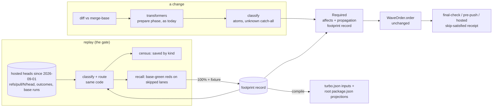

# Brief

<!--
Stage 3. Shaped 2026-10-28 from CAPTURE.md, RESEARCH.md and the fourteen
align rulings in DECISIONS.md (rounds 1–4, same day). Fat-marker fidelity:
file cites say where work lands, not how.
-->

## Problem

Turbo's required set is the floor of intelligence: a task reruns when any file
in its package changes, when any upstream `^build` changes, and when any global
input changes. Our `turbo.json` lists root `package.json` as a global input, and
turbo copies global inputs into every task, so a one-line root `package.json`
edit reruns the repository: on 2026-10-27 a biome catalog bump invalidated 188
of 189 build and check tasks and 187 of 189 lint and test tasks. Root
`package.json` changed in 110 commits since 2026-09-01. The proof ledger is
blind the same way (turbo task hash as the key, lockfile in the epoch), so
"certainty as a lookup" expires on the same edits. On a clean `main` that day,
`test` was 139 MISS / 50 HIT.

The yoyo article asked for the route: given a change, run only the checks its
kind can affect, cheapest first, until the thread returns to its source. The
ontology lineage closed with a planner that re-emits the deployed order and a
verdict that makes no route claim; time-to-certainty paused on a 200-attempt
sample that stopped accumulating when push-first moved the proof it counts to
hosted CI. The KPI's last reading is a censored P50 1.02 h / P95 10.21 h
post-baseline, up from 43.3 min / 3.95 h.

The operator's constraint is the design's: the machinery changes daily, so
nothing in this packet may wait on a measurement window.

## Appetite

Three PR-sized slices, about one week of lane time. The cut line is slice 1: the
loss census is the deliverable even if 2 and 3 slip. Outside the budget: the
ProofFact re-key (DEFERRED; time-to-certainty C1/C4 territory), the pre-push
tier as its own population, the merge queue (B9, gated on E8), symbol-grain
propagation, per-law footprints, any lab.

## Solution Sketch

### Vocabulary (packet-local)

- **atom:** one classified unit of a diff, `(kind, pkg?, path, digest)`.
  `classify : Hunk → ChangeAtom` is total; `unknown` maps to every lane.
- **footprint:** per lane, the atom kinds that can change its verdict, a
  propagation class (`none | reverse-deps | covered-pkgs`), a transformer flag,
  and a fixture reference per claimed absence. One total record keyed by
  `CiLaneId`.
- **route:** `Required(Δ)` (affects ∘ propagate over the package graph), then
  `WaveOrder.order` unchanged. The route selects; it never reorders.
- **census:** over the corpus, machine-time turbo or CI ran that the route would
  not select, by atom kind, costed with the A1 lane P50s.
- **recall:** over the corpus, lanes the route would have skipped that went red
  on that head while green on its merge-base. The gate is 100%.
- **layer 1:** footprints compiled into `turbo.json` task inputs and generated
  field projections of root `package.json`; **layer 2:** `beep ci route`.
- **skip-satisfied receipt:** a hosted lane that starts, routes itself out, and
  completes as success with its atoms, footprint and reason in the job summary.

### The loop

### Slices (in order)

1. **Schemas, route, census.** `ChangeAtom`, `ChangeAtomKind` (LiteralKit),
   `CheckFootprint`, `Propagation`, the total `Record<CiLaneId, CheckFootprint>`
   with every lane at `unknown`, `classify` (semantic atoms for `package.json`,
   `bun.lock`, `turbo.json`, `tsconfig*`, `biome.jsonc`, workflow YAML; path
   atoms elsewhere), `route` over the package graph, and `beep ci route
   plan|census|replay` with the corpus fetch (hosted PR Check runs by head sha,
   `refs/pull/N/head`, main push runs for base-green, digest-pinned receipts).
   Deliverable: the census printed, with the `unknown` share visible. At
   `unknown` everywhere the route equals "run everything" and recall is
   trivially 100%.
2. **First refinements, both layers, final-check.** Refine footprints in census
   rank order; each lands with its mutation fixture and a clean replay. Where
   the footprint is file- or field-grain, compile it: task-input negations and
   the root `package.json` field projections (`root-scripts`, `root-catalog`,
   …) written by the prepare phase like other generated config, and a sweep of
   package-local `turbo.json` overrides that re-widen inputs
   (`$TURBO_ROOT$/**/package.json`). final-check runs the route in shadow
   (selected set vs run set in the receipt), then enforced per refinement; the
   shadow stays as a sentinel row that can revoke, never hold.
3. **Hosted, per lane.** Extend B8's `run | skip-satisfied | hold` from docs-only
   to any lane the route excludes; the job starts, routes, and completes
   `skip-satisfied` with the receipt. Same gate, same record.

### What stays where it is

`WaveOrder` and `gate-order-handoff/v1` (time-to-certainty rulings 76–79);
`ProofFact` / `ProofEpoch` (C1–C4; the re-key is deferred); the deployed
`QualityScheduler`; the ontology tree and `apps/labs/ciops`; B8's docs-only
verdict (extended, not replaced).

## Rabbit Holes

- **Base-green needs main runs, and main runs get cancelled.** 61 of 157
  main-push Check runs in the close window were cancelled. An unknown base
  counts against the route (fail-closed), so the unknown share can dominate
  recall. Report it beside recall; never impute.
- **`bun.lock` atoms.** The lockfile is large and its semantics are the
  per-workspace dependency set turbo already hashes. First cut: one `lockfile`
  kind whose propagation defers to turbo's external-dependency hash per
  workspace; field-grain lockfile atoms only if the census asks.
- **Root `package.json` fields beyond scripts and catalog.** `patchedDependencies`,
  `trustedDependencies`, `workspaces`, `engines` each have consumers; the
  projections must enumerate every field family or leave the remainder as an
  `unknown`-mapped projection.
- **Package-local overrides.** `@beep/identity`'s `turbo.json` survived the
  negation by declaring `$TURBO_ROOT$/**/package.json`; 21 package-local
  `turbo.json` files exist. Layer 1 needs the sweep, not a root-only edit.
- **Transformers in CI.** `lint:fix` and the prepare writers run locally, not
  on hosted; the hosted route classifies the pushed diff. A head whose
  transformer output was not committed is caught by lint, not by the route.
- **Corpus fetch volume.** Over a thousand heads; `gh` rate limits and the
  `refs/pull/*/head` fetch are real. Pin digests, resume by head, never
  re-fetch a pinned head.
- **turbo future flags.** `globalConfiguration` and `affectedUsingTaskInputs`
  are future flags; a turbo bump can change their semantics. The layer-1
  fixture pins the turbo version it was proven on.
- **The proof ledger will disagree.** Until the re-key, a layer-1 negation
  changes turbo task hashes and therefore ledger keys; shadow rows will show
  misses, not disagreements. Say so in the receipt.

## No-Gos

- No measurement window and no sample-size gate anywhere in this packet.
- No ontology, T-Box, auditor run or OWL; the footprint record is code with
  fixtures.
- No reordering: `WaveOrder` and its seed stand.
- No ProofFact re-key in this goal (DEFERRED entry).
- No per-PR ruleset edits; no required context removed from the matrix.
- No scheduler, lock or admission change.
- No symbol-grain propagation, no per-law footprints, no lab.
