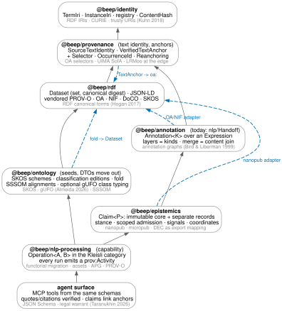
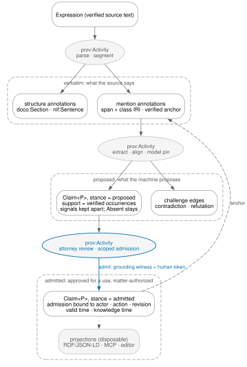
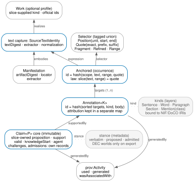

# Rebuilding the text-knowledge foundation from first principles

*beep-effect · `packages/foundation/modeling/{identity,provenance,nlp,rdf,ontology,epistemics,md}` and their consumers · 2026-11-08 · revision 2, after three adversarial reviews*

> **Revision 3 corrections (2026-11-09, applied in place and marked `[rev 3]` where the sketch changed).** From the PR #2993 review (CodeRabbit and the eight-role reviewer panel): the `OccurrenceId` preimage binds the whole `SourceTextIdentity`, extractor and normalization pins included, so two captures of one text cannot collide (section 4, L1); the annotation document carries an `anchors` table so a target hash resolves to range, quote and receipt (L2); targets are deduplicated before sorting and hashing (L2); attribution records are run-specific `Generation` entities that `prov:specializationOf` the content entity, because PROV-CONSTRAINTS forbids two generation events for one entity (L2); the OA codec round-trips on a declared profile and gives unattributed third-party input the import activity as attribution (L2); langextract aligns and accepts fuzzy matches but does not verify against a `VerifiedTextAnchor`, so the new handoff must mint receipts first (D3); `rdf/src/Prov.ts` has a production codec consumer, not one test (D1); the ontology fold emits OWL property declarations and copies caller-supplied `subClassOf` facts rather than minting them (D5); `AnnotatedDocument` is produced on `LangExtractResult` and tested, it is `IrToLaw` that does not read it (D3); `@beep/nlp-processing` already exists as a capability package, so L5 absorbs `nlp/Operations` into it rather than creating it (L5, section 7). The packet `SPEC.md` is normative where it and this report differ.

Companion to `../nlp-algebra-model/nlp-algebra-model-report.md` (the @beep/nlp law audit). The evidence behind every repository claim is in `research/reader-{a,b,c,d}-*.md`, four read-only audits of the law-practice product, the modeling cluster, the pipeline and agent surfaces, and the standards and rulings. Revision 1 of this report was reviewed by three adversarial critics (theory and Effect v4; repository doctrine and facts; legal product). Their findings are in `research/critic-{1,2,3}-*.md`, and §9 lists what they refuted and what changed. Every path is repository-relative with a line number.

---

## 0. Verdict

The stack is a set of good objects with few morphisms between them. Six packages each hold a defensible model of one thing: content-addressed source text with unforgeable anchor proofs, a parametric claim envelope with slice-owned propositions, bitemporal intervals, five separate evidence signals that already know how to be absent, an identity authority, a full PROV-O and Web Annotation vocabulary. What is thin is the arrows and the names: `@beep/nlp` imports none of provenance, rdf or epistemics; the canonical `TextAnchor` has no codec into the Web Annotation selectors the repository already ships; the only PROV-O model has no production consumer; and the live pipeline drops the source digest at its first handoff, invents confidence where none was supplied, and projects claims to RDF without the evidence that would let anyone audit them.

If I were starting from scratch I would build the same six ideas as **eight layers in a dependency DAG connected by lawful codecs**, grounded in formalisms that already exist and already agree with the owner's vision: annotation graphs for the text layer, attributed C-sets and algebraic property graphs for the graph layer, nanopublications and micropublications for the claim envelope, DEC cognitive worlds as the *export* semantics of "proposes versus proves", LRMoo as a profile at the interoperability boundary, and gUFO as an optional, class-level typing for the few terms whose metaproperties drive a check. Category theory stays, but only where it **predicts a law** that a property test can falsify.

What changed between revision 1 and this one, because the critics were right: anchor identity is **occurrence-first** (scope, text capture, range, quote), not quote-first; annotation content and attribution are **separate maps**; evidence weights are **typed signals with no algebra**, not semirings; the attorney's admission is **approval for a use that requires a grounding witness**, not a move into truth; claim status is a **product of owner-declared coordinates**, not one state machine; and **no package is renamed or folded before a real matter has run end to end** [rev 3: this sequencing was superseded on 2026-11-09 by the operator ruling that breaking changes are acceptable; the packet `SPEC.md` and `PLAN.md` rewrite the layers bottom-up and cut consumers over as each lands, with the office-action flow as the standing acceptance test]. The from-scratch picture (§4) is the target. The path (§7) is kept as the critics' repair-first sequence for the record; the packet plan supersedes it.

---

## 1. The vision, as I understand it

I am aligning with these statements, all of which the repository already makes. The rebuild must keep every one of them true.

| Invariant | Where it is stated |
| --- | --- |
| Prose in, proof out. Two families of computation: retrieval **proposes**, fallibly; logic **proves**, soundly. Between them is **the boundary**, "the one place where confidence becomes provenance". | `docs/PROSE_TO_PROOF_VISION.md:35-42` |
| Nothing is asserted without a source; a character span is the provenance link. | `docs/PROSE_TO_PROOF_VISION.md:65` |
| Ground before cite; machine output has zero citation authority; an absent, ambiguous, stale or unverifiable anchor fails closed. | `docs/product/citation-grounding.md:3-24` |
| Agents propose, the attorney approves. Agents are first-class workspace operators; MCP is thesis, not shim. | `docs/PROSE_TO_PROOF_VISION.md:57`; `docs/product/workspace-substrate.md:38`; `docs/ROADMAP.md:135-137` |
| The file is canonical; the graph indexes it. Projections are generated, disposable, never a second writer. | `docs/PROSE_TO_PROOF_VISION.md:63`; `explorations/knowledge-endgame/CAPTURE.md:90-110` (law 3) |
| Identity has two regimes joined by minting: compile-checked `$I` for kinds, runtime-minted digests and IRIs for instances. | `explorations/knowledge-endgame/CAPTURE.md` law 1 |
| Admission is split: **grounding** is a machine-verifiable witness, **governance** is a human token. | same, law 5 |
| Ontologies are the type system that makes non-code work lintable; "sell the red squiggle". | `explorations/knowledge-endgame/CAPTURE.md:153-160` |
| Epistemic vocabulary is foundation; Party is a product slice; propositions are slice-owned; `ClaimLifecycle` stays in `shared/domain`; mechanism stays in the slice. | `standards/architecture/DECISIONS.md:2290-2326` |
| Foundation is domain-agnostic and never depends on slices or the shared kernel; a slice's `domain` may import only `primitive` and `modeling`; capability is unreachable from `domain`. | `standards/ARCHITECTURE.md:54,177,278-282,617-622,705-707` |
| Schema is truth; behavior precipitates from the data. Finite cases are tagged unions; plain data is branded `S.Opaque`; named literal domains are `LiteralKit`; upstream-first with a facet census. | `standards/schema-first-development-prompt.md:42`; `DECISIONS.md:815,2028,2141` |
| Verdict law: names may be shared, vocabularies stay decentralized; structural verification lives with the structure, human dispositions with the reviewed subject, authorization at the enforcement boundary. | `standards/architecture/GLOSSARY.md:573-594` |
| Laws are property tests over production schemas. | `standards/architecture/08-testing.md:46-52` |

Two things in the vision documents I am deliberately **not** inheriting: the local-first, on-device framing (`docs/PROSE_TO_PROOF_VISION.md:55,62,94`) was withdrawn as architecture by the 2026-08-17 revision of the confidentiality rule; and the deleted `ip-law-knowledge-graph` packet that `nlp/THEORY.md:141,193` still names as the owner of the "interpretation functor" no longer exists (`docs/ROADMAP.md:133`).

One thing the owner values that the repository does not state as doctrine anywhere: the category-theoretic grounding. `standards/ARCHITECTURE.md` has no theory of knowledge, text or meaning; the glossary defines neither Claim, Proposition, Evidence, Span, Annotation, Ontology nor Agent; the only categorical document is `nlp/THEORY.md`, which has drifted (Reader D §1, §3, §7). A rebuild has to write that chapter, or the next port drifts the same way.

---

## 2. What exists, and the diagnosis

### 2.1 Worth keeping, as alpha

- **`VerifiedTextAnchor`**: an unforgeable proof token with a serializable but powerless receipt; issuance at `packages/foundation/modeling/provenance/src/VerifiedTextAnchor.ts:396-401`, verification at `:639-659`, receipt at `:354`.
- **`SourceTextIdentity`**: artifact digest versus extracted-text digest, plus a pinned extractor and normalization version (`provenance/src/SourceTextIdentity.ts:125-145`).
- **`makeClaimEnvelope`**: a parametric `Claim<P>` with slice-owned propositions and caller-supplied id schemas (`epistemics/src/Claim/Claim.model.ts:276-291`).
- **Five separate evidence signals, each already `Present | Absent{reason}`** (`Claim.model.ts:69-70,311-317`), ratified by the exploration that said "collapsing them into one score destroys the information a downstream consumer needs" (`explorations/evidence-source-policy-calibration/README.md:14`).
- **Bitemporal half-open intervals** and a working lifecycle transition (`packages/epistemic/use-cases/src/ClaimLifecycle/ClaimLifecycle.service.ts:121-129`, with `ClaimLifecycle` promoted to `shared/domain`).
- **Citation occurrence identity**: `cm1:` binds scope, source reference, locator, both digests, the UTF-16 range and the quote (`packages/law-practice/server/src/internal/Citation/MentionIdentity.ts:111-145`); resource identity `ca1:` is separate (`AuthorityIdentity.ts:126-169`). This is the best-designed boundary in the repository and the rebuild generalizes it.
- **Unit-tagged offsets** with a tested code-point to UTF-16 conversion that fails closed on split surrogates (`packages/foundation/capability/langextract/src/VerifiedSpan/VerifiedSpan.behavior.ts:320-405`).
- **Web Annotation codecs that already exist**: a bidirectional selector codec, a target codec and an evidence-anchor codec (`rdf/src/Adapters/WebAnnotation.ts:358-369,492,577-588`) over a selector union (`rdf/src/Evidence.ts:204-206`).
- `Fibered` restriction with functoriality tests; `ClassificationRegistry` edition pins with no `latest` alias; SPAR acquisition pinned by digest and license; `DocumentAnnotation`'s separation of DoCO/DEO structure from syntax nodes; `effect/Graph` used for containment (`nlp/src/Graph/GraphOps.ts:30`); the manifested, pinned asset-pack loading protocol in `ontology/src/TaxonomyLoader.ts:233-256`.
- The two-families doctrine, ground-before-cite, and agents-propose/attorney-approves.

### 2.2 The diagnosis

**D1. Objects without morphisms.** Verified by empty greps or absent dependencies (Reader B §8, confirmed by Critic 2 finding 4 with the narrowing noted): `provenance.TextAnchor` has no codec into `rdf`'s selector union, and `SourceTextIdentity` no projection to `prov:Entity`; `ontology`'s fold imports only `IRI` and `LanguageTag` from rdf and bypasses `Dataset` (`ontology/src/Fold.models.ts:15-24`); `EvidenceSpan` and `Claim` have no RDF form; `md` cannot produce a `TextAnchor`. `@beep/nlp` depends only on identity, schema and utils. `rdf/src/Prov.ts` has one production consumer (the `ProvRdf.ts` codec) and four test files; no handoff or claim record references it.

**D2. Six anchor encodings around one canonical.** `provenance.TextAnchor` (`:156`), `rdf.TextQuoteSelector/TextPositionSelector` (`Evidence.ts:78-122`), `epistemics.EvidenceSpan` (wraps the `TextAnchor` fields, `:16-21,147`), `nlp.Handoff.Span` (`Contract.ts:249`), `nlp.Graph.Span` (`Schema.ts:358`, floats, no ordering check), and `party-domain.EvidenceAnchor` (a union that also covers header fields, metadata tags and record rows, `packages/party/domain/src/entities/Provenance/Provenance.model.ts:470`). The glossary names `TextAnchor` canonical (`GLOSSARY.md:302-307`); the vision names `GroundedExtraction.span` (`docs/PROSE_TO_PROOF_VISION.md:65`).

**D3. The pipeline is lossy at exactly the point the vision calls sacred.** langextract aligns candidates against the source text and accepts fuzzy matches without minting a `VerifiedTextAnchor` receipt (`langextract/src/Alignment/Alignment.behavior.ts`), then `toAnnotatedDocument` re-mints chunk, mention and entity ids from array position, turns every aligned label into an `Entity`, drops attributes and alignment tier, always emits an empty relation list, and carries no source or text digest (`packages/foundation/capability/langextract/src/Handoff/Handoff.behavior.ts:39-111`). Semantica's RDF projection omits anchor, quote, receipt, producer and confidence from the claim quads and mints a predicate IRI per claim occurrence (`apps/labs/semantica/src/layers/RdfProjectionLive.ts:66-111`); the dataset and quads keep their named graph, only the triple-only artifact drops it (`:113-122`). Missing confidence becomes `1` at the lab's extraction boundary (`ExtractorLive.ts:238-239`); the office-action spike fixes evidence confidence at `0.9` (`packages/law-practice/use-cases/src/OfficeActionReview/OfficeActionReview.service.ts:95`); the docket citation-existence check passes when a document is attached but its text is unavailable (`DocketReview.policy.ts:278-286`; [rev 3] the condition is `hasDocuments && O.isNone(documentText)`, not a missing attachment). The "product-neutral IR" `AnnotatedDocument` is produced on `LangExtractResult` and round-tripped in tests, but the one law consumer, `IrToLaw`, reads `GroundedExtraction` instead, and its stated reason for bypassing the IR is stale (`IrToLaw.ports.ts:6-14` versus `Contract.ts:514`).

**D4. Identifiers come from code paths.** An IRI is authority + package + module path + symbol, so `@beep/ontology/Ontology.models/HttpUrl` is a published identifier that changes when a file is renamed (`identity/src/Id.ts:60-77`, `identity/test/IriBinding.test.ts:58-74`); `packages/tooling/test-kit/test-runner/src/Vitest.errors.ts:23,141,151` pins `test-utils` IRIs under a package now called `test-runner`. Seven registries coexist; `prov:`, `oa:` and `xsd:` are hand-written constants outside the CURIE registry, so `prov:wasGeneratedBy` cannot expand through `Curie.ts` (Reader B §7). Semantica, ciops and the SHACL driver mint under three other schemes.

**D5. Names do not denote.** `provenance` is text identity and anchoring, not PROV; `ontology` is SKOS schemes, classification loaders, FOLIO HTTP DTOs and a fold that emits OWL property declarations with `rdfs:domain` and `rdfs:range` (`ontology/src/Fold.projections.ts:349-359`) and copies caller-supplied facts such as `rdfs:subClassOf` (`Fold.models.ts:485`, `Fold.projections.ts:296-327`) but runs no reasoner; `Evidence` (rdf) is Web Annotation selectors with no evidential semantics; `Vocabulary` has four meanings; `Claim` has five (patent claim, Hohfeld position, `CandidateClaim`, `Claim<P>`, "claim gate verdict"); `Provenance` has three or four. The knowledge-endgame capture counted "span ×8, ontology ×4+, claim ×3, digest ×3, provenance ×3" (`explorations/knowledge-endgame/CAPTURE.md:124-130`).

**D6. Foundation holds product semantics.** `@beep/ontology` ships docketing, party-kind and legal-role schemes and MPEP source IRIs (`ontology/src/Vocabulary.seed.ts:22-104`) against its own README and the ruling "law-practice keeps `LegalRole`" (`DECISIONS.md:2322`); slices re-declare the same vocabularies (`documents/domain/.../Taxonomy.seed.ts`, `law-practice/domain/.../LegalRole.model.ts`). `LogicalEdgeIdentity` requires a nonempty `orgScope` string (`:82,120`), which is defensible for instances but sits oddly under a "tenant-free" README.

**D7. Laws are thinnest where stakes are highest.** `@beep/epistemics` has no property tests and no executable examples; the only `@beep/ontology` properties cover the unused FOLIO DTOs; `@beep/nlp` skips the associativity test on a monoid that is associative and ships one that is not (companion report §4). Seven overlapping status vocabularies exist with no census of which are independent coordinates and which are duplicates (Reader B smell 11; the lifecycle transition itself exists). `rdf.Literal` admits an `xsd:string` with a language tag and the tests assert it; `rdf.Dataset` is a list, so graph equality ignores blank-node isomorphism (smell 9).

**D8. Documentation and theory have drifted.** `THEORY.md:72` cites a module in another package; the modeling file anchors `*.schema.ts`, `*.brand.ts`, `*.codec.ts` (`standards/ARCHITECTURE.md:717`) have 1, 0 and 0 files across the seven packages while five layouts coexist (Reader B §3); the use-cases README says "CONTRACTS ONLY" above live Layers (Reader A §1); `schema-org` has zero demonstrated external runtime consumers but is more than a vocabulary table (typed graph construction, `NodeRef`, serialization and a conformance entrypoint, `schema-org/src/index.ts:1-11,38-52`).

None of D1–D8 is a bad object. They are missing arrows, missing names, or missing laws, and in three places (D3) they are defaults that read as authority in a legal record.

---

## 3. Research grounding

Four retrieval loops (categorical data and annotation formalisms; provenance, claims and confidence; legal knowledge representation; foundational ontologies and document identity), with the load-bearing papers read in full or in their structured report (●) and the rest at abstract level (○). The column says what each one **suggests**; where the first draft over-read a paper, the critics' correction is folded in.

| Formalism | What it fixes | What it suggests for the rebuild |
| --- | --- | --- |
| ● **Annotation graphs** — Bird & Liberman 1999 ([alphaXiv cs/9903003](https://www.alphaxiv.org/abs/cs/9903003)) | "An annotation graph G over a label set L and a node set N is a set of triples having the form ⟨n1, l, n2⟩ … 1. ⟨N, {⟨n1, n2⟩}⟩ is a directed acyclic graph. 2. τ : N ⇀ ℜ is an order-preserving map assigning times to some of the nodes." "The set of annotation graphs is closed under union, intersection and relative complement." | All layers over one text are one standoff structure anchored to one coordinate system, and two passes merge by **set union over shared node names**. That union only works when nodes have canonical names, which in text means canonical offsets: the formalism supports **occurrence-first** identity. |
| ○ **UIMA CAS / LAF** — Eckart de Castilho et al. 2017 ([DOI](https://doi.org/10.18653/v1/w17-0808)); Ide & Suderman ([OpenAlex](https://openalex.org/W1457156378)) | UIMA's `Annotation` is "a feature structure anchored on text via start/end offsets"; the `SofA` is "the signal that annotations are anchored on". | The verified text capture is the SofA. A normalized text is another SofA; the relation between them is a recorded, possibly widening map, not an identity. |
| ● **Web Annotation** — Sanderson, Ciccarese, Van de Sompel 2013 ([alphaXiv 1304.6709](https://www.alphaxiv.org/abs/1304.6709)) | Specific Resources carry Selector, State, Style and Scope; multiple bodies and targets; `oa:hasTarget` is a set. | `oa:` is the wire form the repository already implements; the missing arrow is `TextAnchor → selector`. Multi-target annotations must hash a **sorted** target set. |
| ○ **NIF** — Hellmann et al. 2013 ([DOI](https://doi.org/10.1007/978-3-642-41338-4_7)) | Linked-data vocabulary with `nif:Sentence`, `nif:Word`, `nif:String` and offsets. | A pinned export vocabulary for sentence and token kinds, as an adapter. Internal kinds stay repo-stable; no consumer of this product needs NIF on the critical path. |
| ● **Span-oriented IE** — Ding, Yankoski, Weninger 2024 ([alphaXiv 2403.15453](https://www.alphaxiv.org/abs/2403.15453)) | "a span is a triple s = (b, e, c) … a duality comprised of: (1) a surface form … and (2) one or more corresponding span classes". | A Mention is an anchored occurrence plus a class; the class is model output and carries attribution like everything else machine-produced. |
| ● **Functorial data migration** — Spivak 2010 ([alphaXiv 1009.1166](https://www.alphaxiv.org/abs/1009.1166)) | Schema = small category with path equivalences; instance = functor to Set; Δ_F, Σ_F ⊣ Δ_F ⊣ Π_F; Grothendieck construction to RDF. | Use Δ only for genuine column-dropping between **named, finite Effect-side schemas**. Projections into RDF are codecs or queries, with lens or prism laws on the dataset quotient, not adjunctions. Path equations belong in the schema as checks. |
| ● **Attributed C-sets** — Patterson, Lynch, Fairbanks 2022 ([alphaXiv 2106.04703](https://www.alphaxiv.org/abs/2106.04703)); ● **Algebraic property graphs** — Shinavier, Wisnesky, Meyers 2019 ([alphaXiv 1909.04881](https://www.alphaxiv.org/abs/1909.04881)) | acsets are "a joint generalization of graphs and data frames"; APG labels carry algebraic types and schema morphisms induce Δ with by-construction consistency. | The annotation document is a record of content-keyed tables with typed foreign keys. Colimits with fixed attribute types fail where an identification forces conflicting attribute values, which is exactly why attribution must live outside the content hash. |
| ● **Nanopublications** — Kuhn et al. 2018 ([alphaXiv 1809.06532](https://www.alphaxiv.org/abs/1809.06532)) | "named RDF graphs, with one graph for each of assertion, provenance, and publication info"; trusty URIs "contain a hash value that is calculated on their entire content". | The claim record has an **immutable hashed core**; anything that moves later (challenges, admissions, status) is a separate record that points at the core, as a later nanopub points back. |
| ● **Micropublications** — Clark, Ciccarese, Goble 2014 ([DOI](https://doi.org/10.1186/2041-1480-5-28)) | "The minimal form of a micropublication is a statement with its attribution. The maximal form is a statement with its complete supporting argument, consisting of all relevant evidence, interpretations, discussion and challenges". | Support and challenge are first-class relations; evidence outranks attribution; the support graph is acyclic, the challenge graph need not be (mutual contradiction is the canonical case). |
| ● **Provenance-enhanced statements / DEC** — Vitali & Pasqual 2026 ([alphaXiv 2606.15246](https://www.alphaxiv.org/abs/2606.15246)) | "According to X, φ" statements belong to cognitive worlds typed on named graphs or RDF-star; a `settle` operator moves a conjecture into the reality graph. | A precise **export semantics** for stance: proposed records export as a conjectural world, admitted records as the matter's graph. Not the storage model: a quad has one graph term, and the matter wall is an authorization boundary, not a graph name. The attorney's admission is not DEC's settle, because approval is not factive. |
| ○ **Provenance semirings** — Green & Tannen 2017 ([DOI](https://doi.org/10.1145/3034786.3056125)) | Facts annotated in a commutative semiring; positive queries propagate annotations homomorphically. | Applies to a **derivation query** with a stored provenance term, not to the five heterogeneous signals. Reviewer dispositions and source-asserted confidence do not propagate at all. Deferred until a bounded query exists. |
| ● **Attributable by construction** — Guan 2026 ([alphaXiv 2606.23989](https://www.alphaxiv.org/abs/2606.23989)) | "a copied string is verifiable where a predicted offset is not"; "Provenance is a structural invariant … faithfulness remains an objective". | Quotes are how you **verify**, not how you **identify** an occurrence. langextract's "copy, don't predict offsets" prompt is right; identity still needs the range. |
| ● **Legal warrant** — Taranukhin & Shwartz 2026 ([alphaXiv 2609.17546](https://www.alphaxiv.org/abs/2609.17546)) | "claim-authority warrant [is] the context-sensitive relation between a consequential legal claim and authority that exists, applies to the relevant jurisdiction, is current for the date of analysis, has the legal status represented by the system, and supports the proposition asserted." | Five independent assessment coordinates, each owned by its boundary, with **per-authority-type profiles** (statute, regulation, MPEP guidance, case, prior-art reference, candor disposition). Not one progression; a case can exist and support while later treatment limits one holding. |
| ● **LRMoo for legal norms** — de Martim 2025 ([alphaXiv 2508.00827](https://www.alphaxiv.org/abs/2508.00827), [2506.07853](https://www.alphaxiv.org/abs/2506.07853)) | Work → Expression → Manifestation; "language-agnostic Temporal Versions (TV) — each being a distinct Work — and their monolingual Language Versions (LV), modeled as F2 Expressions". | A WEMI **profile at the interoperability boundary**. `SourceTextIdentity` is finer than an F2 Expression (two OCRs of one document are two text digests); operational identity keeps application, publication and patent numbers as official identifiers, with digests as separate fields. |
| ● **gUFO / UFO** — Almeida et al. 2026 ([alphaXiv 2603.20948](https://www.alphaxiv.org/abs/2603.20948)); Guizzardi et al. 2022 ([DOI](https://doi.org/10.3233/ao-210256)) | "Classes in the taxonomy of types include gufo:Kind, gufo:Phase, gufo:Category … whose purpose is to provide a typology of types that settles the metaproperties (rigidity, sortality, external dependence)". | **Optional, class-level** typing for the few repo-minted classes whose metaproperties drive a check, with a named maintainer; the natural pilot is `LegalPositionRelator`, which already follows UFO-L. Not every registry term, and not SKOS concepts. |
| ○ **UFO-L, FLINT, Hohfeld, LKIF-Core** — Griffo et al. 2023 ([DOI](https://doi.org/10.1016/j.datak.2023.102219)); FLINT ([DOI](https://doi.org/10.3233/ssw230016)); Markovich 2020 ([DOI](https://doi.org/10.1007/s11225-019-09870-5)); Hoekstra et al. 2009 ([DOI](https://doi.org/10.3233/978-1-58603-942-4-21)) | Legal relations as relators between role-playing parties grounded in norms; eight Hohfeldian positions; a legal core ontology. | The law-practice slice owns legal semantics (`LegalPositionRelator`, `HohfeldPosition` exist); the foundation owns the relator and role mechanism and registers the external IRIs. |
| ● **PROV-O ↔ BFO** — Prudhomme et al. 2025 ([DOI](https://doi.org/10.1038/s41597-025-04580-1)) | "A prov:Activity is equivalent to a process because it happens over time, while not being a temporal region itself"; alignments must be coherent and consistent. | Alignments are **data** (SSSOM, which the `ontology-mapper` skill already uses) with coherence checks. |
| ○ **DoCO** — Constantin et al. 2016 ([DOI](https://doi.org/10.3233/sw-150177)); ● **Evidence Units** — Han et al. 2026 ([alphaXiv 2604.00500](https://www.alphaxiv.org/abs/2604.00500)) | Structural and rhetorical document components; parser-independent chunks with completeness checks. | Generic blocks as an **optional** layer. Patent structure (claim numbers, text, status, dependency links, rejection-to-claim coverage, numbered paragraphs, page/line pinpoints) is a **law-owned profile** with ST.96 and Akoma Ntoso mappings; geometric inclusion does not establish any of it. |
| ○ **Canonical RDF forms** — Hogan 2017 ([DOI](https://doi.org/10.1145/3068333)) | Iso-canonical forms for graphs with blank nodes. | `rdf.Dataset` is a set with quotient equality, and a graph digest is defined only on a canonical form (RDFC-1.0 is the implementable algorithm; Hogan's is the theory). |
| ○ **Bitemporal property graphs** ([DOI](https://doi.org/10.1007/978-3-032-05281-0_15)); **evidential argumentation** ([alphaXiv 2608.27824](https://www.alphaxiv.org/abs/2608.27824)); **claim-level calibration** ([alphaXiv 2608.22483](https://www.alphaxiv.org/abs/2608.22483)) | Valid and transaction time on graph elements; attack and support with grounded semantics; calibrated claim-level confidence. | Keep the bitemporal design; model contradiction as attack edges that may form cycles; a confidence value carries its calibration origin or is `Absent{reason}`. |

---

## 4. The target: eight layers in a DAG



Eight layers, six modeling packages, two capabilities, one cross-cutting agent contract. The layer numbers name roles, not a linear order: the real constraint is the dependency DAG in §7. Each layer gives its purpose, objects (sketched as Effect schemas; **sketches, not compiled**; the packet's first deliverable is a compiling version checked against `effect` 4.1.2, per Critic 1 finding 12), morphisms, laws, upstream vocabulary, and what it replaces. Sketches follow the repo's conventions as far as prose allows: `S.Opaque` brands for plain values, `S.TaggedUnion` for finite cases, `LiteralKit([...])` for named literal domains, `S.HashMap` and `S.HashSet` carriers, recursion through `S.suspend((): S.Codec<D, E> => ...)`, `Effect.fn` for effectful functions, and caller-supplied builders where a slice must inject its own schemas, mirroring `makeClaimEnvelope`.

### L0 · Identity — `@beep/identity` (keep)

**Purpose.** Two identity regimes joined by minting: compile-checked ids for *kinds*, content-addressed ids for *instances*; one closed-world vocabulary registry; one digest format; the activity id every other layer references.

**Objects.**

```ts
// one digest format everywhere: "sha256:<64 hex>", one brand per domain, fixed (open template brands are rejected by S.brand)
export const ContentHash    = S.String.pipe(S.check(S.isPattern(/^sha256:[0-9a-f]{64}$/)), S.brand("ContentHash"))
export const AnchorDigest   = ContentHash.pipe(S.brand("AnchorDigest"))          // domain separation by brand, preimage versioned ("anchor/v1")
export const ActivityId     = ContentHash.pipe(S.brand("ActivityId"))            // lives here so annotation and claim records can reference a run

// kinds: a published term never depends on a code path
export const TermIri        = IRI.pipe(S.brand("TermIri"))                        // minted from the registry under https://beep-effect.com/ns/...
export const TermBinding    = S.Struct({ code: CodeId, term: TermIri, since: Semver })   // a data table that pins today's module-derived IRIs, not a derivation

// the registry: every namespace the repo speaks, pinned, with an optional class-level ontological type
export const Namespace      = S.Struct({ prefix: Prefix, iri: IRI, source: PinnedSource, license: Spdx, version: S.String })
export const Term           = S.Struct({ iri: IRI, namespace: Prefix, local: LocalName,
                                         ontoType: Present.or(Absent)(GufoClassType),     // Kind | Role | Phase | Category | Mixin, classes only, untyped allowed
                                         deprecated: Present.or(Absent)(Deprecation) })
```

**Morphisms.** `Curie<V> ⇄ IRI` closed-world over *all* namespaces (including `prov:`, `oa:`, `nif:`, `xsd:`, `gufo:`); `CodeId → TermIri` through the binding table; canonical JSON (one implementation, RFC 8785) for records. Graph canonicalization lives in `@beep/rdf`, which owns the RDF data model; `identity` never imports `rdf`.

**Laws.** expand ∘ contract = id on registered terms; `a ≡ b ⇒ hash(canon a) = hash(canon b)` for the declared record equivalence (key order); **term stability**: a snapshot over the published term set, including today's module-derived IRIs, that only a deprecation record may change; preimage versioning: a digest's domain tag and version are part of the preimage (`cm1:` with `citation-mention/v1` is the precedent).

**Replaces.** IRIs derived from package and file paths (D4); seven partial registries; two `Curie`s and three CURIE parsers; prefixed versus bare digests and two private canonical-JSON copies.

### L1 · Text — `@beep/provenance` (keep the name for now; it is text identity and anchoring)

**Purpose.** What a source *is* and how to point into it, with proof. No semantics, no confidence, no PROV; it stays rdf-free so slices can import anchors without the semantic-web stack.

**Objects.**

```ts
// identity of a text capture is what SourceTextIdentity already is: artifact digest + extracted-text digest + extractor + normalization version
// an occurrence is identified the way the citation engine identifies a mention: scope, text capture, unit, range, quote (the cm1 preimage, generalized)
export const OffsetUnit   = LiteralKit(["utf16-code-unit", "unicode-code-point", "utf8-byte"])  // no grapheme clusters in identity-bearing positions
export const OccurrenceId = ContentHash.pipe(S.brand("OccurrenceId"))   // hash("occurrence/v1", SourceTextIdentity (sourceDigest, textDigest, extractor, normalizationVersion, scope and locator fields), unit, start, end, quote)  [rev 3: its own brand; the whole capture identity in the preimage, as cm1 does; a changed locator re-mints]
export const QuoteKey     = ContentHash.pipe(S.brand("QuoteKey"))   // hash of the normalized quote: a grouping key, explicitly not injective

// the selector algebra, Web Annotation's, as the tagged union rdf/Evidence.ts already sketches; TextAnchor keeps its wire shape as the Position case
export const Selector = S.TaggedUnion({
  Position: { unit: OffsetUnit, start: S.Natural, end: S.Natural },          // half-open, start < end
  Quote:    { exact: S.NonEmptyString, prefix: S.Option(S.String), suffix: S.Option(S.String) },
  Fragment: { conformsTo: IRI, value: S.String },
  Refined:  { base: S.suspend((): S.Codec<Selector, SelectorEncoded> => Selector), by: S.suspend(...) },
  Range:    { from: S.suspend(...), to: S.suspend(...) },
})
export const Resolution  = S.TaggedUnion({ Unique: { quote: S.NonEmptyString, position: Position }, Ambiguous: { count: S.Natural }, NotFound: {} })
export const Reanchoring = S.TaggedUnion({ Exact: { from: OccurrenceId, to: OccurrenceId }, Widened: { from: OccurrenceId, to: OccurrenceId },
                                          Unmapped: { from: OccurrenceId, reason: S.String } })   // between two text captures, with its own receipt
// VerifiedTextAnchor: unchanged in shape; pinpoints (page/line, paragraph, claim number) are versioned display locators owned by the slice
```

**Morphisms.** `resolve: (textCapture, Selector) → Resolution` (ambiguity is a distinct outcome, which `citation-grounding.md` requires to fail closed); `reanchor: (from, to, LocatorMap) → Anchored → Reanchoring` (lax: normalization is many-to-one, so a lift may widen or fail); unit conversions `Position<u> ⇄ Position<v>` on the three units above; `TextAnchor ⇄ oa:TextPositionSelector + oa:TextQuoteSelector`, implemented in `@beep/rdf` next to the selector codecs that exist (`rdf` may import `provenance`); AST source maps `md | pandoc | lexical node → Anchored` owned by each AST package (they import `provenance`; today `rdf` imports `md`, which is the wrong direction).

**Laws** (each with the bug it would catch).

- `slice(textCapture, position) = quote` (exists; catches a stale anchor).
- Unit conversion is a bijection on valid boundaries and fails closed on a split surrogate (exists in langextract, moves here; catches a Python code-point offset entering a UTF-16 slice).
- Reanchoring is lax-functorial: `reanchor(g ∘ f) ⊑ reanchor(g) ∘ reanchor(f)`, with equality on the `Exact` fragment, and natural on `Exact`: `quote(reanchor f a) = N_f(quote a)` (catches a locator map that drifts under NFKC or de-hyphenation; the test uses those, not whitespace).
- `OccurrenceId` is stable under serialization and distinct across repeated boilerplate in one text (catches the array-order ids in the handoff and first-match `indexOf` in the wink adapter).
- A `VerifiedTextAnchor` cannot be constructed from its receipt without re-verification (a module-privacy argument, stated as such, plus a test that the receipt decodes to a powerless value).

**Upstream.** OA selectors; UIMA SofA; LRMoo as a profile at the boundary; Guan for verification.

**Replaces.** Six anchor encodings by one occurrence identity plus one selector union; `VerifiedSpan`'s unit tagging moves down from a capability into the foundation; law-practice's `SourceRef`, `TextQuote` and `SourceQuote` become projections of an occurrence.

**Why occurrence-first and not quote-first.** Repeated claim language, examiner boilerplate and headers share quote and context; a quote answers "does this string exist here", an identity must answer "which occurrence". The citation engine already decided this correctly. Quotes locate and verify; ranges identify; re-anchoring across captures is a recorded map, never an invariant of a hash.

### L2 · Annotation — `@beep/annotation` (new, when a consumer earns it; absorbs `nlp/Handoff`, `nlp/Graph/Schema`, `nlp/Ontology/Kind`)

**Purpose.** One standoff annotation model over text captures for every layer: generic document structure, segmentation, mentions, chunks, and extractor candidates. Bird and Liberman's annotation graph, typed, with content separated from attribution.

**Objects.**

```ts
// built by a slice- or capability-supplied kind registry, mirroring makeClaimEnvelope; the body schema is chosen per kind
export const makeAnnotationDocument = <Kinds extends KindRegistry>(kinds: Kinds) => S.Struct({
  text:        SourceTextIdentity,
  anchors:     S.HashMap(OccurrenceId, Anchored),                   // [rev 3] the occurrence table: every target id resolves here to range, quote and receipt
  annotations: S.HashMap(AnnotationId, AnnotationOf(kinds)),      // content: id = hash("annotation/v1", deduplicated sorted targets, kind, body)
  attribution: S.HashMap(AnnotationId, S.HashSet(Generation)),     // [rev 3] run-specific entities (content id, activity) that specializationOf the content; kept outside the content hash
}).pipe(S.check(everyTargetResolves, everyAnnotationAttributed))
// AnnotationOf(kinds): { id, targets: HashSet<OccurrenceId> (deduplicated and sorted before hashing), kind: Kinds[K].iri, body: Kinds[K].body }
// Generation: { run: RunEntityId (= hash("generation/v1", contentId, activityId), prov:specializationOf the content), content: AnnotationId, activity: ActivityId, at: Instant }; unique per (content, activity); two runs that produce the same content yield two Generation records, not two prov:wasGeneratedBy of one entity (PROV-CONSTRAINTS); conflicting times for one pair are a typed refusal on merge
```

**Kinds (layers).** Generic structure: `Section`, `Paragraph`, `Title`, `Figure`, bound to DoCO IRIs through the registry. Segmentation: `Sentence`, `Word`, bound to NIF IRIs for export. Extraction: `Mention{class}`, `Chunk` (an Evidence Unit with a source map), and **candidates**: `RelationCandidate{subject: MentionId, predicate: TermIri, object: MentionId}`, `CorefCandidate{members: HashSet<MentionId>}`. Candidates are what the extractor read, with attribution; they are not claims. The consuming slice promotes them into its own proposition union (the 2026-10-21 ruling: propositions are slice-owned; a capability does not own a domain's union). Patent structure is **not** a generic kind: claim numbers, text, status, dependency links, rejection-to-claim coverage and pinpoints are a law-owned profile (`PatentDocument.model.ts` already aligns to ST.96 claim fields).

**Morphisms.** `merge` is the pointwise join: union of annotation maps (content-keyed, so idempotent) and union of attribution sets; `restrict_K`: restriction to a kind (a selection, not a Δ); `AnnotationDocument ⇄ OA + NIF JSON-LD` in an adapter subpath (`@beep/annotation/rdf`), so the base package stays rdf-free; AST → structure layer through the L1 source maps; `Chunker: textCapture → chunks` with a total source map.

**Laws.**

- Merge is a join in the lattice of finite sets of content-keyed annotations **over one text capture** (the text is a check-level index; merging across captures is a typed refusal). Catches: duplicated text nodes when two passes of one document merge (the companion report's counterexample), and lost provenance when a `HashMap.union` overwrites.
- `hash` is invariant under target permutation and duplication (deduplicate, then sort, before hashing). Catches: two ids for one multi-target annotation, including `[a]` versus `[a, a]`.
- Every annotation has non-empty attribution, and each `(annotation, activity)` pair is exactly one `Generation` record whose run-specific entity is a `prov:specializationOf` the content entity. Catches: a rerun that silently drops its activity, and two generation events claimed for one PROV entity.
- Referential integrity is preserved by `merge` and `restrict_K`. Catches: dangling target ids across layers.
- Containment is derived from strict range inclusion with a kind tie-break for equal spans (a one-sentence paragraph equals its sentence); multi-target annotations have no containment. Catches: the `canContain` closure bug and the equal-span cycle.
- The OA/NIF codec round-trips both ways on the RDF quotient for the declared OA profile and preserves resolution: `resolve(E, decode(encode s)) = resolve(E, s)`. Third-party OA input without `dcterms:creator` or `as:generator` is admitted with the import activity as its attribution (the import is a `prov:Activity` over the source document digest); the round trip then holds up to that added attribution.

**Upstream.** Annotation graphs; UIMA SofA; LAF; OA; NIF and DoCO as pinned export vocabularies; Evidence Units.

**Replaces.** `Handoff/Contract.ts` (`Chunk`, `Mention`, `Entity`, `Relation`, `Provenance`, `AnnotatedDocument`), `Graph/Schema.ts`, the three stratum kits in `Ontology/Kind.ts`, and semantica's ad-hoc `EvidenceClaim` structure. Until a consumer exists, the same contract can be landed as the repaired handoff inside `@beep/nlp` (§7, step 2).

### L3 · Taxonomy and alignments — `@beep/ontology` (keep the name; seeds and DTOs move out; split only after a facet census)

**Purpose.** Knowledge organization systems and their alignments: SKOS concept schemes, classification registries with pinned editions, SSSOM mapping sets, the identity-triple fold that emits RDFS and OWL declarations, and optional class-level gUFO typing. OWL authoring with a reasoner remains the `packages/ontology/*` slice.

**Objects.** `ConceptScheme`, `Concept` (SKOS), `ClassificationEdition` (IPC, CPC, Nice: the existing pins with no `latest`), `MappingSet` (SSSOM: subject, predicate, object, justification, confidence as a typed field), `GufoClassType` attached to `Term` in L0 for classes only.

**Morphisms.** `fold → rdf.Dataset` as the only serialization path (`toTurtle` writes from a Dataset, never from strings); `align: (Term, Term) → MappingSet` with a coherence check; `audit: Term → ReadonlyArray<OntoViolation>` over the typed subset (a `Role` must specialize a `Kind`; a rigid type never specializes an anti-rigid one; a `Relator` mediates at least two roles), run as a lint lane on any term an agent proposes.

**Laws and profiles.** A **profile**, not a SKOS law: `skos:broader` is acyclic in repo-owned schemes, and an imported edition with a hierarchical cycle is admitted with a recorded exception (SKOS itself permits cycles). An edition is immutable once pinned. A mapping set is coherent and consistent (no term mapped to two disjoint upper types). The audit is sound on the typed subset and silent on untyped entries.

**Moves out.** `Vocabulary.seed.ts` and `SemanticFoundation.seed.ts` (docketing, party kinds, legal roles, filing roots) to a law-practice asset pack, loaded through the manifested, pinned protocol the package already uses for vendor data (`ontology/README.md:10-16,39-56`; `TaxonomyLoader.ts:233-256`), preserving seed IRIs and approval metadata; the FOLIO HTTP DTOs (`Ontology.models.ts:242-311`) to a driver only if they carry exported behavior, otherwise to the one CLI command that uses them.

### L4 · Claims — `@beep/epistemics` (keep; restructured around an immutable core)

**Purpose.** Tenant-free vocabulary for what someone asserts, on what evidence, with what stance, when. The nanopublication shape (an immutable core plus records that point at it), micropublication support and challenge relations, typed signals with no algebra, and owner-declared assessment coordinates.

**Objects.**

```ts
// the hashed core is immutable: only what is true at creation
export const makeClaimCore = <P extends S.Top>(proposition: P, ids: IdSchemas) => S.Struct({
  proposition,  logicalKey: ids.logicalKey,                          // slice-supplied key function, as today
  supportAtCreation: S.HashSet(OccurrenceId),                          // verified occurrences; evidence outranks attribution
  generatedBy: ActivityId,  assertedBy: AgentRef,                       // prov:Activity and prov:Agent (SoftwareAgent with model pin, Person, Organization)
  valid: Interval,  knowledgeStart: Instant,                            // knowledge end is derived from the successor, never stored in the hash
  scope: ids.scope,                                                     // the slice supplies org / matter
})
// everything that moves is a separate record that points at a core
export const Stance     = LiteralKit(["verbatim", "proposed", "admitted"])   // DEC worlds are an export mapping of these, not the storage model
export const Challenge  = S.Struct({ from: ClaimId, to: ClaimId, kind: ChallengeKind, generatedBy: ActivityId })   // cycles allowed
export const Admission  = S.Struct({ claim: ClaimId, actor: AgentRef, matter: ScopeRef, action: ActionKind, revision: RevisionRef,
                                     grounding: S.NonEmptyArray(VerifiedAnchorReceipt), token: HumanAdmissionReceipt, at: Instant })  // "approved for this use"
export const Signals    = /* unchanged: five tagged signals, each Present | Absent{reason}, Claim.model.ts:311-317 */
export const Assessments = <K extends LiteralKit>(coords: K) => S.HashMap(coords, Verdict)   // per-coordinate verdicts, owner-declared; a slice supplies the LTS per coordinate
```

**Stance and admission.** `verbatim` is what the source says; `proposed` is what a machine or a person put forward; `admitted` is approved **for a stated use** by an actor with authority, bound to the exact revision and scope, and only with a non-empty grounding witness. Admission is not truth, and it is not DEC's `settle`; it is the governance half of the admission split, with the grounding half as a required argument. The DEC worlds are produced on export: proposed records as a conjectural world, admitted records as the matter's graph.

**Status.** Not one state machine. The foundation supplies `Assessments<K>` as a product of coordinates and the laws below; each owner declares its coordinates and its per-coordinate transitions (`ClaimLifecycle.advance` in the epistemic slice stays where the 2026-10-21 ruling put it; `ClaimLifecycle` stays in `shared/domain`). The legal warrant decomposition is five such coordinates, instantiated per authority-type profile by the law-practice slice. The seven overlapping vocabularies get a **census**: coordinate, duplicate, or display projection, before anything merges.

**Signals.** The five typed signals, as they are, with `Absent{reason}`. There is no default algebra across them. Any ranking an interface needs is a **named, versioned triage policy** (deadline proximity, consequence, source absence, conflicting evidence, unresolved review) that is tested on unknowns and ties and never crosses an admission gate. Provenance semirings return only for a bounded derivation query with a stored provenance term, with Boolean and lineage evaluations first.

**Morphisms.** `promote: (candidate annotations, VerifiedAnchor set, P, Activity) → ClaimCore + stance proposed` (the missing contract, Reader C defect 2); `admit: (ClaimCore, grounding, token) → Admission`; `ClaimCore + records ⇄ nanopub named graphs` in an adapter subpath (`@beep/epistemics/rdf`); projections to downstream schemas with declared loss.

**Laws.**

- The record log is prefix-monotone; the as-of view `R(t)` never changes after `t`; per `logicalKey`, successive knowledge intervals are disjoint and start no earlier than the generation time. Catches: a mutation of a hashed record, a retroactive edit.
- An admission exists only with non-empty grounding, and every grounding anchor verifies against the current text digest at admission time. Catches: a settled claim with no verified source (ground before cite).
- `supportAtCreation` and `derivedFrom` are acyclic; `Challenge` may form cycles. Catches: a support loop.
- Retraction closes over `derivedFrom`: a claim derived only from retracted claims is flagged. Catches: orphaned derivations.
- `a ≡ b ⇔ logicalKey(a) = logicalKey(b)` on generated pairs under the slice's declared equivalence. Catches: two keys for one proposition.
- Per-coordinate refusal is a no-op; independent coordinates commute; gates are monotone predicates over the assessment map. Catches: a gate that passes on `unknown`.
- `Absent{reason}` is never coerced to a number; the office-action `0.9` and the lab `1` are the regression tests.

**Upstream.** Nanopublications; micropublications; PROV-O; bitemporal models; evidential argumentation; DEC as export.

### L5 · Operations — `@beep/nlp-processing` (capability; absorbs `nlp/Operations` and `nlp/Algebra` after an upstream census)

**Purpose.** Effectful transformations as arrows, with provenance by construction and honest laws.

**Objects and morphisms.** `Operation<A, B, E, R> = { name: TermIri, run: (a: A) => Effect<B, E, R> }` with `E` and `R` fixed per pipeline; `compose`, `product` (sequential; a `commutes` witness is required to claim interchange), `traverse`; aggregation over `effect/Combiner` and `effect/Reducer` where the facet census shows coverage (both exist in the installed `effect`; presence is not coverage, so the census is the first PR). Provenance is a Writer: `withActivity: Operation<A, B> → Operation<A, B>` over a `HashSet<Activity>` log, available only for `A` and `B` with ids (`HasIds`), recording `used`, `generated` and `wasAssociatedWith` (engine edition or model pin plus prompt digest). Composition records fine-grained activities; a composite is a derived view. The duplicated `TypeClass.ts` and `makeOperation` go.

**Laws.** Kleisli identity and associativity for fixed `(E, R)` under a declared observation (`Exit` plus a `Ref` trace), with defects, tracing and interruption excluded in the preamble; `Pure` means `Effect.succeed(f(a))` with total `f`, and only `Pure` is central (the counterexample with a throwing `sync` is the test); PROV completeness: every output id has non-empty attribution and `generated` is never earlier than `used`; the algebra laws from the companion report for each instance that survives the census.

### L6 · Interchange — `@beep/rdf` (keep) and the codecs each owner ships in an adapter subpath

**Purpose.** The RDF data model and serializations plus vendored vocabularies. Codecs live with the owner of the source shape and sit in a subpath so base packages stay rdf-free: `provenance.TextAnchor ⇄ oa:` in `rdf` (rdf imports provenance); `@beep/annotation/rdf`; `@beep/epistemics/rdf`; `ontology.fold → Dataset` in `ontology`.

**Fixes.** `Literal` becomes `Simple | Typed | LangTagged`; `Dataset` becomes a set with equality up to blank-node isomorphism and `digest(Dataset)` defined on the canonical form (ordering and serialization of existing fixtures migrate explicitly, including `apps/labs/semantica/fixtures/gold/v1/g-projection.json`); `prov:`, `oa:`, `nif:`, `xsd:` enter the L0 registry; `rdf → md` is removed; `schema-org`'s facets (typed graph construction, `NodeRef`, serialization, conformance, vocabulary) are inventoried and each gets a home or a justified deletion.

**Laws.** Dataset equality is a quotient (iso-canonical forms agree); every projection is deterministic given a Skolem scheme; a projection declares kept and omitted fields and the kept ones round-trip (a lens law, GetPut and PutGet on the kept part).

### L7 · Agent surface

Not a package; a contract across all of them. Tool input and output schemas are the same Effect schemas (`mcp-kit` already does this with `S.toJsonSchemaDocument`); prompts render from schema annotations rather than hand-written prose beside the schema (`langextract/src/Service/Service.prompt.ts:19-83` is half of each today); docs are docgen over `**Example**` blocks and discoverable law tests; MCP write tools write only `proposed` records and never mint an admission; the audit in L3 and SHACL shapes run as a lint on any term an agent proposes.

**The attorney-facing invariant** (replacing "every artifact terminates in claim ids", which cannot describe drafting): every emitted quotation and citation has verified source evidence; every attributed factual assertion has evidence or a visible unresolved flag; every proposed amendment carries an original-disclosure support assessment; original legal argument is labelled as proposed argument with linked authorities, premises and review status; the draft is versioned and approval binds to that revision.

**Matter walls** are authorization, not graph names: enforced at source retrieval, anchor resolution, graph queries, search and vector filtering, cache lookup, draft assembly and provenance traversal; identical bytes in two matters never grant cross-matter access; a two-matter adversarial fixture with identical content and distinct decisions is part of the test suite.



---

## 5. Semantics and names

Renames are deferred until a real matter has run end to end (§7). The table records what each name should **denote** so that the eventual rename is a known quantity, and where the critics found the current name more consistent than my first proposal, that is noted.

| Today | Denotation and eventual name | Why, and when |
| --- | --- | --- |
| `@beep/provenance` | Text identity and anchoring. `@beep/text` is the honest name; keep `provenance` until consumers are counted by a facet census (search hits: 156 files; audited consumers: unknown). | PROV-O stays `@beep/rdf/Prov`. Three things named provenance become one in the glossary first, in the package name later. |
| `@beep/ontology` (foundation) | SKOS schemes, classification editions, alignments and the fold. The fold does author RDFS/OWL declarations, so "taxonomy" under-describes it. Keep the name; move seeds and DTOs out; split only after a facet census. | Critic 2 finding 9. |
| `@beep/nlp` | Schemas fold into `@beep/annotation`, operations into `@beep/nlp-processing`, after the repaired handoff has a consumer. | The modeling/capability line is unruled for the text stack; `domain` cannot import `capability`. |
| `@beep/schema-org` | Inventory facets; retire or rehome each. | Zero demonstrated external runtime consumers, but not "only a table". |
| `TextAnchor`, `VerifiedTextAnchor` | Keep as the source-pointing nouns. `Selector` and `OccurrenceId` are added beside them. | Established and correct; renaming them was my mistake. |
| `Span` ×2, `EvidenceSpan`, selectors, `EvidenceAnchor` ×2 | `OccurrenceId` + `Selector` for text; `party-domain.EvidenceAnchor` keeps its non-text cases. | One anchor for text; "evidence" is a role a claim gives an occurrence. |
| `Entity`, `Relation` (nlp handoff) | `Mention`, `RelationCandidate`, `CorefCandidate` (annotations); referents and relations become slice-owned claims, coreference as a versioned partition claim with a stable referent id. | What the extractor read versus what a slice asserts. |
| `Provenance` (nlp), `generatedBy: string` | `prov:Activity` with `SoftwareAgent`. | Use the model the repo vendors. |
| `confidence: UnitInterval` with defaults `1` and `0.9` | The existing five signals with `Absent{reason}`; named triage policies for ranking. | Absence is information; a default is a lie in legal evidence. |
| `Claim` ×5 | `Claim<P>` (envelope), `PatentClaim`, `LegalPosition` (Hohfeld), `Proposal` (a claim record with stance `proposed`), verdict stems per the glossary law. | One noun cannot carry five meanings for an agent reading the API. |
| `fold` (ontology assembly) | Keep. `Fold.assembly.ts` names an assembly fold deliberately. | Critic 2 finding 10; consistency wins. |
| `Vocabulary` ×4 | `Namespace`, `Term`, `ConceptScheme`, `ConformanceTable` in the glossary. | Each is a different thing. |
| `orgScope` in "tenant-free" epistemics | A slice-supplied `scope` id schema in the envelope builder. | Makes the README true without removing scope from identity. |
| File roles | Keep `.schema.ts` by default and `.model.ts` where canonized; propose law-test discoverability before any `.laws.ts` role. | `ARCHITECTURE.md:709-717`; a suffix adds no execution. |

Glossary entries to add (today absent): Occurrence, Selector, Annotation, Mention, Candidate, Referent, Layer, Claim (envelope), Proposition, Evidence (role), Stance, Admission, Namespace, Term, Concept Scheme, Ontology (OWL) versus Taxonomy (SKOS), Provenance (PROV) versus Source identity, Agent (prov:Agent versus principal versus party), Knowledge Graph, Work/Expression/Manifestation (as a profile).

---

## 6. Theory: the law catalogue

This replaces "full categorical fidelity" with a list. Three kinds of statement are kept apart: a **law** (a property of this repository's functions that a test can falsify), a **profile** (a local constraint stricter than the upstream standard), and an **acceptance test** (an operational scenario). A property test is falsification, not proof. Each row names the bug it would catch; a row with no answer was deleted.

| Id | Layer | Kind | Statement | Fails if |
| --- | --- | --- | --- | --- |
| `L0-1` | L0 | law | expand ∘ contract = id on registered terms | a namespace is missing from the registry |
| `L0-2` | L0 | law | `a ≡ b ⇒ hash(canon a) = hash(canon b)` for records, set-valued fields sorted on the preimage | key order, number formatting or set ordering leaks into a digest |
| `L0-3` | L0 | acceptance | published term set changes only with a deprecation record (snapshot, including module-derived IRIs) | a file rename changes an identifier |
| `L1-1` | L1 | law | `slice(text, position) = quote` | a stale or re-indexed anchor |
| `L1-2` | L1 | law | unit conversion is a bijection on valid boundaries; split surrogates fail closed | a code-point offset enters a UTF-16 slice |
| `L1-3` | L1 | law | reanchoring is lax-functorial, exact on `Exact`, natural on `Exact` (tested with NFKC and de-hyphenation) | a locator map widens silently |
| `L1-4` | L1 | law | `OccurrenceId` distinct across repeated boilerplate; stable under serialization | array-order ids; first-match `indexOf` |
| `L1-5` | L1 | law | `resolve` returns `Ambiguous` for repeated passages | an ambiguous quote resolves to the first hit |
| `L1-6` | L1 | acceptance | a receipt cannot become a `VerifiedTextAnchor` without re-verification | deserialization grants proof |
| `L2-1` | L2 | law | merge over one text capture is idempotent, commutative, associative on content, and attribution unions | a rerun overwrites provenance |
| `L2-2` | L2 | law | annotation hash is invariant under target permutation and duplication, minted from an array | one annotation, two ids |
| `L2-3` | L2 | law | every annotation has non-empty attribution; each (annotation, activity) is one generation | a dropped activity |
| `L2-4` | L2 | law | referential integrity survives merge and restriction | dangling target ids |
| `L2-5` | L2 | law | containment is a strict order with a kind tie-break on equal spans | an equal-span cycle |
| `L2-6` | L2 | law | OA/NIF codec round-trips both ways on the RDF quotient and preserves `resolve` | third-party OA input breaks |
| `L3-1` | L3 | profile | `skos:broader` acyclic in repo-owned schemes; imported cycles recorded | an import silently rewrites hierarchy |
| `L3-2` | L3 | profile | mapping sets coherent and consistent | a term maps to two disjoint upper types |
| `L3-3` | L3 | law | audit sound on the typed subset, silent on untyped | an untyped term fails the lint |
| `L3-4` | L3 | acceptance | a pinned edition is immutable | a classification symbol changes meaning |
| `L4-1` | L4 | law | log prefix-monotone; `R(t)` stable after `t`; knowledge intervals disjoint per key | a retroactive edit of a hashed record |
| `L4-2` | L4 | law | admission requires non-empty grounding that verifies now | a settled claim without a source |
| `L4-3` | L4 | law | support and derivation acyclic; challenges may cycle | a support loop; a forbidden mutual contradiction |
| `L4-4` | L4 | law | retraction closure over derivation | an orphaned derived claim |
| `L4-5` | L4 | law | `a ≡ b ⇔ key(a) = key(b)` on generated pairs (fixture here; every owning slice adds its instance) | two keys for one proposition |
| `L4-6` | L4 | law | refusal is a no-op; independent coordinates commute; gates monotone | a gate that passes on unknown |
| `L4-7` | L4 | acceptance | `Absent{reason}` never coerces to a number | the `1` and `0.9` defaults return |
| `L5-1` | L5 | law | Kleisli identity and associativity for fixed `(E, R)` under a declared observation | an effectful composition reorders |
| `L5-2` | L5 | law + acceptance | `Pure` commutes with every operation under the declared observation (law); the throwing `sync` counterexample is not central (acceptance) | a throwing `sync` is treated as pure |
| `L5-3` | L5 | law | `generated` never earlier than `used`; every output attributed | a run with no activity |
| `L6-1` | L6 | law | dataset equality up to blank-node isomorphism; digest on canonical form | two serializations, two digests |
| `L6-2` | L6 | law | projection deterministic; kept fields satisfy GetPut and PutGet | a projection that cannot be audited |

Removed from revision 1 as vacuous, library-testing or category errors: union laws on `HashSet` itself, `hasPath` transitivity, layer-restriction distributivity, LTS totality, "no function Signals → number" (a lint, not a law), "AnchorId invariant under re-indexing", semiring propagation, `canContain = hasPath` (kind-level and instance-level graphs are different graphs).

---

## 7. Architecture, dependencies and the path



**Dependency DAG** (compile-time; all inside `foundation/modeling` except the capabilities, and each edge is legal under `standards/ARCHITECTURE.md:617-622`): `provenance → identity`; `annotation → provenance, identity`; `rdf → identity, provenance`; `ontology → identity, rdf`; `epistemics → annotation, provenance, identity`; `annotation/rdf` and `epistemics/rdf` subpaths `→ rdf` (optional for slices); `md`, `pandoc-ast`, `lexical`, `html → provenance` (source maps); `nlp-processing (capability) → annotation, epistemics, ontology`; `langextract (capability) → provenance, annotation, epistemics`. Removed: `rdf → md`; nlp's isolation. Graph canonicalization is implemented where the RDF model lives, so `identity` never depends on `rdf`.

**Rulings to add or amend**, each a dated `standards/architecture/DECISIONS.md` entry with a reversal clause, reached through the explorations pipeline and `/grill-with-docs`. None of these overturns the 2026-10-21 split, the lifecycle promotion or the verdict law; three of them give those rulings content.

1. Text-stack package boundaries and the dependency DAG above (there is no ruling today).
2. The canonical anchor: `TextAnchor` stays canonical; `Selector` and `OccurrenceId` are added; occurrence identity binds scope, text capture, unit, range and quote; re-anchoring is a recorded map. Amends the glossary's "canonical shape" entry by extension.
3. Where legal vocabulary seeds live: the law-practice asset pack, loaded through the manifested protocol.
4. `@beep/nlp`: modeling schemas versus capability operations, resolved by the fold in §5 once the repaired handoff has a consumer.
5. Extend upstream-first beyond Effect to pinned external vocabularies (OA, NIF, PROV-O, SKOS, gUFO, LKIF, ELI) as **adapters and registry entries**, with license and digest; internal kinds stay repo-stable.
6. A knowledge-stack chapter in `standards/architecture/`: the layers, the boundary as admission with two witnesses, the identity regimes, stance, and what counts as a law (§6).
7. Status census: which of the seven vocabularies are coordinates, duplicates or projections; `Assessments<K>` as the foundation shape; `StructuralVerdict` renamed per the verdict law.
8. Glossary additions (§5).
9. Vision docs: rewrite the local-first posture; settle BeepGraph's "Proposed" status; retire `THEORY.md`'s dead owner.

**The path.** The eight steps below are the critics' "smallest sequence that captures most of the value" (Critic 3), reordered against the DAG. Each is one goal packet. Package renames and folds are **not** in the first six; they are decided at step 8 by a facet census, and nothing is retired without the per-facet procedure in `standards/architecture/11-evolution-and-deprecation.md:121-176` (persisted bytes unchanged in a retirement PR; incompatible changes go to a separate migration goal with old-wire codecs).

1. **Freeze identities.** Freeze the citation and source identity encodings. Add the `TermBinding` table so a file move cannot rename a published IRI, with the stability snapshot over today's module-derived IRIs. Keep runtime, external, content, occurrence and decision identities distinct in the glossary.
2. **Carry provenance through the handoff.** Thread `SourceTextIdentity` and verified-anchor receipts through `toAnnotatedDocument`, the office-action mapper, docket evidence and the RDF projection (or a durable resolver next to it). Preserve both digests, matter scope, extractor and normalization pins, producer, attributes and typed candidates. Re-verify after deserialization. Declare intentional projection loss per consumer. This is the L2 contract landed inside `@beep/nlp`'s handoff; `IrToLaw` reads it instead of `GroundedExtraction`.
3. **Remove invented certainty.** Delete the `1` and `0.9` defaults; use `Absent{reason}`; keep measured alignment, model scores, deterministic workflow scores and human dispositions as separate signals. Change the docket check that passes on an attached document with unavailable text from pass to unknown without hiding urgent tentative entries.
4. **Occurrence identity everywhere.** Replace array-order ids and first-match or zero-fallback anchors with `OccurrenceId` (the `cm1:` preimage generalized). Test repeated claim language, repeated boilerplate, source drift, Unicode boundaries, cross-page text and ambiguous matches. Quote matching locates; it does not identify.
5. **One complete office-action flow.** Law-owned claim numbers, dependencies and pinpoints; source-linked rejection coverage; independent, versioned legal assessments per authority-type profile; attorney admission bound to actor, action and revision with a grounding witness. Preserve the stronger `OfficeActionStructure` path over the `IrToLaw` spike. Synthetic fixtures in the repository; authorized private material only in the operational environment.
6. **One intake flow.** Outlook to review to tentative calendar entry, and one Box source retrieval: matter authorization at every access, durable evidence access, idempotent writes, replay, correction and undo; a named, versioned triage policy that keeps uncertain items visible.
7. **Attorney-facing drafting review.** A revision-bound view that distinguishes quotations, facts, proposed amendments and original argument; ground-before-cite enforced; disclosure support and legal judgment reviewed explicitly; every user-visible citation opens the right occurrence.
8. **Then decide the folds.** With consumers counted per facet: `@beep/annotation` as a package, the `nlp` fold, `schema-org`'s facets, `ontology`'s seeds and DTOs, the `provenance` rename, DEC export, bounded provenance queries, gUFO typing of the one relator that drives a check.

Net package change at step 8, if the census supports it: `annotation` added, `nlp` folded, `schema-org` rehomed; `provenance`, `ontology`, `epistemics`, `rdf`, `identity` kept. No package is created except through `bun run beep create-package`; no exception inventory grows.

---

## 8. Documentation, API and taste

- **One chapter, one diagram.** The constitution gets the knowledge-stack chapter and the DAG figure; today it has no theory of text or meaning at all.
- **Laws are discoverable tests.** Schema-based law tests already have a home (`standards/architecture/08-testing.md:46-52`); add discoverability (a tag, a docgen section that lists them per package) before any new file role. `THEORY.md` becomes a narrative that links each structural claim to its test; a README may claim a structure only by linking its law.
- **Schemas are the API.** Opaque brands for values, tagged unions for cases, kits for literal domains, `HashMap`/`HashSet` carriers, `Effect.fn` for every effectful function, data-last `dual` where a pipeline reads better. Codecs are `S.link`/`decodeTo` optics with round-trip laws on the right quotient. Builders stay until the 10-21 ruling's reversal clause is taken. The sketches in §4 are checked against `effect` 4.1.2 before they become a contract.
- **Agents read what humans read.** The glossary, the registry and the JSON Schemas are one source; prompts render from schema annotations; the audit lint is the squiggle; write tools produce `proposed` records only.
- **Taste.** Fewer nouns, each denoting one thing. The best code in the repository (the citation engine's `cm1:`/`ca1:` split, the verified anchor, the edition pins, the manifested asset loader) is the house style; the rebuild generalizes it rather than inventing beside it.

---

## 9. What the critics refuted, the risks, and the deciding questions

### 9.1 Refuted in revision 1, and what changed

| Revision 1 claim | Critic | Verdict | Change |
| --- | --- | --- | --- |
| Anchor identity is quote-first; `AnchorId` invariant under re-indexing | 1, 2, 3 | Refuted: the hash inputs move under re-indexing; boilerplate collides; Guan supports verification, not identity; `cm1:` binds the range for a reason | Occurrence-first identity (§4 L1); re-anchoring as a recorded map; `resolve` returns `Ambiguous` |
| `generatedBy` inside the annotation, outside its hash; "exactly one Activity" | 1, 3 | Refuted: probed on `effect` 4.1.2, `HashSet` keeps two records and `HashMap.union` is not commutative | Content and attribution as separate maps; each (id, activity) one generation |
| Five signals as five semirings; propagation is a homomorphism; blended score a type error | 1, 3 | Refuted: the carriers have no + and ×; reviewer dispositions must not propagate; no query algebra; IEEE × is not associative; `Absent + a = a` forces `Absent = 0` | Typed signals with no algebra; named triage policies; semirings deferred to a bounded derivation query |
| `settle(claim, token)` moves a claim into the epistemic world; one LTS replaces seven vocabularies | 1, 2, 3 | Refuted: no grounding witness; approval is not factive; a universal LTS contradicts the 10-21 ruling, the lifecycle promotion and the verdict law; a transition implementation exists | `admit(core, grounding, token)` bound to actor, action, revision; `Assessments<K>` with owner-declared coordinates; DEC as export |
| Extraction capability owns the referent/relation proposition union | 2 | Refuted: propositions are slice-owned and `domain` cannot import capability | Candidates as annotations; slices promote |
| `Work.kind` with application, office action, statute | 2, 3 | Refuted: legal semantics in foundation again; official identifiers are not digests | Slice-supplied kind; WEMI as a boundary profile; official ids as separate fields |
| "Merge is exactly the pushout over the shared text" | 1 | Refuted: the pushout over the text identifies only the text; idempotence comes from content addressing | "Join in the lattice of content-keyed annotations over one text capture" |
| Δ/Σ/Π for projections into RDF; round trips as unit and counit | 1 | Refuted: RDF is not an instance on a finite schema; direction unstated; units are not identities | Δ only between named Effect-side schemas; RDF projections are codecs with lens laws |
| "No codec between any two anchor encodings"; "serializes triples without their named graph"; "ontology has no axioms"; "schema-org is a duplicate table"; "15 and 17 consumers" | 2 | Overstated: Web Annotation codecs exist; dataset and quads keep the graph; the fold emits OWL declarations; schema-org has five facets; search hits are not audited consumers | §2 corrected; census required before any retirement |
| Rename provenance, ontology and nlp in steps 2 to 7 | 2, 3 | Refuted as sequencing: renames before a real matter spend the delivery budget without retiring the largest risks; chapter 11 forbids byte changes in retirement PRs | Renames deferred to step 8 after the census |
| gUFO type on every term; NIF as internal kinds; DoCO as patent structure | 3 | Refuted: category mistake (types versus individuals), maintenance burden, no consumer; patent structure needs claim numbers, dependencies and pinpoints | Optional class-level typing with a pilot; NIF and DoCO as adapters; law-owned structure profile |
| "Every agent artifact terminates in claim ids" | 3 | Refuted: cannot describe drafting; anchoring a draft to itself proves nothing | Attorney-facing invariant (§4 L7) |
| Matter wall as a named-graph boundary | 1, 3 | Refuted: a quad has one graph term; graph names label, they do not authorize | Authorization at every access path; two-matter adversarial fixture |
| Schema sketches compile under the stated conventions | 1 | Refuted: six constructs rejected by `tsc`; no `S.Opaque` used; `AnyAnnotation` undefined | Sketches rewritten and marked uncompiled; the compiling version is the packet's first deliverable |

### 9.2 What held

The diagnosis (objects without morphisms; the anchor encodings; the lossy pipeline; the identity-from-paths fossil; the defaults as defects); the separation of the five signals; `Absent ≠ 1`; term IRIs decoupled from code paths with a binding table and snapshot; `rdf.Dataset` as a quotient with a canonical digest and `Literal` as three cases; Kleisli non-commutation and the refusal to claim monoidality; unit conversions as bijections on valid boundaries; the micropublication shape for the envelope subject to the immutability split; every proposed dependency edge being legal under the layering rules.

### 9.3 Risks

- *Effort goes to the wrong place.* The sequence in §7 exists so that steps 2 to 4 land before any rename. If step 8 never comes, the product still has its evidence intact.
- *Over-formalization.* Every law in §6 names the bug it catches; a law without one was deleted. Category theory appears where it predicts a test, nowhere else.
- *Consumers.* Search hits for `@beep/provenance` touch 156 files and for `@beep/rdf` 144; audited consumer counts are unknown. No retirement or rename proceeds without the per-facet census.
- *The attorney's time.* Unknown items must stay visible without outranking urgent ones; the triage policy is named, versioned and tested on ties.

### 9.4 Deciding questions

Branch points where the codebase is silent or self-contradictory, so they are the owner's:

1. Does the repaired handoff land inside `@beep/nlp` first (step 2) and only later fold into a new `@beep/annotation` (step 8), or is the new package opened at once? I recommend the former.
2. Are claim statuses modelled as owner-declared coordinates (`Assessments<K>`) with a census of the seven vocabularies, or does the slice keep its single lifecycle and the foundation adds nothing? I recommend the coordinates, because the warrant profiles need them.
3. Do external vocabularies (NIF, DoCO, gUFO) enter as adapters with repo-stable internal kinds, or as the internal kinds themselves? I recommend adapters.
4. Does the exploration packet get re-scoped from `nlp-annotation-family` to the text-knowledge stack now, with steps 1 to 4 as its first goals, or does it wait until a real matter has run? I recommend re-scoping now and sequencing exactly as §7.

---

## 10. References

Papers read in full or in their structured report are marked ●; abstract-level ○. Links are alphaXiv where the paper is on arXiv, DOI otherwise.

- ● Bird, S.; Liberman, M. *A Formal Framework for Linguistic Annotation* (1999). https://www.alphaxiv.org/abs/cs/9903003
- ○ Eckart de Castilho, R.; Ide, N.; et al. *Representation and Interchange of Linguistic Annotation: An In-Depth, Side-by-Side Comparison of Three Designs* (2017). https://doi.org/10.18653/v1/w17-0808
- ○ Ide, N.; Suderman, K. *The Linguistic Annotation Framework, LAF*. https://openalex.org/W1457156378
- ● Sanderson, R.; Ciccarese, P.; Van de Sompel, H. *Designing the W3C Open Annotation Data Model* (2013). https://www.alphaxiv.org/abs/1304.6709
- ○ Hellmann, S.; Lehmann, J.; Auer, S.; Brümmer, M. *Integrating NLP Using Linked Data* (2013). https://doi.org/10.1007/978-3-642-41338-4_7
- ● Ding, Y.; Yankoski, M.; Weninger, T. *Span-Oriented Information Extraction* (2024). https://www.alphaxiv.org/abs/2403.15453
- ● Spivak, D. I. *Functorial Data Migration* (2010). https://www.alphaxiv.org/abs/1009.1166
- ● Patterson, E.; Lynch, O.; Fairbanks, J. *Categorical Data Structures for Technical Computing* (2022). https://www.alphaxiv.org/abs/2106.04703
- ● Shinavier, J.; Wisnesky, R.; Meyers, J. G. *Algebraic Property Graphs* (2019). https://www.alphaxiv.org/abs/1909.04881
- ○ Schultz, P.; Spivak, D. I.; Vasilakopoulou, C.; Wisnesky, R. *Algebraic Databases* (2016). https://www.alphaxiv.org/abs/1602.03501
- ● Kuhn, T.; et al. *Nanopublications: A Growing Resource of Provenance-Centric Scientific Linked Data* (2018). https://www.alphaxiv.org/abs/1809.06532
- ● Clark, T.; Ciccarese, P.; Goble, C. *Micropublications* (2014). https://doi.org/10.1186/2041-1480-5-28
- ● Vitali, F.; Pasqual, V. *Provenance-Enhanced Statements in Knowledge Graphs* (2026). https://www.alphaxiv.org/abs/2606.15246
- ○ Green, T. J.; Tannen, V. *The Semiring Framework for Database Provenance* (2017). https://doi.org/10.1145/3034786.3056125
- ● Guan, S. *Attributable by Construction: Claim-Anchored Provenance for Multi-Document Summarization* (2026). https://www.alphaxiv.org/abs/2606.23989
- ○ *Claim-Level Confidence Calibration for Reliable Decision Making with Large Language Models* (2026). https://www.alphaxiv.org/abs/2608.22483
- ○ *Evidential-Based Higher-Order Set Argumentation Framework* (2026). https://www.alphaxiv.org/abs/2608.27824
- ● Prudhomme, T.; et al. *A semantic approach to mapping the Provenance Ontology to Basic Formal Ontology* (2025). https://doi.org/10.1038/s41597-025-04580-1
- ○ Hogan, A. *Canonical Forms for Isomorphic and Equivalent RDF Graphs* (2017). https://doi.org/10.1145/3068333
- ○ *Bitemporal Property Graphs* (2025). https://doi.org/10.1007/978-3-032-05281-0_15
- ● Taranukhin, M.; Shwartz, V. *Position: Legal LLM Hallucination Should Be Evaluated as Failure of Legal Warrant* (2026). https://www.alphaxiv.org/abs/2609.17546
- ● de Martim, H. *Legal Knowledge Graph Foundations, Part I* (2025). https://www.alphaxiv.org/abs/2508.00827
- ● de Martim, H. *Modeling the Diachronic Evolution of Legal Norms* (2025). https://www.alphaxiv.org/abs/2506.07853
- ○ Hoekstra, R.; Breuker, J.; Di Bello, M.; Boer, A. *LKIF Core* (2009). https://doi.org/10.3233/978-1-58603-942-4-21
- ○ Griffo, C.; Almeida, J. P. A.; Lima, J. A. O.; Sales, T. P.; Guizzardi, G. *Legal powers, subjections, disabilities, and immunities* (2023). https://doi.org/10.1016/j.datak.2023.102219
- ○ *The FLINT Ontology* (2023). https://doi.org/10.3233/ssw230016
- ○ Markovich, R. *Understanding Hohfeld and Formalizing Legal Rights* (2020). https://doi.org/10.1007/s11225-019-09870-5
- ● Almeida, J. P. A.; Guizzardi, G.; Sales, T. P.; Fonseca, C. M. *gUFO* (2026). https://www.alphaxiv.org/abs/2603.20948
- ○ Guizzardi, G.; et al. *UFO: Unified Foundational Ontology* (2022). https://doi.org/10.3233/ao-210256
- ○ Constantin, A.; Peroni, S.; Pettifer, S.; Shotton, D.; Vitali, F. *The Document Components Ontology (DoCO)* (2016). https://doi.org/10.3233/sw-150177
- ● Han, Y.; et al. *Evidence Units* (2026). https://www.alphaxiv.org/abs/2604.00500

Repository evidence: `2026-11-08-reader-a-law-practice.md` (abridged in this packet: the 3,700-line schema index is elided), `2026-11-08-reader-b-modeling-audit.md`, `2026-11-08-reader-c-agent-surfaces.md`, `2026-11-08-reader-d-standards-vision.md`. Adversarial reviews of revision 1: `2026-11-08-critic-1-theory.md`, `2026-11-08-critic-2-doctrine.md`, `2026-11-08-critic-3-product.md`. The companion `@beep/nlp` law audit lives in the OpenResearch artifacts directory (`nlp-algebra-model/`), outside this repository.

## 11. Reproduction

- Figures: the three Graphviz sources under `figures/` were rendered to SVG before import (`dot -Tsvg`, Nimbus Sans, all at or under 396 pt); the render script and PDFs stayed in the OpenResearch artifacts directory.
- Literature: `orx discover` loops and `orx paper` reads on 2026-11-08; the queries are listed by loop in the session transcript.
- Readers and critics: seven read-only delegate sessions over worktree HEAD `de54b37982b` on branch `explorations/nlp-annotation-family`; their reports are carried into this packet as `2026-11-08-reader-*.md` and `2026-11-08-critic-*.md` (reader A abridged; absolute home paths replaced with `~`).
