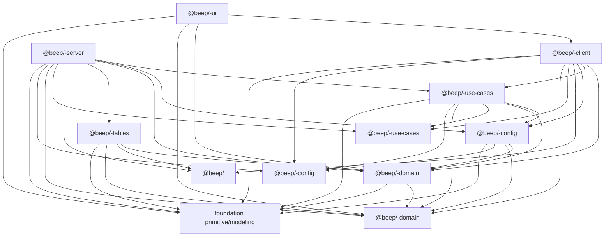
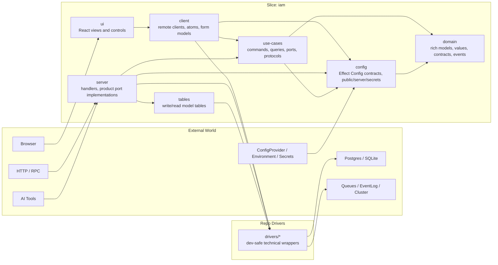
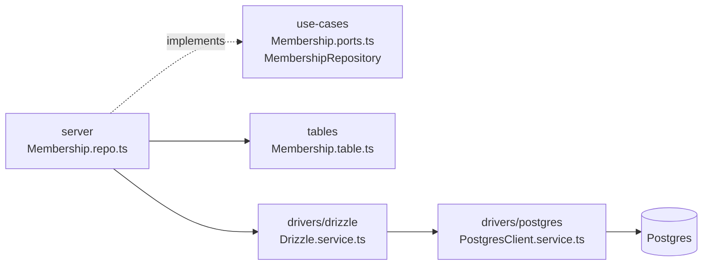
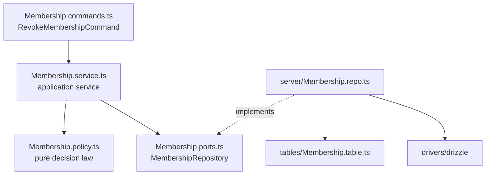
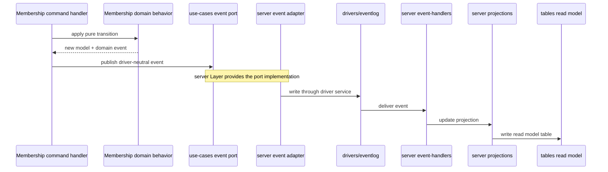
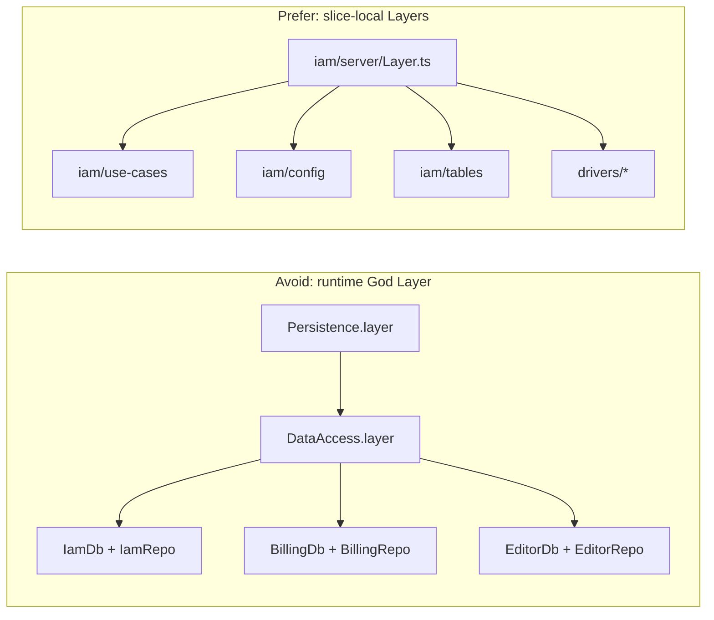

# beep-effect Architecture Standard

This document is the binding architecture constitution for beep-effect. It
defines how slice packages and non-slice families are shaped, where
responsibilities live, and how readers should infer intent from topology. If a
proposed slice, package, adapter, or dependency contradicts this document, the
proposal must change or this document must be amended.

The companion rationale packet lives in
[`standards/architecture/`](architecture/README.md). The companion packet
explains why these rules exist. This file states the rules and teaches the
default way to apply them.

Canonical executable examples live in `packages/architecture-lab/*` with the
`apps/architecture-lab-proof` harness and are covered by tests. Longer
membership snippets in this document are architectural sketches unless they
explicitly reference the architecture lab packages.

## North Star

beep-effect uses a hexagonal vertical slice architecture for product code.

Domain-agnostic reusable substrate, developer-operational packages, and
technical boundary wrappers use explicit non-slice family/kind grammar so they
are as legible as slices instead of becoming generic `common` buckets.

A slice is a bounded context: it owns a language, its data and its invariants,
and its write and reaction model is one `Domain.Model` by default. It ships as
four packages, one per dependency closure: `contract` (what clients and other
contexts import), `model` (the write and reaction model), `host` (server
adapters, stores and cluster classes) and `web` (React). Contexts exchange
versioned integration facts through published streams and call each other only
through contracts. Effect Cluster on Postgres is the first host. See
[Model-First Slice Topology](#model-first-slice-topology). Slices built on the
earlier seven-package shape (domain, use-cases, config, server, client, tables,
ui) stay legal as the legacy shape until their own migration. Technical
wrappers live in the repo-level `drivers` family. The goal is high modularity
without copy-paste drift:
experiments should be easy to create, easy to delete, and still shaped like
production-quality code.

The architecture optimizes for four things:

1. Fast domain experiments that do not create long-term topology debt.
2. Clear driver boundaries so Drizzle, Postgres, browser APIs, queues, and
   other infrastructure do not leak into domain language.
3. Reusable rich domain concepts without turning the repo into one giant shared
   horizontal layer.
4. Reviewable topology where file paths and role suffixes carry enough
   context to keep work consistent.

## How To Use This Standard

Start with the smallest boundary that owns the meaning:

| Task | Default home |
|------|--------------|
| Product behavior or product language | The owning slice: its `contract` and `model` packages. |
| Facts or calls another context needs | The provider's `contract` package: an integration fact or a gateway contract. |
| Product language deliberately shared by multiple slices | `shared/*`, after the shared-kernel promotion gate. |
| External engines, SDKs, services, frameworks, or browser platform wrappers | `drivers/*`. |
| Domain-agnostic reusable substrate owned by this repo | `foundation/*`, after the specific-home-first routing test. |
| Repo-authored libraries published for external consumption | `ecosystem/*`, through the promotion gate in [14-ecosystem-packages.md](architecture/14-ecosystem-packages.md). |
| Law-abiding experimental app proving an uncertain idea | `apps/labs/*`, per [15-lab-apps.md](architecture/15-lab-apps.md). |
| Typed application/runtime configuration contracts | The runtime that reads them: the slice `host` or the app. Legacy slices: the slice or shared `config` package. |
| Product-agnostic UI primitives, themes, tokens, hooks, composition helpers, or repo brand identity | `foundation/ui-system`. |
| Browser/client product state, adapters, or interaction behavior | The slice `web` package. Legacy slices: the slice `client` or `ui` package. |
| App runtime wiring | The app entrypoint or an app-local `src/runtime/Layer.ts` helper. |

Apps are executable workspaces, not reusable package surfaces by default.
Framework apps such as Next.js and Tauri should keep their runtime modules
app-local through `@/*` and should not publish a public `@beep/<app>` TypeScript
API, root `src/index.ts`, package exports, or docgen surface. Runtime proof apps are the explicit exception: they may stay
package-like when the app exists to prove a runtime contract from a public
workspace API.

The `@beep/beep` app is the one repo-operations app. It composes the
`beep` command line from `@beep/beep-<group>` command tools, may depend on any
tooling package, publishes no TypeScript API, and nothing depends on it
(DECISIONS 2026-10-28). Until `goals/beep-cli-composition` completes,
`@beep/repo-cli` still holds that role.

Law-abiding experimental apps live under `apps/labs/*`: they are
production-shaped, durable while useful, and mechanically deletable without
per-app shared-registration edits. They obey
[15-lab-apps.md](architecture/15-lab-apps.md).

The core vocabulary is deliberately small at the entry point: slice (bounded
context), contract, model, host, web, Module, integration fact, adapter,
driver, shared kernel, foundation, Layer, and proof inventory. More specialized terms remain canonical, but use the
[glossary](architecture/GLOSSARY.md) when they first matter instead of loading
the whole vocabulary at once.

## Core Principles

### 1. Slice First

Default to putting product behavior inside the slice that owns the domain
language. Do not create horizontal runtime packages just to gather all similar
layers from every slice.

Effect v4 Layers are memoized by default, so slices can provide their own local
dependencies without building a global "God Layer" that knows every database,
repository, handler, and driver in the system.

### 2. Ports Point Inward, Adapters Point Outward

Domain concepts must not know about drivers. In a model-first slice the model
declares every port it needs (`.external.ts`, `.store.ts`, a consumer port over
another context's gateway), and the host implements them in `.adapter.ts`
files over drivers or other contexts' contracts. In a legacy slice, use-cases
define product ports and boundary contracts and server packages implement them
using tables and drivers. Driver packages expose technical capabilities and
dev-safe wrappers around third-party libraries.

### 3. Shared Is A Shared Kernel

The `shared` package family is the DDD shared kernel. It contains cross-cutting
language that multiple slices deliberately share. It is not a dumping ground for
code that did not fit elsewhere. Domain-agnostic reusable substrate belongs in
`packages/foundation`, not in `shared`.

### 4. Rich Domain, Pure Behavior

Domain models should be richer than value bags. They should model shape,
validation, and pure behavior. Domain behavior may return Effect values for
typed validation and domain failure, but it must not perform infrastructure side
effects.

### 5. Schemas Are Executable Contracts

For pure data models, `Schema` is the source of truth. Rich annotations, codecs,
constructors, defaults, guards, equivalence, documentation metadata, and runtime
decoders should come from the same schema value. Plain `type` aliases and
`interface` declarations may describe compile-time intent, but they cannot prove
unknown runtime data is valid.

Service contracts and type-level-only utility surfaces may stay as TypeScript
types. Domain payloads, wire payloads, persisted rows, and config payloads
should be schema-first whenever `Schema` can represent the shape.

When a schema-modeled shape represents a finite set of variants, lifecycle
states, status/result cases, or case-specific payloads, model it as a
discriminated union. Do not model finite cases as one object with optional or
nullish fields unless an external wire contract requires that shape; in those
cases, decode or normalize the boundary value into an internal tagged model
before case-specific behavior branches.

In a model-first slice the stored formats are the Model's events, state,
receipts, request context and saga payloads, and they follow the
stored-format law: stored bytes are never rewritten and schemas convert on read
(see [Stored Formats Convert On Read](#stored-formats-convert-on-read)).
Tables are projection stores and inbox stores inside a host. The
`ProductEntity` law below governs legacy slices; the entity kit is frozen.

Persisted entities follow the same law. A persisted product entity starts with
`ProductEntity.Entity<Self>()(EntityId)(fields, annotations)` from
`@beep/shared-domain/entity/ProductEntity`. This factory supplies the schema
class constructor, shared audit and identity fields, SQL table name, and shared
indexes from the product-tier kit and the entity id. The entity schema's
decoded side is domain language, and its encoded side is the persistence row shape. Entity fields use normal
Effect Schema optional/nullish codecs
(`S.OptionFromNullOr`, `S.OptionFromOptionalKey`, `S.optionalKey`, and related
variants) instead of bespoke nullable wrappers. Table projection code reads the
Schema AST and rejects persisted selected-row fields whose encoded absence is
optional, `undefined`, or ambiguous; SQL row absence must encode as `null`.

Entity roles stay explicit. `.model.ts` calls the product kit, declares the
schema class and colocates SQL column/index metadata through effect-drizzle.
The product factory appends identity fields after the entity's own fields.
`.values.ts` owns reusable supporting schemas and literal domains. `.behavior.ts` owns pure behavior and derived guards that do
not belong in the persistence declaration.

Drizzle tables are projected, not hand-mapped. Slice/shared `tables` packages
call `toPgTable(EntityModel)` from `@beep/effect-drizzle/pg` and publish only
concrete table metadata for their product language. `@beep/drizzle` owns
execution and transaction capability only. Table packages do not own a second
SQL DSL, live database execution, transactions, repositories, or migrations.

### 6. Topology Is Compressed Context

Readers get the map from mirrored package paths and role suffixes. A
model-first slice uses `<Module>/<Noun>.<kind>.ts`, such as
`Claim/AcceptClaim.command.ts`, `Claim/Claim.aggregate.ts` and
`Claim/ClaimReview.handler.ts`, with generated files checked for drift. Legacy
slices use concept-qualified role module names such as
`Membership.policy.ts`, `Membership.event-handlers.ts`, and
`Membership.command-client.ts`.

Role suffixes are canonical when the role exists. The full vocabulary is not
required for every concept.

### 7. Non-Slice Families Are Explicit

Non-slice artifacts are never `misc`.

- `foundation` owns domain-agnostic reusable substrate
- `drivers` owns flat repo-level technical boundary wrappers
- `tooling` owns developer-operational code packages
- `ecosystem` owns flat publishable libraries authored for external
  consumption; member `src/` and runtime dependency edges are `@beep/*`-free,
  and published-package standards supersede repo style laws inside members
  (see [14-ecosystem-packages.md](architecture/14-ecosystem-packages.md))

Every non-slice artifact declares exactly one family so readers, reviewers, and
tooling can infer the intended boundary before opening the first file. `kind`
is required only for families that intentionally declare a kind segment;
`drivers` and `ecosystem` remain the flat family exceptions.

`packages/_internal/db-admin` is a narrow durable internal exception for
repository-owned database migration aggregation and generated migration SQL.
Product apps and product slice packages must not depend on it; see
[07-non-slice-families.md](architecture/07-non-slice-families.md).

### 8. One Public Origin, One Identity Authority

`beep-effect.com` is the single public origin. Its apex hosts ring-0
projections of the public substrate only, at the reserved Site Routes owned by
`@beep/public-site`; `/ns/` is reserved forever for dereferencing identity
IRIs; services and instances that are not projections (a practice instance,
the proxy, anything authenticated) use subdomains. Hosted URLs come from
`@beep/public-site` (`hostedUrl`, `labRoute`) and IRIs come from
`@beep/identity` composers under the identity authority
`https://beep-effect.com/ns/`; product code outside those two packages never
writes either as a string literal (tests and the law's allowlist excepted),
and `@beep/identity` never depends on `@beep/public-site`.
`bun run beep laws retired-iri-authorities` enforces the rule (see
`standards/architecture/DECISIONS.md`, 2026-10-20).

## Package Dependency Graph

The legal dependency flow is inward toward domain and outward only through
adapters. Arrows point from the importing package to the imported package.
`domain` is the pure core: its only outbound dependencies are shared-kernel
language and allowed foundation packages that stay driver-neutral.

This graph focuses on slice boundaries plus direct driver imports. Driver-to-
driver and driver-to-foundation rules are defined in
[07-non-slice-families.md](architecture/07-non-slice-families.md).



Forbidden by default:

- `domain` depending on anything except shared-kernel language and
  `foundation/primitive` or `foundation/modeling` packages. This excludes slice
  `config`, `@beep/<kernel>-config`, `foundation/capability`,
  `foundation/ui-system`, `Config`, `ConfigProvider`, server, client, tables,
  UI, drivers, and use-cases.
- `use-cases` depending on `server`, `client`, `ui`, `tables`, or concrete
  drivers.
- `config` depending on `use-cases`, `server`, `client`, `ui`, `tables`, or
  concrete drivers.
- `drivers/*` depending on product concepts from any slice or `shared/*`.
- `ui`, `tables`, or `drivers/*` importing slice `config` directly.
- `shared/*` depending on product slices or drivers.
- slice packages importing `packages/tooling/*/*` packages.
- Runtime packages merging all slice layers into one global dependency object.

Client/UI dependency caveats:

- `config --> domain` is one-way. Config may reuse domain schemas, brands, and
  value objects; domain must never import config or read runtime configuration.
- `client` may import `use-cases` only through required client-safe contract
  subpaths such as `@beep/<slice>-use-cases/public` and
  `@beep/<kernel>-use-cases/public`. Those exports may include command/query
  language, driver-neutral boundary contracts, driver-neutral DTOs, actionable
  application errors, and client-safe facade contracts. They must not include
  product ports, server-only service/facade contracts, workflows, process
  managers, schedulers, or live Layer values.
- `client` may import config only through `@beep/<slice>-config/public` and
  `@beep/<kernel>-config/public`. It must not import `/server`, `/secrets`,
  `/layer`, or `/test`.
- `client` may import drivers only through the required browser-safe subpath
  `@beep/<driver>/browser`. Driver package roots are never browser-safe by
  default.
- `use-cases` may import config contracts or services for application tunables.
  Live config resolution helpers belong under config `/layer`; live application
  Layer composition belongs in `server`, `client`, or top-level application
  entrypoint composition that assembles those adapter boundaries.
- `ui` may import `domain` only for driver-neutral schemas, value objects,
  display contracts, and form validation. UI behavior should go through
  `client` services/state instead of calling use-case orchestration directly.
- `shared/domain` and any future `shared/config` package follow the same inward
  rules as slice `domain` and `config`. High-bar shared packages never own
  drivers.
- `shared/tables` may import `@beep/effect-drizzle/pg` for metadata-only table
  projection from shared-kernel entity schemas. This projection dependency
  does not permit live driver capability, query execution, migrations,
  repositories, seeders, or database transactions in shared packages.

## Model-First Slice Topology

A slice is a bounded context: it owns a language, its data and its
invariants. Its write and reaction model is one `Domain.Model` from
`@alchemy.run/domain` by default. A second Model in the same context is allowed
only for an independent event lifecycle or storage placement. How much fits in
an agent's context window is not a boundary test (D2). Decision numbers in this
section cite `explorations/model-first-slices/DECISIONS.md`, the source of
truth for this shape; the dated record is "Slices Are Model-First Bounded
Contexts In Four Packages" (2026-11-18) in `standards/architecture/DECISIONS.md`.

This is the target shape. Every new slice uses it, and no new slice migration
to `@alchemy.run/domain` starts on the seven-package shape (D17). Slices built
on the seven-package shape stay legal as the legacy shape until their own
migration; see [Legacy Seven-Package Slice Topology](#legacy-seven-package-slice-topology).

### Four Packages, One Per Dependency Closure

A package exists for one dependency closure (D3):

```txt
packages/<context>/
  contract/   @beep/<context>-contract   what clients and other contexts import
  model/      @beep/<context>-model      the write and reaction model
  host/       @beep/<context>-host       server adapters, stores, cluster classes
  web/        @beep/<context>-web        React screens over generated bindings
```

`contract`, `model` and `host` exist for every context. `web` exists when the
context has screens. There is no `use-cases`, `tables`, `config`, `client` or
`ui` package in a model-first context:

- `use-cases` dissolves: commands live in the contract, their decisions in the
  model's aggregates, and the library's command dispatch is the execution
  boundary.
- `tables` dissolves: a table is a projection store or an inbox store behind a
  port, implemented in the host.
- `config` dissolves: each runtime owns its configuration in the host or the
  app, and business constants are model values.
- `client` and `ui` become one `web` package over bindings generated from the
  contract (D12).

The contract is the default import for browsers and for other contexts. A
screen that wants `Aggregate.predict` imports the model on purpose, and that
screen is listed (D3). A predicted result is never authorization and never a
write.

### The Contract Package

The contract holds the aggregate-free declarations: ids, commands with their
events and private rejections, shared events and rejections, read contracts for
views and queries, integration facts, gateway contracts and the context's
capabilities. Its client Apis are `Domain.Api` declarations over a catalog
shaped like a Model that holds the context's commands, view read contracts and
queries and no aggregate. The typed nested client survives, and a parity test
asserts that each contract Api's RPC group equals the model Api's group (D9, as
amended in phase 1 of the exploration).

An Api over a catalog is a client contract only; serving it, or calling
`clientInProcess` on it, has no model behind it and fails. The library builds an
Api only from a Model, and `decide` and `evolve` are inline fields of the
aggregate declaration, so the contract declares views and queries a second
time, as read contracts built from shared parts. This lasts until upstream
splits the Api from the model. The upstream target has two parts: a model-free
Api contract, and an aggregate declaration separate from `decide` and
`evolve`, as `toLayer` already separates views, policies and sagas from their
implementations. When that lands, the catalog and the second declarations are
deleted.

### File Grammar

Declarations are `<Module>/<Noun>.<kind>.ts`. A `.handler.ts` beside a
declaration implements a view, policy, saga, projection, query or cluster
class. An `.adapter.ts` in the host implements a port, a gateway or a
middleware's server half over a driver or another context's contract (D10).

- **Folders are Modules.** A Module holds a consistency boundary, a process or
  a read model. The same Module name appears in the contract and the model:
  the contract's `Claim/` holds what a client sends and reads, the model's
  `Claim/` holds the aggregate that decides it. The package line is the
  dependency closure and the Module line is the concept. There are no kind
  folders (`aggregates/`, `commands/`, `events/`) and no subdomain folders.
- **One primary export per file.** Each file has one designated primary
  export, and a checker compares it with the suffix by a rule per kind: most
  kinds name the primary after the noun; an adapter is named for what it
  adapts, and a machine's primary is its `update`.
- **A command is a complete decision record.** A command file holds the
  command, the events it records and the rejections only it returns. An event
  that several commands record gets an `.event.ts`; a rejection that several
  commands share gets a `.rejection.ts`.
- **Generated files are never edited.** `<Context>.handlers.ts` is generated
  from the Model and checked by diff: a hand-kept registry can omit a handler
  while every suffix check passes. Web bindings and the app's cluster entry
  modules are generated the same way.
- **Retired.** `.live.ts`, which names no responsibility and mislabels handlers
  that run unchanged in memory; subdomain folders; kind folders; wildcard
  package exports; `.atoms.ts` and `.view.tsx` as web roles.

Role vocabulary:

| Package | Suffix | Holds |
|---------|--------|-------|
| contract | `.id.ts` | A branded id |
| contract | `.command.ts` | A command; its events and private rejections as companions |
| contract | `.event.ts` | An event several commands record |
| contract | `.rejection.ts` | A rejection several commands share |
| contract | `.read.ts` | A view's or query's read contract |
| contract | `.fact.ts` | A published integration fact and its versions |
| contract | `.gateway.ts` | A service other contexts call |
| contract | `.catalog.ts` | The aggregate-free catalog (until upstream splits the Api) |
| contract | `.capabilities.ts` | The operations a grant can name |
| contract | `.contract.ts` | A client Api over the catalog |
| model | `.aggregate.ts` | State union, `decide`, `evolve`, `reply` |
| model | `.rules.ts` | Pure guards that `decide` starts from |
| model | `.view.ts`, `.stream.ts` | A read model; a stream, published or internal |
| model | `.policy.ts`, `.saga.ts` | A reaction; a process |
| model | `.projection.ts`, `.query.ts` | A store or stream writer; a reader |
| model | `.handler.ts` | The implementation of a view, policy, saga, projection or query |
| model | `.store.ts` | A store port and its memory twin |
| model | `.external.ts` | A `Domain.ExternalSystem` port |
| model | `.api.ts`, `.model.ts` | An Api; the context's Model |
| model | `<Context>.handlers.ts` | The generated handler registry |
| model | `<Context>.ports.ts` | The ports union and the purity assertion |
| host | `.adapter.ts` | A port, a gateway or a middleware's server half |
| host | `.singleton.ts`, `.entity.ts`, `.cron.ts`, `.workflow.ts` | A cluster class |
| host | `.handler.ts` | A cluster class's implementation |
| host | `.inbox.ts`, `.store.ts` | A consumer's inbox; a host-side store port |
| host | `.http.ts`, `.mcp.ts`, `.route.ts` | An HTTP or MCP surface; a host route |
| host | `<Context>.cluster.ts` | What the context runs on a pool: parts and Apis |
| host | `<Context>.descriptor.ts` | The deployment descriptor, as data |
| host | `Adapters.ts`, `Host.ts`, `Config.ts` | Composers; the host runtime's configuration |
| web | `.screen.tsx` | A React screen over bindings or a machine |
| web | `.machine.ts` | Screen state, messages and a pure `update` |
| web | `.controller.ts` | Runs a machine's intents through the bindings |
| web | `<Context>.bindings.ts` | Bindings generated from the contract |
| web | `.runtime.ts` | The atom runtime |
| kernel | `.context.ts`, `.middleware.ts` | Request context and middleware declarations |

### Exact Exports

Every package's `exports` map names each entry point exactly. A wildcard over
`src` (`./*`) is not a boundary in a model-first package, because it makes the
boundary depend on every caller obeying a convention (D10). The source export
map is the truth and the publish mirror is derived from it. Where a package has
a root entry, it is a pure re-export. Import specifiers keep their `.ts`
extensions.

### Legal Imports

| Package | Resolves | Cannot resolve |
|---------|----------|----------------|
| contract | `@alchemy.run/domain`, `effect`, the shared kernel, the contract kit, `foundation/primitive` and `foundation/modeling` | any model, host, aggregate or handler file; drivers |
| model | its own contract, `@alchemy.run/domain`, `effect`, the shared kernel, `foundation/primitive` and `foundation/modeling` | drivers, React, the DOM, Node, any other context |
| host | its own model and contract, other contexts' contracts, drivers, `@alchemy.run/effect-cluster` | React, another context's model or host |
| web | its own contract and generated bindings, React, Effect Atom; its own model only for a listed `Aggregate.predict` screen | any `.handler.ts` or `.adapter.ts`, the host, driver roots |
| app | slice hosts and their deployment descriptors, webs, pools and cloud provider packages | Module-level internals of any context |

Between contexts:

- A context never imports another context's aggregate, private event, view,
  store, handler or model. A stored domain event rebuilds the producer's
  state; letting another context follow it would make every internal
  refactor a public breaking change (D11).
- A context reaches another only through the provider's contract: a
  synchronous call through a port the consumer declares in its model and
  implements in its host over the provider's gateway contract, or an
  asynchronous integration fact read from the provider's published stream
  (see [Between Contexts](#between-contexts)).
- The model declares everything it needs from outside itself as ports. A type
  in `<Context>.ports.ts` fails when a handler requires a service the model
  never declared and names the leaked service. Neither the type nor the
  package manager proves a handler's code is pure (`fetch`, `Date.now` and
  module state leave no Effect requirement), so lint and the independent
  reviewer cover those.

### The Shared Kernel In A Model-First Slice

The shared kernel stays language only (D7, D27): ids, the `Invocation` and
`Provenance` schemas, the pure grant-check language (grant terms, what "covers"
means, the `MissingGrant` rejection), the fact envelope and inbox key, the
request key, the deployment descriptor and stream pin schemas, and the
`Session` middleware declaration. It holds no aggregate, no Model, no Layer and
no credential handling. Model-first contexts do not use `shared/use-cases`:
synchronous contracts live in the provider's contract package.

### Authority

A context named `authority` owns grants, delegation and a general
Accountability relation: every agent-rooted action names an accountable human
(D7, D18, D27). Only authority builds an `Invocation`. Events store
provenance alone: the root, on whose behalf, the causal chain and grant ids,
never grant terms (D4, D24). At each hop a policy or saga asks authority,
through a port it declares, to re-admit the chain from live grants.
Re-admission never adds a grant; it passes those still in force, and a command
that needs a lapsed one is refused and the refusal recorded (D30). A command an
integration fact starts runs under the consuming record's own provenance plus a
hop naming the fact; facts carry no provenance and nobody is re-admitted for
them (D32). Command ids are request keys over the org, the operation and a
request fingerprint, and the org is the same resource scope grants are
checked against (D14, D36). The `audience` annotation, `Actor`, `CurrentActor`
and the kernel's `stamp` and `relay` are retired. Approval is an authenticated
command in the product context, not a workflow signal (D4, D28).

Agent runs belong to a context named `runs`: the `AgentRun` aggregate, the
budget ledger and run lineage (D6, D28). A run gets its authority by
delegation when it is requested (named operations, a resource scope, an
expiry), and a child run narrows it again (D26); the budget lives in the runs
ledger alone (D29). A run is one bounded piece of work, and a session entity
holds a chain of runs (D23). An operating agent calls tools derived from a
contract under a grant; an agent that writes code gets the contract client in
a sandbox (D21). A Reasoner port carries an evaluation contract (D19).

### The Host

Effect Cluster on Postgres is the first host (D5). Each context's host
publishes a deployment descriptor as data, naming its models, its processes and
the fact versions it consumes (D13, D34). The app composes descriptors onto
pools and names no individual model or process, and the cluster entry modules
are generated into the app from the composed descriptors (D40). A slice names
no cloud.

One context calls another through the provider's contract Api over the pool's
own dispatch. Contexts in a pool trust each other, a caller from another pool
presents that pool's gateway token, and a host has no principal of its own;
every call still carries provenance that authority re-admits (D39).

A pool is a host for a model-first context when it meets these guarantees,
each with its bound. The conformance suite proves the first three on the
cluster; the startup refusal of D54 and the frozen-runner case of D55 are
proven in process, and their cluster cases have not run yet:

- No acknowledged write is overwritten: the commit transaction re-reads the
  version and refuses when it moved (D41).
- A runner that lost its shard cannot commit: the commit is fenced on shard
  ownership, identified by a connection pool named for the runner, and a
  runner whose pool is not named fails at start (D45, D49, D54).
- After a runner dies, every reaction happens exactly once within one lease
  plus wake latency: 80 seconds on the present library constants, a 60-second
  lease and two 10-second polls (D42).
- A write sent to a frozen runner completes or fails within the caller's retry
  budget, is never stored twice, and a retry under the same id gets its
  receipt (D55).

Effect Cluster meets them with library fixes that are not yet in an Alchemy
release. Goal work adds those fixes as root patches in `patchedDependencies`
(`goals/effect-cluster-host`), and they come out when a release includes them
(D61).
`@beep/alchemy-postgres` remains until an Alchemy release carries the fixes and
the conformance suite passes on it unpatched (D5, D53). `Domain.InMemory` hosts
stories and tests.

### Between Contexts

Contexts exchange versioned integration facts (D11, D33):

- **Publishing.** The producer declares each fact in its contract
  (`<Module>/<Fact>.fact.ts`), one event class per version. A projection in
  the producer's model reads aggregate events directly, never a versioned
  view, and writes the facts to a `Domain.Stream`. That projection is the
  outbox; no host outbox table or relay exists. The host serves the stream as
  a feed.
- **Consuming.** The consumer keeps an inbox in its host, keyed by producer,
  fact id and version. It translates each fact into its own language and sends
  its own commands under request keys, so a fact delivered twice changes
  nothing.
- **Pins and generations.** A published stream is pinned to its writer, its
  generation and its sources. The projection behind it is never rebuilt in
  place: a checker refuses a version bump of the projection or of anything it
  reads, and a change of its sources, unless the generation is pinned closed and
  a new one opened. A change to a fact is a new fact version or a new stream
  generation. The feed serves closed generations followed by the open one as a
  single log, and positions keep their meaning across generations (D43).
- **Handover.** An upgrade that replaces a publisher waits until the old one
  has published everything pending, read from the host's own records for any
  publisher (D47, D50).
- **Retirement.** A fact version is retired when no deployment descriptor
  consumes it, and a producer's newest version never is (D34, D40). A closed
  generation stops being served only when the next holds every fact it held,
  every consumer in every descriptor has read past it, and positions keep
  their meaning (D51).
- **Synchronous calls** go through a consumer-declared port over the
  provider's gateway contract (D11).

Contexts are named by their language: every name has one meaning inside a
context, and context naming stays with the independent reviewer.

### Stored Formats Convert On Read

Stored bytes are never rewritten (D22). Payload conversion on read handles
added defaults, removals, renames and compatible type changes; an incompatible
change is one declared read-time transform per version step. A new event tag is
for a new fact only. The law covers every stored format: events, aggregate
state, receipts, request context and saga payloads. Saga activity results are
part of it: a compatible change converts on read, an incompatible change is a
new saga version, and runs in flight finish on the version they started (D35).
Frozen old-format fixtures and replay equivalence prove each change. A rebuild
or replay suppresses side effects, and a projection sink takes the source
position and generation (D14).

Every stored field has a retention class. Content that may have to be erased
(names, document text, evidence excerpts) lives in a store behind a port, and
erasure leaves a tombstone; events are never rewritten for it. An agent's reads
of privileged material are recorded, and untrusted content carries a trust
label that limits which actions it can influence (D14). These rules are decided
and have no checker yet.

### Web

React stays. An ordinary screen is one `.screen.tsx` over bindings generated
from the contract: view subscriptions, command atoms with ids and typed
rejections, read-after-write and reconnect. A screen with real interaction law
adds a `.machine.ts` with a pure `update`, a `.controller.ts` and a story. Every
machine correlates on command id, receipt and view revision (D12).

### Proof Inventory

Each invariant of a context is listed in a generated proof inventory with its
checker, the inputs the checker reads, its assumptions, its known gaps and its
evidence. The inventory is rendered from data and a check fails on drift (D8).

- Mechanical laws run in every check: `Domain.verify` on each Model, the
  primary-export rule, import-graph walks of the contract and web closures,
  the port purity type, handler-registry drift, contract parity, stream pins
  and stored-format fixtures. The model, host and app import rows are held by
  the package manifests. The cluster entries run as the conformance suite
  against a deployed stack.
- Story coverage counts executed outcomes: every declared command outcome must
  execute in some story or test. A rejection tag found in a file does not count.
  A story fails on any event, rejection or external call it does not account
  for.
- The Effect language-service rules run in every check with nothing switched
  off.
- Semantic questions go to a reviewer that did not write the change: whether
  each context, aggregate and command names a thing the business recognises
  and belongs where it was put; whether each capability is the narrowest that
  does the job and each delegation narrows; whether a fact should be public and
  each of its fields belongs in what other contexts may depend on; what a
  stored field may retain. A person decides only where that reviewer and the
  author disagree.

### Scaffolding And Checks

`bun run beep architecture` will generate a four-package context through
`bun run beep create-package`, which stays the only package bootstrap, once
`goals/model-first-standard` retargets it (P1 step 2); until then it emits only
the legacy shape and is not used for a new context. The
shell `create-package` emits is the package skeleton law, and every package
with tests type-checks its test tree. Checkers for role suffix and placement,
exact exports and imports between contexts start from a day-one baseline of the
legacy slices' violations and only ratchet down; a slice leaves the baseline
with its own migration (D17). A syntactic check is a Biome GritQL rule; a check
that needs the import graph, the file system or generation lives in the repo
CLI.

## Legacy Seven-Package Slice Topology

> **Legacy shape.** This section and the seven-package sections it governs
> ([Boundary-Sensitive Export Contracts](#boundary-sensitive-export-contracts),
> [Canonical Concept Topology](#canonical-concept-topology),
> [Domain-Kind Folders](#domain-kind-folders), [Role Suffixes](#role-suffixes),
> [Responsibility Boundaries](#responsibility-boundaries) and
> [Event-Sourced Slices On `@alchemy.run/domain`](#event-sourced-slices-on-alchemyrundomain))
> describe slices built before the model-first shape. They stay legal until
> each slice's own migration and bind edits to those slices. New slices use
> [Model-First Slice Topology](#model-first-slice-topology), and no new slice
> migration to `@alchemy.run/domain` starts on this shape.

Every legacy product slice uses the same package family unless a package
genuinely has no role in that slice.

```txt
packages/<slice>/
  domain/
  use-cases/
  config/
  server/
  client/
  tables/
  ui/
```

The package names follow the public package convention:

```txt
@beep/<slice>-domain
@beep/<slice>-use-cases
@beep/<slice>-config
@beep/<slice>-server
@beep/<slice>-client
@beep/<slice>-tables
@beep/<slice>-ui
```

The canonical spine is vocabulary, not a scaffold mandate. Create the smallest
real package set that carries current behavior. A new package needs both:

- a concrete architecture role
- meaningful exported behavior, contract, adapter, config surface, or test
  fixture

Do not create packages only for symmetry. Future generators should default to
minimal packages and add optional packages only through explicit flags or
prompts.

`config` is optional canonical-shape. Create it only when a slice has meaningful
configuration contracts. The canonical shared package names are names for roles
when those packages exist: `@beep/<kernel>-domain`, `@beep/<kernel>-config`, and
high-bar `@beep/<kernel>-use-cases`. `env` package naming is legacy
source-specific vocabulary, not a slice package kind. Environment variables are
one possible `ConfigProvider` source for config declarations.

`shared` is the canonical cross-slice slice with a reduced spine:

```txt
packages/<kernel>/
  domain/
  config/   # create only after real shared config contracts exist
  use-cases/ # create only after high-bar contract promotion
  client/   # create only after high-bar contract promotion
  server/   # create only after high-bar contract promotion
  tables/   # high bar only
  ui/       # create only after high-bar contract promotion
```

`shared/domain` is the active normal home today; `shared/config` is a reserved
normal role for real cross-slice config contracts. `shared/client`,
`shared/server`, and `shared/ui` do not exist yet. They are reserved high-bar
exceptions, created only when real exported behavior clears the promotion bar.
`shared/use-cases` now exists as a contract-only exception whose first promoted
surface is the tenant-bound `PromotionGate`.

The `shared/use-cases` package is contract-only: deliberate
cross-slice commands, queries, driver-neutral DTOs, driver-neutral boundary
contracts, client-safe application errors, facade interfaces, and ultra-high-bar
product ports are allowed. A shared product port must prove why a shared
command, query, event, or facade contract is insufficient. It never owns
workflows, process managers, schedulers, handlers, concrete adapters, driver
imports, or live Layer values. `shared` never owns drivers or generic substrate.

Meaningful exports in high-bar `shared/*` packages require a promotion record in
that package's README before or alongside the export. The record must include:

- the shared product semantics being accepted
- the current consumers or explicit cross-slice rationale
- the exported surface being promoted
- rejected homes, especially the owning slice and `foundation`
- runtime, adapter, driver, and Layer limits
- contract-only proof for `shared/use-cases`
- review evidence for the deliberate coupling

`standards/architecture/DECISIONS.md` records architecture-wide policy changes.
It does not replace package-level promotion records.

Technical wrappers live in the flat repo-level drivers family:

```txt
packages/drivers/<name> -> @beep/<name>
```

New packages should follow this target layout immediately.

## Boundary-Sensitive Export Contracts

> **Legacy shape.** This section governs legacy seven-package slices. Model-first
> slices follow [Model-First Slice Topology](#model-first-slice-topology).

This standard is target-first. Boundary-sensitive package roots and `./*`
wildcard exports may remain during migration for compatibility, but explicit
subpaths are the only canonical boundary contract in new examples and new
package guidance.

`use-cases` publishes explicit boundary subpaths:

```txt
@beep/<slice>-use-cases/public
@beep/<slice>-use-cases/server
@beep/<slice>-use-cases/test
```

When it exists, `@beep/<kernel>-use-cases` follows the same contract.

- `/public` is client-safe: commands, queries, driver-neutral DTOs, boundary
  contracts, public action errors, and client-safe facade interfaces.
- `/server` is the server-only application contract surface, including product
  ports, server-only service or facade contracts, and slice-local
  workflow/process/scheduler contracts when that slice uses them.
- `/test` is for use-case test helpers and fixtures.

`config` publishes explicit boundary subpaths:

```txt
@beep/<slice>-config/public
@beep/<slice>-config/server
@beep/<slice>-config/secrets
@beep/<slice>-config/layer
@beep/<slice>-config/test
```

`@beep/<kernel>-config` follows the same contract.

- `/public` is the only browser/client-safe config surface.
- `/server`, `/secrets`, and `/test` are server/test-only.
- `/layer` remains canonical, but it is server/runtime-only config resolution
  surface rather than a browser-safe API.

Driver browser safety is also explicit: if a driver exposes a browser-safe
surface, it must do so from `@beep/<driver>/browser`. The package root is never
browser-safe by default.

Canonical subpath names are required names when that role exists. They are not a
requirement to publish placeholder exports from packages that do not need that
role.

## Non-Slice Family Grammar

Not every important artifact is a product slice. Non-slice artifacts use
explicit family and, when applicable, kind grammar so topology still compresses
context.

The canonical non-slice families are:

| Family       | Canonical kinds                                         | Purpose                                                  |
|--------------|---------------------------------------------------------|----------------------------------------------------------|
| `foundation` | `primitive`, `modeling`, `capability`, `ui-system`      | Repo-owned domain-agnostic reusable substrate.           |
| `drivers`    | flat family; no extra kind segment                      | External engines, SDKs, services, and frameworks.        |
| `tooling`    | `library`, `tool`, `policy-pack`, `test-kit`, `infra`   | Developer-operational code packages.                     |
| `ecosystem`  | flat family; no extra kind segment                      | Publishable repo-authored libraries for external consumption. |

The `shared` package family is not part of this table. `shared` remains the DDD
shared kernel and canonical cross-slice slice. `foundation` is not a rename of
the shared kernel. `drivers` are not candidates for `shared`.

Route specific homes before reaching for `foundation/capability`:

1. Product semantics go to the owning slice or `shared/*`.
2. External engines, SDKs, services, frameworks, and browser platform wrappers
   go to `drivers`.
3. Repo operations, generators, policy packs, and automation go to `tooling`.
4. Product-agnostic UI primitives, themes, tokens, hooks, composition
   helpers, and repo brand identity go to `foundation/ui-system`.
5. Only remaining repo-owned, domain-agnostic technical services may go to
   `foundation/capability`.

`foundation/capability` is accepted only after a negative gate plus proof:

- it carries no product semantics
- it does not wrap an external engine, third-party SDK, service, framework, or
  browser platform API
- it is not repo-operational tooling
- it is not a UI primitive, design-system role, or React ergonomics layer
- it has multiple real consumers or an explicit platform-capability rationale

Reusable shape alone is not enough. A service or Layer does not belong in
`foundation/capability` merely because it is technical.

Browser/runtime capability routing is platform-first:

| Concern | Home |
|---------|------|
| Low-level browser platform wrapper | `drivers/*` with `@beep/<driver>/browser` |
| Product-agnostic React hook or component over a browser capability | `foundation/ui-system` |
| Product-specific browser behavior or state | Slice `client` or `ui` |
| Rare runtime-neutral repo-owned technical service | `foundation/capability`, only after the capability gate |

Driver package roots are not browser-safe by default. Foundation package roots
must be runtime-neutral or browser-safe by contract; any environment-specific
foundation surface needs an explicit environment entrypoint.

### Canonical Roots And Names

The canonical roots are:

```txt
packages/foundation/<kind>/<name>
packages/drivers/<name>
packages/tooling/<kind>/<name>
packages/ecosystem/<name>
```

These roots sit beside slice roots such as `packages/iam/*` and the shared
cross-slice root `packages/<kernel>/*`.

Public package names follow the family role:

```txt
foundation -> @beep/<purpose>
drivers    -> @beep/<driver>
tooling    -> @beep/repo-<purpose> (libraries, policy packs, test kits)
tooling    -> @beep/beep-<group> (command tools composed by @beep/beep)
ecosystem  -> @beep/<name> (the npm name; workspace name = published name)
```

Ten tooling packages that predate the `beep-` rule keep their names as
recorded exceptions (DECISIONS 2026-10-28), among them `@beep/test-utils`
below. New tooling names follow the rule.

Examples:

```txt
packages/foundation/modeling/schema       -> @beep/schema
packages/foundation/modeling/identity     -> @beep/identity
packages/foundation/ui-system/ui          -> @beep/ui
packages/drivers/drizzle                  -> @beep/drizzle
packages/drivers/postgres                 -> @beep/postgres
packages/tooling/tool/cli                 -> @beep/repo-cli
packages/tooling/library/repo-utils       -> @beep/repo-utils
packages/tooling/policy-pack/repo-configs -> @beep/repo-configs
packages/tooling/test-kit/test-utils      -> @beep/test-utils
packages/ecosystem/effect-drizzle         -> @beep/effect-drizzle
```

A shared UI primitives library such as `@beep/ui` is a
`foundation/ui-system` package. It is not a product slice and not shared-kernel
domain language. A Drizzle wrapper such as `@beep/drizzle` is a `drivers`
package. It is not a slice kind and not shared-kernel language.

### Required Metadata

Every non-slice artifact declares machine-readable family metadata. `kind` is
required for `foundation` and `tooling`. `drivers` and `ecosystem` are the
explicit flat-family exceptions and omit `kind`.

Code packages record it in `package.json`:

```json
{
  "name": "@beep/schema",
  "beep": {
    "family": "foundation",
    "kind": "modeling"
  }
}
```

```json
{
  "name": "@beep/effect-drizzle",
  "beep": {
    "family": "ecosystem"
  }
}
```

```json
{
  "name": "@beep/drizzle",
  "beep": {
    "family": "drivers"
  }
}
```

Path and metadata must agree. Repo tooling, doc generation, and future boundary
checks treat this metadata as the source of truth instead of guessing from
directory names alone.

### Family And Kind Dependency Rules

`foundation` is layered:

| Kind           | May depend on                                                  |
|----------------|----------------------------------------------------------------|
| `primitive`    | `foundation/primitive`                                         |
| `modeling`     | `foundation/primitive`, `foundation/modeling`                  |
| `capability`   | `primitive`, `modeling`, `capability`                          |
| `ui-system`    | `primitive`, `modeling`, `ui-system`, `drivers` (narrow; below) |

`ui-system` is a side branch, not a top layer. It does not depend on
`foundation/capability` by default.

The `ui-system` → `drivers` edge is narrow (ratified 2026-07-14; see
`standards/architecture/DECISIONS.md`): a ui-system package may import a
driver's browser-safe pure root (pure helpers, schemas, service tags) and may
default a driver's browser-safe `/browser` layer as an overridable dependency
injection default. A ui-system package must never import or compose a
driver's server-only or secret-bearing surfaces, and must keep every live
layer overridable by the consuming app.

`drivers` is intentionally flat:

- drivers may depend on `foundation/primitive`, `foundation/modeling`, and
  `foundation/capability`
- drivers may depend on other drivers when the dependency stays acyclic and the
  boundary remains product-neutral
- drivers do not depend on `shared/*`, product slices, or `packages/tooling/*/*`
- if the repo increasingly owns the implementation as reusable substrate, move
  it to `foundation` instead of keeping it in `drivers`

These rules are dependency ceilings, not permission for cycles.

`tooling` is operational code:

| Kind          | May depend on                                                                  |
|---------------|--------------------------------------------------------------------------------|
| `library`     | any `foundation` kind, `tooling/library`                                       |
| `policy-pack` | any `foundation` kind, `tooling/library`                                       |
| `tool`        | any `foundation` kind, `tooling/library`, `tooling/policy-pack`                |
| `test-kit`    | any `foundation` kind, `tooling/library`, `tooling/policy-pack`, `test-kit`    |
| `infra`       | any `foundation` kind, `drivers`, `tooling/library`; nothing depends on `infra` |

Repo-wide orchestration is behavior inside `tool`. It is not a separate
canonical kind. Tools never import other tools; code that two tools share
moves into a `tooling/library` package. The `beep` command line is composed
from command tools by the `@beep/beep` app, which is an app, not a tooling kind.

Tooling packages may depend on a driver only for a narrowly scoped operational
adapter: repository analytics, code generation, migration, fixture, or CLI work
that needs a product-neutral external engine. The tooling package must declare
the driver dependency and project reference directly, keep product semantics out
of the driver, and keep reusable runtime substrate in `foundation` instead of
using tooling as a backdoor dependency root.

`ecosystem` inverts the polarity instead of layering:

- member `src/` and runtime manifest edges (`dependencies`,
  `peerDependencies`) carry no `@beep/*` dependency at all — not even
  `foundation`; runtime dependencies are peers on the member's host libraries
- member tests and `devDependencies` may use any repo package (test kits,
  harnesses, fixtures)
- any repo package that could legally depend on the member's published npm
  artifact may depend on the workspace member the same way; the member is
  consumed in-repo like an external library
- the family charter, artifact policy, and gate profile live in
  [14-ecosystem-packages.md](architecture/14-ecosystem-packages.md)

### Slice Consumption Rules

A model-first slice follows [Legal Imports](#legal-imports): each of its four
packages has one closure, and contexts reach each other only through the
provider's contract. The rules below govern legacy seven-package slices and the
family ceilings that hold for both shapes.

Slices and the shared kernel may consume `foundation`, but only in boundary-
appropriate ways:

- `domain` and `shared/domain` may import only `foundation/primitive` and
  `foundation/modeling`.
- `use-cases`, `config`, `server`, and `tables` may also import
  `foundation/capability` when needed.
- `client`, `ui`, and high-bar shared adapters may import browser-safe
  `foundation/ui-system` packages and browser-safe `primitive`/`modeling`
  packages.
- `server` and `tables` may import drivers directly.
- `client` may import only browser-safe driver entrypoints exposed from the
  canonical subpath name `@beep/<driver>/browser`.
- `domain`, `use-cases`, `config`, `ui`, and all `shared/*` packages do not
  import drivers.
- Slice-to-slice direct imports across `domain`, `use-cases`, `server`,
  `tables`, `client`, or `ui` packages of *different* slices are forbidden.
  Cross-slice integration goes through emitted events or, if a real contract has
  been promoted, the `shared/use-cases` package. This is the same family
  of acyclic ceiling that drivers respect among themselves, applied to slices.
- Product slices and shared-kernel packages do not depend on
  `packages/tooling/*/*`.
- `foundation`, `drivers`, `tooling`, and `ecosystem` do not depend on product
  slices or the shared kernel; `ecosystem` member `src/` additionally depends
  on no `@beep/*` package at all.

### Canonical File-Role Anchors

Non-slice file roles are smaller than slice role vocabularies but still
canonical:

| Family/kind                | Canonical anchors                                                                 |
|----------------------------|-----------------------------------------------------------------------------------|
| `foundation/primitive`     | flat modules plus `index.ts`; optional environment entrypoints such as `*.browser.ts` |
| `foundation/modeling`      | concept modules with `*.schema.ts`, `*.brand.ts`, `*.codec.ts`, `index.ts`; package-specific role files when canonized |
| `foundation/capability`    | `*.service.ts`, `*.layer.ts`, `*.schema.ts`, `*.errors.ts`, optional `*.client.ts` |
| `foundation/ui-system`     | `components/`, `themes/`, `styles/`, `hooks/`, `assets/`, `index.ts`             |
| `drivers`                  | `*.service.ts`, `*.layer.ts`, `*.errors.ts`, `*.config.ts`, optional `*.browser.ts`, `*.test-layer.ts` |
| `tooling/library`          | library modules plus `index.ts`                                                   |
| `tooling/tool`             | `src/bin.ts` (optional when `@beep/beep` composes the tool), `commands/`, `*.command.ts`, `*.service.ts`, `*.schemas.ts`, `index.ts` |
| `tooling/policy-pack`      | `*.config.ts`, `*.policy.ts`, `index.ts`                                          |
| `tooling/test-kit`         | `*.test-kit.ts`, optional `fixtures/`, `layers/`, `index.ts`                     |
| `tooling/infra`            | `alchemy.run.ts` at the package root, stack modules under `src/`, `index.ts`      |

Repo CLI commands use thresholded role topology. Single-file leaf commands may
stay flat while they have no schemas, service, renderers, or subcommands.
Command groups and role-bearing commands live in `commands/<Group>/` with
`<Group>.command.ts` for flags and the `Command` tree, `<Group>.schemas.ts`
for command data, `<Group>.errors.ts` for the command-boundary tagged error,
`<Group>.service.ts` for the `Context.Service` contract and default live layer,
and `index.ts` as the curated public facade. Use earned semantic roles such as
`<Group>.render.ts`, `<Group>.progress.ts`, `<Group>.media.ts`, or
`<Group>.plan.ts`; reserve `<Group>.config.ts` for runtime/config-provider
backed settings and `<Group>.layer.ts` for non-trivial layer variants.
Each command tool exposes its package root and explicit `/commands/<Group>`
facades only; deep role files are private, and package-local tests use
source-only `/test/<Group>` aliases rather than package exports. Until
`goals/beep-cli-composition` completes, every command group still lives in
`@beep/repo-cli`, so today those surfaces are
`@beep/repo-cli/commands/<Group>` and `@beep/repo-cli/test/<Group>`.

`@beep/schema` uses namespace-first schema concept modules. Reusable schema
concepts publish flat public subpaths such as `@beep/schema/Color`,
`@beep/schema/HttpHeaders`, and `@beep/schema/HttpProtocol`.
Consumers import the concept namespace and use concise role members:

```ts
import * as Color from "@beep/schema/Color"
import * as HttpProtocol from "@beep/schema/HttpProtocol"

Color.HexColor
Color.HexToRgb
HttpProtocol.Schema
```

The package root `@beep/schema` remains a curated flat facade for convenience
and migration compatibility. It is not the canonical home for full concept
namespaces. Concept role files live under `src/<Concept>/` and use small,
reviewable role suffixes:

```txt
src/Color/
  Color.adjust.ts
  Color.hex.ts
  Color.oklch.ts
  Color.rgb.ts
  Color.scale.ts
  Color.shared.ts
  Color.transforms.ts
  Color.ts
  index.ts
```

Only `@beep/schema/<Concept>` is public for concept modules. Role files are
source topology, not public import paths. Former topical suites are represented
by PascalCase leaf concept modules and flat exact public subpaths. Lowercase
topical source and public paths such as `src/color/`, `src/http/`,
@beep/schema/color, and @beep/schema/http/headers are retired topology, not
compatibility surfaces. Suite aggregate modules such as
@beep/schema/Blockchain, @beep/schema/Dom, @beep/schema/Http,
@beep/schema/Location, and @beep/schema/Person are retired; import leaf
concept modules such as `@beep/schema/EvmAddress`,
`@beep/schema/DomReactNode`, and `@beep/schema/HttpHeaders` instead. `Csv` is a
same-concept schema module and does not re-export sibling CSV parser,
formatter, option, or error modules. Retired acronym casing aliases such as
@beep/schema/ExpectCT and @beep/schema/XSSProtection are not public exports;
use the canonical concept casing (`ExpectCt`, `XssProtection`). `SchemaUtils`
and similar utility namespaces may expose helper leaves when the helper itself
is the public concept, for example `@beep/schema/SchemaUtils/collectAnnotationsAt`.

Core schema role suffixes are `.schema.ts`, `.input.ts`, `.transforms.ts`,
`.constructors.ts`, `.guards.ts`, `.errors.ts`, and `.types.ts`. Earned
semantic roles are allowed when they are clearer than forcing the core set,
such as parser, formatter, SQL projection, or color-conversion roles.

Inside a concept namespace, concise role names are canonical: `Schema`,
`Input`, `FromInput`, `Object`, and `Unit`. Legacy full names such as
`HttpProtocol.HttpProtocol` may remain as aliases of `HttpProtocol.Schema`
during migration.
Prefer promoted source concepts over per-symbol modules: `Color` is one
concept module even though it exports many color schemas and conversions.
Package-local tests may use source-only test seams such as
`@beep/schema/test/Markdown`; parser internals
under `src/internal/` are not public package subpaths. `bun run beep lint
schema-topology` enforces the retired lowercase topology, retired suite
aggregators, private role-file exports, promoted concept folder exports,
private parser seams, and generated root alias drift.

`foundation/modeling` is upstream-first. Where upstream covers a
`foundation/modeling` concept's intent, its covered facets retire in the same
PR that migrates their consumers, with no alias; the whole concept retires
unless the lines reading its uncovered members outnumber the lines using its
covered facets (ADAPT, per the facet census). A new concept is not added where
upstream already covers it (`standards/architecture/DECISIONS.md`
"Upstream-First Foundation/Modeling").
Named internal literal domains use `LiteralKit`; anonymous inline unions never
referenced by name use `S.Literals`.

Script-only pseudo-packages are not canonical. If an artifact matters enough to
name in the architecture, it should have a real family/kind contract and a real
entrypoint surface.

## Hexagonal Slice

Each slice has a domain core, an application ring, and adapter packages around
the outside.

This diagram shows runtime request/data flow, not import direction. The package
dependency graph above is the source of truth for legal imports.



## Canonical Concept Topology

> **Legacy shape.** This section governs legacy seven-package slices. Model-first
> slices follow [Model-First Slice Topology](#model-first-slice-topology).

The default concept topology mirrors the domain spine across packages.

```txt
packages/iam/
  domain/src/
    aggregates/
      Enrollment/
        Enrollment.model.ts
        Enrollment.events.ts
        Enrollment.policy.ts
    entities/
      Membership/
        index.ts
        Membership.model.ts
        Membership.values.ts
        Membership.errors.ts
        Membership.behavior.ts
        Membership.policy.ts
        Membership.access.ts
        Membership.contracts.ts
        Membership.events.ts
        Membership.machine.ts
    values/
      LocalDate/
        LocalDate.model.ts
        LocalDate.behavior.ts
    Events.ts

  use-cases/src/
    entities/
      Membership/
        Membership.commands.ts
        Membership.queries.ts
        Membership.access.ts
        Membership.ports.ts
        Membership.service.ts
        Membership.errors.ts
        Membership.http.ts
        Membership.rpc.ts
        Membership.tools.ts
        Membership.cluster.ts
        Membership.workflows.ts
        Membership.processes.ts
    Api.ts
    Rpc.ts
    Tools.ts
    Cluster.ts

  config/src/
    entities/
      Membership/
        Membership.config.ts
    Config.ts
    PublicConfig.ts
    ServerConfig.ts
    Secrets.ts
    Layer.ts
    TestLayer.ts

  server/src/
    entities/
      Membership/
        Membership.repo.ts
        Membership.http-handlers.ts
        Membership.rpc-handlers.ts
        Membership.tool-handlers.ts
        Membership.event-handlers.ts
        Membership.cluster-handlers.ts
        Membership.workflow-handlers.ts
        Membership.projections.ts
        Membership.layer.ts
    Api.ts
    Rpc.ts
    Tools.ts
    Events.ts
    Cluster.ts
    Layer.ts

  tables/src/
    entities/
      Membership/
        Membership.table.ts
        Membership.read-model-table.ts
    Tables.ts
    ReadModels.ts

  client/src/
    entities/
      Membership/
        Membership.command-client.ts
        Membership.query-client.ts
        Membership.service.ts
        Membership.atoms.ts
        Membership.form-model.ts
        Membership.machine.ts
        Membership.layer.ts

  ui/src/
    entities/
      Membership/
        Membership.form.tsx
        Membership.fields.tsx
        Membership.table.tsx
        Membership.list.tsx
        Membership.detail.tsx
        Membership.admin.tsx

packages/drivers/
  postgres/src/
    PostgresClient.service.ts
    PostgresClient.layer.ts
    Postgres.errors.ts
    Postgres.config.ts
    PostgresClient.test-layer.ts
  drizzle/src/
    Drizzle.service.ts
    Drizzle.layer.ts
    Drizzle.errors.ts
    Drizzle.config.ts
    Drizzle.test-layer.ts
```

This topology is a vocabulary, not a requirement to create empty files. A
concept only owns the role files that its behavior actually needs.

## Domain-Kind Folders

> **Legacy shape.** This section governs legacy seven-package slices. Model-first
> slices follow [Model-First Slice Topology](#model-first-slice-topology).

Domain package folders classify the kind of domain concept:

| Folder        | Meaning                                                                                                                      |
|---------------|------------------------------------------------------------------------------------------------------------------------------|
| `aggregates/` | Aggregate roots and consistency boundaries. Use when lifecycle and invariants span multiple child entities or values.        |
| `entities/`   | Identity-bearing concepts that are not aggregate roots, or simple aggregate-like concepts whose boundary is only themselves. |
| `values/`     | Value objects with no identity. Prefer local concept values first; promote to `values/` only when reused.                    |
| `policies/`   | Escape hatch for slice-wide or cross-concept pure policies. Not the default.                                                 |
| `services/`   | Rare pure DDD domain services. Not application services, not Effect service ports.                                           |

Aggregates are first-class. Do not hide aggregate roots in `entities/` when the
concept is really a consistency boundary.

## Role Suffixes

> **Legacy shape.** This section governs legacy seven-package slices. Model-first
> slices follow the role vocabulary in [File Grammar](#file-grammar).

Role suffixes are the filename vocabulary that tells readers what a
module is allowed to do.

The grammar is:

```txt
<package>/src/<domain-kind>/<Concept>/<Concept>.<role>.ts
```

For React UI files:

```txt
<package>/src/<domain-kind>/<Concept>/<Concept>.<role>.tsx
```

Multi-word roles use hyphenated suffixes:

```txt
Membership.event-handlers.ts
Membership.command-client.ts
Membership.read-model-table.ts
```

Package-level composers use PascalCase:

```txt
Api.ts
Model.ts
Rpc.ts
Tools.ts
Events.ts
Cluster.ts
Layer.ts
Tables.ts
ReadModels.ts
Config.ts
PublicConfig.ts
ServerConfig.ts
Secrets.ts
TestLayer.ts
```

### Domain Role Vocabulary

| Role            | Meaning                                                          |
|-----------------|------------------------------------------------------------------|
| `.model.ts`     | Schema-first model, identity, constructors, simple rich methods. |
| `.values.ts`    | Concept-local value objects.                                     |
| `.errors.ts`    | Actionable domain failures callers may branch on.                |
| `.behavior.ts`  | Pure behavior too large or visible for the model file.           |
| `.policy.ts`    | Pure domain decision law.                                        |
| `.access.ts`    | Pure permission/action/resource vocabulary.                      |
| `.contracts.ts` | Driver-neutral DTOs shared by domain and use-cases.              |
| `.events.ts`    | Domain events and event groups.                                  |
| `.machine.ts`   | Pure lifecycle state machine.                                    |
| `.command.ts`   | `Domain.Command` with the events and rejections it declares.     |
| `.aggregate.ts` | `Domain.Aggregate`: state, `decide`, `evolve`, `reply`, `read`.  |
| `.view.ts`      | `Domain.View`: a pure fold with `validate` as its boundary.      |
| `.stream.ts`    | `Domain.Stream`: a per-key log clients read.                     |
| `.external.ts`  | `Domain.ExternalSystem` contract (operations and schemas only).  |
| `.context.ts`   | `Domain.RequestContext` a middleware provides.                   |
| `.middleware.ts`| Middleware declaration (`RpcMiddleware.Service`) and its error.  |
| `.rejection.ts` | A `Domain.Rejection` shared by several commands.                 |

Domain role files never define handlers, clients, transports, runtimes,
persistence, or driver access.

### Use-Case Role Vocabulary

| Role            | Meaning                                                                             |
|-----------------|-------------------------------------------------------------------------------------|
| `.commands.ts`  | Application command envelopes and command language.                                 |
| `.queries.ts`   | Application query envelopes and query language.                                     |
| `.access.ts`    | Effectful authorization over domain access vocabulary.                              |
| `.ports.ts`     | Product ports needed by use-cases.                                                  |
| `.service.ts`   | Application service contract/orchestration facade.                                  |
| `.errors.ts`    | Actionable application failures.                                                    |
| `.http.ts`      | Driver-neutral HttpApi endpoint/group declarations.                                 |
| `.rpc.ts`       | Driver-neutral Rpc/RpcGroup declarations.                                           |
| `.tools.ts`     | Driver-neutral AI tool/toolkit declarations.                                        |
| `.cluster.ts`   | Driver-neutral cluster entity protocol definitions.                                 |
| `.workflows.ts` | Durable workflow declarations or application workflow contracts.                    |
| `.processes.ts` | Process managers/sagas coordinating multiple commands, events, ports, or workflows. |
| `.schedulers.ts` | Scheduler contracts or schedule declarations coordinating time-based work.          |
| `.policy.ts`    | `Domain.Policy` reaction declaration (what it listens to; no handler).              |
| `.saga.ts`      | `Domain.Saga` declaration (key, input, rejections; no handler).                      |
| `.projection.ts`| `Domain.Projection` declaration (sources, key, events; no handler).                 |

Use-cases publish explicit boundary subpaths:

- `@beep/<slice>-use-cases/public` for client-safe commands, queries,
  driver-neutral DTOs, driver-neutral boundary contracts, actionable
  application errors, and client-safe facade interfaces
- `@beep/<slice>-use-cases/server` for server-only application contracts,
  including product ports, server-only service/facade contracts, and slice-local
  workflow/process/scheduler contracts when present
- `@beep/<slice>-use-cases/test` for test helpers and fixtures

Canonical subpath names are required names when that role exists, not a requirement
to add placeholder exports. Package roots and `./*` exports may remain during
migration, but they are not the canonical boundary contract.

The high-bar `shared/use-cases` package follows the same
`/public`, `/server`, and `/test` contract. It is narrower than slice
`use-cases`: only commands, queries, driver-neutral DTOs, driver-neutral boundary
contracts, client-safe application errors, facade interfaces, and ultra-high-bar
product ports are allowed. Product ports require proof that a
command/query/event/facade contract would not preserve the intended boundary. It
never owns workflows, process managers, schedulers, handlers, concrete adapters,
driver imports, or live Layer values.

### Config Role Vocabulary

| Role              | Meaning                                                                                 |
|-------------------|-----------------------------------------------------------------------------------------|
| `.config.ts`      | Concept-owned Effect `Config` declarations, typed config models, and config vocabulary. |
| `Config.ts`       | Package-level config composer for shared slice config contracts.                        |
| `PublicConfig.ts` | Browser-safe config contracts and services that client packages may import.             |
| `ServerConfig.ts` | Server-only config contracts and services.                                              |
| `Secrets.ts`      | Secret config declarations using redacted values.                                       |
| `Layer.ts`        | Server/runtime-only config resolution helpers, including live Layers that read from the ambient `ConfigProvider`. |
| `TestLayer.ts`    | Static/test config Layers and fixtures tied to config declarations.                     |

These roles map to explicit export subpaths:

- `@beep/<slice>-config/public` for browser-safe config contracts
- `@beep/<slice>-config/server` for server-only config contracts
- `@beep/<slice>-config/secrets` for redacted secret config
- `@beep/<slice>-config/layer` for server/runtime-only config resolution
  helpers
- `@beep/<slice>-config/test` for test helpers and fixtures

`@beep/<kernel>-config` follows the same contract. Canonical subpath names are required
names when that role exists. Package roots and `./*` exports may remain during
migration, but they are not the canonical boundary contract.

### Server Role Vocabulary

| Role                    | Meaning                                                                                       |
|-------------------------|-----------------------------------------------------------------------------------------------|
| `.repo.ts`              | Product repository port implementation.                                                       |
| `.<port-name>.ts`       | Product port implementation named after the port, such as `.mailer.ts` or `.token-signer.ts`. |
| `.http-handlers.ts`     | HttpApi handlers.                                                                             |
| `.rpc-handlers.ts`      | Rpc server handlers.                                                                          |
| `.tool-handlers.ts`     | AI tool handlers.                                                                             |
| `.event-handlers.ts`    | Side-effectful domain event reactions.                                                        |
| `.cluster-handlers.ts`  | Cluster entity runtime handlers.                                                              |
| `.workflow-handlers.ts` | Workflow runtime handlers.                                                                    |
| `.projections.ts`       | Projection/read-model writers, including `Domain.Projection` `toLayer` handlers.              |
| `.policy-handlers.ts`   | `Domain.Policy` `toLayer` handlers.                                                           |
| `.saga-handlers.ts`     | `Domain.Saga` `toLayer` handlers.                                                             |
| `.layer.ts`             | Concept-level server Layer composition.                                                       |

### Client Role Vocabulary

| Role                 | Meaning                                              |
|----------------------|------------------------------------------------------|
| `.command-client.ts` | Remote command adapter.                              |
| `.query-client.ts`   | Remote query adapter.                                |
| `.service.ts`        | Ergonomic client-facing `Context.Service` facade.    |
| `.atoms.ts`          | Effect Reactivity atoms, refs, and client state.     |
| `.form-model.ts`     | Form schemas, metadata, and client validation model. |
| `.machine.ts`        | Browser/client interaction state machine.            |
| `.layer.ts`          | Concept-level client Layer composition.              |

### Tables And UI Role Vocabulary

| Package       | Roles                                                                              |
|---------------|------------------------------------------------------------------------------------|
| `tables`      | `.table.ts`, `.read-model-table.ts`, `Tables.ts`, `ReadModels.ts`                  |
| `ui`          | `.form.tsx`, `.fields.tsx`, `.table.tsx`, `.list.tsx`, `.detail.tsx`, `.admin.tsx` |

## Responsibility Boundaries

> **Legacy shape.** This section governs legacy seven-package slices. Model-first
> slices follow [Model-First Slice Topology](#model-first-slice-topology).

### `domain`

Domain owns driver-neutral semantic language and pure transition law:

- rich models, value objects, entities, aggregates
- domain contracts, events, policies, access vocabulary
- pure lifecycle state machines

Domain does not own protocol declarations, product ports, repository
interfaces, driver wrappers, handlers, tables, browser state, or runtime Layers
that connect to external systems.

### `use-cases`

Use-cases own imperative application intent and boundary language:

- commands and queries
- driver-neutral protocol declarations
- effectful application authorization
- product ports
- service/facade contracts
- slice-local workflow/process orchestration contracts when the slice needs them
- actionable application errors

Product ports live here by default because they describe what the application
needs in product language. Protocol declarations also live here by default.
Slice `use-cases` may also declare workflow/process/scheduler contracts. The
high-bar `shared/use-cases` package does not: it is contract-only and
limited to deliberate cross-slice commands, queries, driver-neutral DTOs,
driver-neutral boundary contracts, client-safe application errors, facade
interfaces, and ultra-high-bar product ports. Product ports in that
package are exceptional even inside the high-bar exception and require explicit
proof that a less coupled shared contract is insufficient.

Use-cases may import config contracts and services, but neither slice
`use-cases` nor the `shared/use-cases` package owns live Layers that read
the runtime environment or participate in package-local or top-level application
entrypoint Layer composition.

### `config`

Config owns typed runtime/application configuration contracts:

- Effect `Config` declarations and key namespaces
- typed config schemas, models, and services
- public/browser-safe config contracts
- server-only config contracts
- redacted secret config
- config defaults and literal domains tied directly to config declarations
- server/runtime-only config resolution helpers, including live Layers that read
  from the ambient `ConfigProvider`
- static/test config Layers and fixtures

Config may depend inward on `domain` and `shared` for driver-neutral schemas,
brands, value objects, and validation. That dependency is one-way: domain must
not import config, `@beep/<kernel>-config`, `Config`, `ConfigProvider`, or any
runtime configuration helper. Config must not import use-cases, server, client,
UI, tables, or concrete drivers.

Config is not a general constants package. Business invariants belong in
`domain`; application behavior belongs in `use-cases`; driver defaults belong
in `drivers/*`; presentation constants belong in `client` or `ui`.

### `server`

Server owns runtime adapters, product port implementations, and live Layer
composition:

- HTTP, RPC, AI tool, cluster, event, and workflow handlers
- repository and product port implementations
- projections and read-model writers
- concept-level and package-level server Layers

Server may depend on use-cases, config, domain, tables, and drivers.

### `shared/*`

`shared` is the cross-slice slice. Its active normal home today is:

- `shared/domain`

Reserved roles are:

- `shared/config`
- `shared/use-cases`
- `shared/client`
- `shared/server`
- `shared/tables`
- `shared/ui`

`shared/tables` currently exists as a narrow metadata-only package.
`shared/use-cases` also exists as a contract-only exception for the promoted
tenant-bound `PromotionGate`; the remaining names above are reserved roles, not
package directories today.

The `shared/use-cases` package is contract-only. It may own cross-slice
commands, queries, driver-neutral DTOs, driver-neutral boundary contracts,
client-safe application errors, facade interfaces, and ultra-high-bar product
ports. Product ports must prove why a command/query/event/facade contract is
insufficient. It never owns workflows, process managers, schedulers, handlers,
concrete adapters, driver imports, or live Layer values.

Shared packages encode deliberate cross-slice product semantics. They do not
own generic substrate, technical wrappers, or drivers.

### `drivers/*`

Drivers own technical engines and dev-safe wrappers:

- Drizzle, Postgres, SQLite, EventLog, message storage, workflow engines,
  sharding, queues, locks, browser APIs, retries, and low-level config
- event-store platforms, such as the `@alchemy.run/domain` `Platform` on
  Postgres (`@beep/alchemy-postgres`)
- technical errors, boundary-local layer constructors, and test layers
- service facades that hide unsafe third-party shape

Driver packages do not define product/business ports, shared-kernel language,
or slice-local application behavior.

Driver packages live under `packages/drivers/<name>` and use short public names
such as `@beep/drizzle`. If a technical package becomes repo-owned substrate
instead of an external boundary wrapper, it belongs in `foundation`, not
`drivers`.

If a driver exposes browser-safe functionality, it must publish that surface
from `@beep/<driver>/browser`. The driver package root is never browser-safe by
default.

### `tables`

Tables own the slice-local persistence adapter surface for product-specific
schema and mapping:

- write-model tables
- read-model/projection tables
- table-level mapping helpers when they are unavoidable

Tables may depend on domain for schema/value identity, foundation helpers, and
drivers, but tables are not domain and they are not repo-level generic drivers.

### `client`

Client owns browser/client adapters, domain-facing client state, and live client
Layer composition:

- command/query clients
- client service facades
- atoms, form models, optimistic state, and client state machines

Client may depend on `@beep/<slice>-use-cases/public`,
`@beep/<kernel>-use-cases/public` when that package exists,
`@beep/<slice>-config/public`, `@beep/<kernel>-config/public`, and browser-safe
driver entrypoints exposed from `@beep/<driver>/browser`. It must not import
server config, secret config, config `/layer`, server-only live Layers, driver
package roots, or non-browser driver surfaces.

UI code should consume this package instead of implementing domain CRUD and
remote orchestration directly inside React components.

### `ui`

UI owns React composition:

- forms, fields, tables, detail views, admin views, and lists
- presentation behavior
- interaction wiring to client services/state

UI does not implement product use-cases, server handlers, or driver adapters.
UI should consume client services/state instead of importing config or drivers
directly.

## Access, Policy, And Error Kinds

`access` and `policy` are not synonyms.

```txt
access = who may attempt which action on which resource
policy = what the domain permits to be true
```

Domain `*.access.ts` defines pure permission/action/resource vocabulary. It
must not query users, grants, sessions, tenancy, or feature flags.

Use-case `*.access.ts` performs effectful authorization over that vocabulary. It
may consult product ports such as grants, org membership, ownership lookup, or
feature flags.

Domain `*.policy.ts` defines pure domain decision law, such as whether a
membership may be revoked or whether a membership role may be changed.

Errors are split by actionability:

| Error kind                          | Location                                             |
|-------------------------------------|------------------------------------------------------|
| Actionable domain failure           | `domain/<Concept>.errors.ts`                         |
| Actionable application failure      | `use-cases/<Concept>.errors.ts`                      |
| Technical/internal driver failure   | `drivers/<Driver>.errors.ts`                         |
| Boundary translation failure        | server handlers translate to protocol response shape |

Do not create `*.errors.ts` files just to wrap every possible failure. Create
them when callers can make product decisions from the error tag.

## Driver Boundary

Driver packages wrap third-party and infrastructure shape. Server packages adapt
those technical capabilities to product ports.

In this diagram, solid arrows are import/use dependencies. The dotted arrow is an
implementation relationship.



In this shape, a use-case can ask for `MembershipRepository` without knowing
whether the implementation uses Drizzle, Postgres, SQLite, a test store, or an
event-sourced projection.

Driver services use Effect v4 `Context.Service` and expose technical
capability, not product verbs:

````ts
import { $DrizzleId } from "@beep/identity";
import * as Context from "effect/Context";
import type * as Effect from "effect/Effect";
import * as Layer from "effect/Layer";
import * as S from "effect/Schema";

const $I = $DrizzleId.create("Drizzle.service");

/**
 * Technical Drizzle driver failure scoped to a driver operation.
 *
 * @category errors
 * @since 0.0.0
 */
export class DrizzleError extends S.TaggedError<DrizzleError, { readonly brand: unique symbol }>($I`DrizzleError`)(
  "DrizzleError",
  {
    operation: S.String,
    cause: S.Defect({ includeStack: true }),
  },
  $I.annote("DrizzleError", {
    description: "Technical Drizzle driver failure scoped to a driver operation.",
  })
) {}

/**
 * Narrow product-neutral Drizzle adapter consumed by `Drizzle.makeLayer`.
 *
 * @category models
 * @since 0.0.0
 */
export interface DrizzleClient {
  readonly execute: (
    statement: string,
    parameters: ReadonlyArray<unknown>
  ) => Effect.Effect<ReadonlyArray<unknown>, DrizzleError>;
  readonly withTransaction: <A, R>(
    use: (transaction: DrizzleClient) => Effect.Effect<A, DrizzleError, R>
  ) => Effect.Effect<A, DrizzleError, R>;
}

/**
 * Runtime shape exposed by the {@link Drizzle} service.
 *
 * @category services
 * @since 0.0.0
 */
export interface DrizzleShape {
  readonly execute: (
    statement: string,
    parameters: ReadonlyArray<unknown>
  ) => Effect.Effect<ReadonlyArray<unknown>, DrizzleError>;
  readonly withTransaction: <A, R>(
    use: (transaction: DrizzleShape) => Effect.Effect<A, DrizzleError, R>
  ) => Effect.Effect<A, DrizzleError, R>;
}

const makeService = (client: DrizzleClient): DrizzleShape => ({
  execute: client.execute,
  withTransaction: (use) => client.withTransaction((transaction) => use(makeService(transaction))),
});

/**
 * Effect service for product-neutral Drizzle execution.
 *
 * @category services
 * @since 0.0.0
 */
export class Drizzle extends Context.Service<Drizzle, DrizzleShape>()($I`Drizzle`) {
  /**
   * Build a Layer from a narrow product-neutral Drizzle adapter.
   *
   * @category layers
   * @since 0.0.0
   */
  static readonly makeLayer = (client: DrizzleClient): Layer.Layer<Drizzle> =>
    Layer.succeed(Drizzle, Drizzle.of(makeService(client)));
}
````

Product ports use product language. Server-only port failures live in
`Membership.errors.ts`; the port file imports those errors instead of defining
technical/driver failures inline or leaking them through the public use-case
API:

````ts
import { LiteralKit } from "@beep/schema";
import * as S from "effect/Schema";
import * as Identity from "@beep/identity";
import * as Context from "effect/Context";
import * as Effect from "effect/Effect";
import type * as O from "effect/Option";

const MembershipId = S.String.pipe(S.brand("MembershipId"));
type MembershipId = typeof MembershipId.Type;
// Small local stand-ins for the illustrative slice imports.
class MembershipRepositoryUnavailable extends S.TaggedError<MembershipRepositoryUnavailable, { readonly brand: unique symbol }>()("MembershipRepositoryUnavailable", {}) {}
const Membership = S.Struct({ id: MembershipId });
type Membership = typeof Membership.Type;
// import type { Membership, MembershipId } from "@beep/iam-domain/entities/Membership";
// import type { MembershipRepositoryUnavailable } from "./Membership.errors.ts";
// Illustrative package composer; no registered workspace package is assumed.
const { $IamUseCasesId } = Identity.make("iam-use-cases");

const $I = $IamUseCasesId.create("entities/Membership/Membership.ports");

/**
 * Port describing the persistence surface required by Membership use cases.
 *
 * @category services
 * @since 0.0.0
 */
export class MembershipRepository extends Context.Service<
  MembershipRepository,
  {
    readonly save: (model: Membership) => Effect.Effect<void, MembershipRepositoryUnavailable>;
    readonly findById: (id: MembershipId) => Effect.Effect<O.Option<Membership>, MembershipRepositoryUnavailable>;
  }
>()($I`MembershipRepository`) {}
````

The implementation belongs in server:

````ts
import { LiteralKit } from "@beep/schema";
import * as Context from "effect/Context";
import * as Effect from "effect/Effect";
import * as Layer from "effect/Layer";
import * as A from "effect/Array";
import * as O from "effect/Option";
import * as S from "effect/Schema";
import { Drizzle } from "@beep/drizzle";

// Small local stand-ins for the illustrative slice imports.
class MembershipAlreadyRevoked extends S.TaggedError<MembershipAlreadyRevoked, { readonly brand: unique symbol }>()("MembershipAlreadyRevoked", {}) {}
const MembershipId = S.String.pipe(S.brand("MembershipId"));
type MembershipId = typeof MembershipId.Type;
const MembershipRole = LiteralKit(["owner", "admin", "member"]);
const MembershipStatus = LiteralKit(["active", "invited", "revoked"]);
class Membership extends S.Class<Membership, { readonly brand: unique symbol }>("Membership")({
  id: MembershipId, organizationId: S.String, actorId: S.String,
  role: MembershipRole, status: MembershipStatus,
}) {
  canRevoke(): boolean { return !MembershipStatus.is.revoked(this.status); }
  revoke(): Effect.Effect<Membership, MembershipAlreadyRevoked> {
    return this.canRevoke()
      ? Effect.succeed(Membership.make({ ...this, status: MembershipStatus.Enum.revoked }))
      : Effect.fail(new MembershipAlreadyRevoked());
  }
}
class MembershipRepository extends Context.Service<MembershipRepository, {
  readonly save: (model: Membership) => Effect.Effect<void, MembershipRepositoryUnavailable>;
  readonly findById: (id: MembershipId) => Effect.Effect<O.Option<Membership>, MembershipRepositoryUnavailable>;
}>()("example/MembershipRepository") {}
const MembershipRow = S.Struct({ id: MembershipId, organizationId: S.String, actorId: S.String, role: MembershipRole, status: MembershipStatus });
const MembershipTable = { name: "memberships", toRow: (model: Membership) => model, fromRow: (row: typeof MembershipRow.Type) => Membership.make(row) };
class MembershipRepositoryUnavailable extends S.TaggedError<MembershipRepositoryUnavailable, { readonly brand: unique symbol }>()("MembershipRepositoryUnavailable", { operation: S.String, cause: S.Defect() }) {}
const toMembershipRepositoryUnavailable = (operation: string, cause: unknown) => new MembershipRepositoryUnavailable({ operation, cause });
// import { MembershipRepository } from "@beep/iam-use-cases/server";
// import { toMembershipRepositoryUnavailable } from "@beep/iam-use-cases/server/Membership.errors";
// import { MembershipRow, MembershipTable } from "@beep/iam-tables/entities/Membership";
// import type { Membership, MembershipId } from "@beep/iam-domain/entities/Membership";

/**
 * Server-side Drizzle adapter implementing the Membership repository port.
 *
 * @category layers
 * @since 0.0.0
 */
export const MembershipRepositoryLive = Layer.effect(
  MembershipRepository,
  Effect.gen(function* () {
    const drizzle = yield* Drizzle;

    return {
      save: Effect.fn("MembershipRepository.save")(function* (model: Membership) {
        yield* drizzle
          .execute(`upsert into ${MembershipTable.name}`, [MembershipTable.toRow(model)])
          .pipe(
            Effect.asVoid,
            Effect.mapError((error) => toMembershipRepositoryUnavailable("save", error))
          );
      }),
      findById: Effect.fn("MembershipRepository.findById")(function* (id: MembershipId) {
        return yield* drizzle
          .execute(`select * from ${MembershipTable.name} where id = $1 limit 1`, [id])
          .pipe(
            Effect.flatMap((rows) =>
              O.match(A.head(rows), {
                onNone: () => Effect.succeed(O.none<Membership>()),
                onSome: (row) =>
                  S.decodeUnknownEffect(MembershipRow)(row).pipe(
                    Effect.map(MembershipTable.fromRow),
                    Effect.map(O.some)
                  ),
              })
            ),
            Effect.mapError((error) => toMembershipRepositoryUnavailable("findById", error))
          );
      }),
    };
  })
);
````

## CQRS, Events, Workflows, Cluster, And Read Models

In a model-first slice every write and reaction is a `@alchemy.run/domain`
block: commands and events in the contract; aggregates, views, streams,
policies, sagas, projections and queries in the model, each implemented by a
`.handler.ts` beside it; cluster classes in the host. Effect Cluster is the
process model, and the host guarantees in [The Host](#the-host) are the
conformance bar for any pool. The rest of this section, its role files and its
planned eventlog, message-storage, workflow and sharding drivers describe legacy
seven-package slices; no model-first slice uses those drivers.

CQRS and distributed-system roles stay concept-local by default.

In this diagram, solid arrows are application flow. The dotted arrow is an
implementation relationship.



Domain owns events and pure lifecycle machines:

```txt
domain/src/entities/Membership/Membership.events.ts
domain/src/entities/Membership/Membership.machine.ts
domain/src/Events.ts
```

Use-cases own commands, queries, workflows, process managers, schedulers,
product ports, and protocol declarations:

```txt
use-cases/src/entities/Membership/Membership.commands.ts
use-cases/src/entities/Membership/Membership.queries.ts
use-cases/src/entities/Membership/Membership.http.ts
use-cases/src/entities/Membership/Membership.rpc.ts
use-cases/src/entities/Membership/Membership.tools.ts
use-cases/src/entities/Membership/Membership.cluster.ts
use-cases/src/entities/Membership/Membership.workflows.ts
use-cases/src/entities/Membership/Membership.processes.ts
use-cases/src/entities/Membership/Membership.schedulers.ts
use-cases/src/entities/Membership/Membership.ports.ts
```

Server owns handlers, projections, and runtime layers:

```txt
server/src/entities/Membership/Membership.event-handlers.ts
server/src/entities/Membership/Membership.projections.ts
server/src/entities/Membership/Membership.cluster-handlers.ts
server/src/entities/Membership/Membership.workflow-handlers.ts
```

Drivers own technical engines:

```txt
packages/drivers/eventlog/src/EventLog.service.ts
packages/drivers/message-storage/src/MessageStorage.service.ts
packages/drivers/workflow/src/WorkflowEngine.service.ts
packages/drivers/sharding/src/Sharding.service.ts
```

Event and projection flow:



State machine placement:

| Machine                          | Location                               |
|----------------------------------|----------------------------------------|
| Pure lifecycle transition law    | `domain/<Concept>.machine.ts`          |
| Process manager / saga           | `use-cases/<Concept>.processes.ts`     |
| Cluster runtime mailbox behavior | `server/<Concept>.cluster-handlers.ts` |
| Client interaction state         | `client/<Concept>.machine.ts`          |

### Event-Sourced Slices On `@alchemy.run/domain`

> **Legacy shape.** This placement table is the seven-package placement of
> `@alchemy.run/domain` blocks, used by `documents` vault-sync until its own
> migration. A new slice places blocks by closure instead (see
> [Model-First Slice Topology](#model-first-slice-topology)): declarations a
> client needs in `contract`, decisions and reactions in `model`, adapters and
> cluster classes in `host`. Its Platform is Effect Cluster on Postgres, and
> `@beep/alchemy-postgres` remains for legacy slices until an Alchemy release
> carries the host fixes. The rules below about provenance as a
> `RequestContext` and upcast-on-read versions are refined for model-first
> slices by [Authority](#authority) and
> [Stored Formats Convert On Read](#stored-formats-convert-on-read).

A slice whose write model is event-sourced declares it with
`@alchemy.run/domain` (decision 2026-11-06 in
`standards/architecture/DECISIONS.md`): `Event`, `Command`, `Rejection`,
`Aggregate`, `View`, `Policy`, `Saga`, `Projection`, `Stream`,
`ExternalSystem`, `RequestContext`, `Api` and `Model`. Slice packages import it
directly; there is no shared-kernel facade over it. The first such slice is
`documents` vault-sync (`goals/alchemy-vault-sync-slice`).

Placement follows purity. Declarative constructors describe; Layers host.

| Block | Package | Role file | Hosted by |
|-------|---------|-----------|-----------|
| `Domain.Event`, `Domain.Rejection` | `domain` | beside their command in `.command.ts`, or `.events.ts` / `.rejection.ts` | the Platform |
| `Domain.Command` | `domain` | `<Concept>/<VerbNoun>.command.ts` | the use-case dispatch boundary |
| `Domain.Aggregate` (state, `decide`, `evolve`, `reply`, `read`) | `domain` | `<Concept>/<Concept>.aggregate.ts` | the Platform |
| `Domain.View`, `Domain.Stream` | `domain` | `<Concept>/<Name>.view.ts`, `.stream.ts` | the Platform |
| `Domain.RequestContext`, middleware declaration | `domain` | `<Name>.context.ts`, `<Name>.middleware.ts` | `server/<Name>.ts` provides the server half |
| `Domain.ExternalSystem` contract | `domain` | `<Concept>/<Name>.external.ts` | `server` adapter named after the port |
| `Domain.Policy`, `Domain.Saga`, `Domain.Projection` declarations | `use-cases` | `.policy.ts`, `.saga.ts`, `.projection.ts` | `server` `.policy-handlers.ts`, `.saga-handlers.ts`, `.projections.ts` (`toLayer`) |
| `Domain.Model`, `Domain.Api` | `use-cases` | `Model.ts`, `Api.ts` composers | `server` Layer: Platform + workflow engine + handlers |
| Platform driver | `drivers` | `@beep/alchemy-postgres` | app runtime |

Rules that follow from the decision:

- Event streams are the system of record. Legacy tables survive as read models
  rebuilt by Projections; the cutover is single-writer (genesis import as
  version-1 events, then the Model writes alone and the drizzle write path is
  deleted in the same PR). No dual writes.
- Every stored event carries a schema version: a static on the event class
  (default 1), stamped by the driver at write and upcast at read. Stored events
  are never rewritten.
- Provenance (principal, source kind, timestamp) is a `RequestContext` the
  Session middleware provides. The driver persists it beside the event; payload
  fields carry an actor only when the actor is business-meaningful.
- Stream ids are the existing branded public ids. Unique-value reservations and
  tenant-local keys are org-qualified; membership is enforced by the Session
  middleware, never inferred from the key.
- Views are security boundaries: one view per audience, `validate` on every
  read. An `Api` exposed over MCP serves Views only until the view-security
  tests (revoked membership after subscription, cross-tenant key guessing,
  stream history, one policy across CLI/MCP/HTTP) pass.
- Kernel spans (`Domain.send`, `Domain.decide`, `Domain.view`, ...) nest under
  the registered boundary spans of the dispatch adapter and the driver;
  `attributes` on events and commands is the only way payload data reaches a
  span, and it is audited for PII before deploy.
- The entity kit in `packages/shared/domain/src/entity/` is frozen
  (`bun run beep laws entity-kit-freeze --check`); a slice migration removes its
  own importers.

## Layer Composition Without God Layers

Avoid central runtime packages that merge every slice's repositories, database
access, handlers, and drivers into one global layer.



Package-level Layer composers are still useful. The rule is that they should
compose a slice or adapter boundary, not become the place where unrelated slices
are welded together.

App-level composition is also allowed when it stays app-local and boring. Use an
entrypoint or an app-local helper such as:

```txt
apps/<app>/src/runtime/Layer.ts
```

That helper may import public slice/package Layers, runtime providers required
by the app boundary, and config/driver boundaries through approved public
subpaths. It may export only app-specific live Layers and app-specific test
Layers or fixtures.

The God Layer rejection test is Boundary + Ownership. An app Layer helper is
forbidden when it:

- reaches into private concept-level slice internals
- re-exports slice Layers as a convenience barrel
- owns product policy, handlers, repositories, schedules, workflows, or
  cross-slice orchestration
- aggregates unrelated slice internals into a shared runtime package
- hides server-only config or driver roots behind a browser/client-safe surface

## Worked `iam/Membership` Example

Domain errors are actionable, and domain model behavior is pure:

````ts
import * as Identity from "@beep/identity";
import * as S from "effect/Schema";

// Illustrative package composer; no registered workspace package is assumed.
const { $IamDomainId } = Identity.make("iam-domain");

const $I = $IamDomainId.create("entities/Membership/Membership.errors");

/**
 * Domain failure raised when revoking a Membership that is already revoked.
 *
 * @category errors
 * @since 0.0.0
 */
export class MembershipAlreadyRevoked extends S.TaggedError<MembershipAlreadyRevoked, { readonly brand: unique symbol }>(
  $I`MembershipAlreadyRevoked`
)(
  "MembershipAlreadyRevoked",
  {},
  $I.annote("MembershipAlreadyRevoked", {
    description: "Membership revocation failed because it is already revoked.",
  })
) {}
````

````ts
import * as Identity from "@beep/identity";
import { LiteralKit } from "@beep/schema";
import * as Effect from "effect/Effect";
import * as S from "effect/Schema";

// Small local stand-ins for the illustrative slice imports.
const AccountId = S.String.pipe(S.brand("AccountId"));
const OrganizationId = S.String.pipe(S.brand("OrganizationId"));
class MembershipAlreadyRevoked extends S.TaggedError<MembershipAlreadyRevoked, { readonly brand: unique symbol }>()("MembershipAlreadyRevoked", {}) {}
// import { AccountId } from "@beep/iam-domain/entities/Account";
// import { OrganizationId } from "@beep/iam-domain/entities/Organization";
// import { MembershipAlreadyRevoked } from "./Membership.errors.ts";
// Illustrative package composer; no registered workspace package is assumed.
const { $IamDomainId } = Identity.make("iam-domain");

const $I = $IamDomainId.create("entities/Membership/Membership.model");

/**
 * Branded identifier for an organization membership.
 *
 * @category schemas
 * @since 0.0.0
 */
export const MembershipId = S.String.pipe(
  S.brand("MembershipId"),
  $I.annoteSchema("MembershipId", {
    description: "Unique identifier for an organization membership.",
  })
);
/**
 * @category schemas
 * @since 0.0.0
 */
export type MembershipId = typeof MembershipId.Type;

/**
 * Role granted by an organization membership.
 *
 * @category schemas
 * @since 0.0.0
 */
export const MembershipRole = LiteralKit(["owner", "admin", "member"]).pipe(
  $I.annoteSchema("MembershipRole", {
    description: "Role granted by an organization membership.",
  })
);
/**
 * @category schemas
 * @since 0.0.0
 */
export type MembershipRole = typeof MembershipRole.Type;

/**
 * Lifecycle status of an organization membership.
 *
 * @category schemas
 * @since 0.0.0
 */
export const MembershipStatus = LiteralKit(["active", "invited", "revoked"]).pipe(
  $I.annoteSchema("MembershipStatus", {
    description: "Lifecycle status of an organization membership.",
  })
);
/**
 * @category schemas
 * @since 0.0.0
 */
export type MembershipStatus = typeof MembershipStatus.Type;

/**
 * Account participation in an organization with pure lifecycle behavior.
 *
 * @category models
 * @since 0.0.0
 */
export class Membership extends S.Class<Membership, { readonly brand: unique symbol }>($I`Membership`)(
  {
    id: MembershipId,
    organizationId: OrganizationId,
    accountId: AccountId,
    role: MembershipRole,
    status: MembershipStatus,
  },
  $I.annote("Membership", {
    description: "Account participation in an organization.",
  })
) {
  // Prototype methods, not arrow fields: an arrow field is an own property per
  // instance and breaks Equal.equals between decodes of the same row.
  canRevoke(): boolean {
    return !MembershipStatus.is.revoked(this.status);
  }

  revoke(): Effect.Effect<Membership, MembershipAlreadyRevoked> {
    return this.canRevoke()
      ? Effect.succeed(
          Membership.make({
            id: this.id,
            organizationId: this.organizationId,
            accountId: this.accountId,
            role: this.role,
            status: MembershipStatus.Enum.revoked,
          })
        )
      : Effect.fail(new MembershipAlreadyRevoked());
  }
}
````

Use-case service defines the contract in product language:

````ts
import * as S from "effect/Schema";
import * as Identity from "@beep/identity";
import * as Context from "effect/Context";
import * as Effect from "effect/Effect";

class MembershipRevocationDenied extends S.TaggedError<MembershipRevocationDenied, { readonly brand: unique symbol }>()("MembershipRevocationDenied", { reason: S.String }) {}
// Small local stand-ins for the illustrative slice imports.
class MembershipNotFound extends S.TaggedError<MembershipNotFound, { readonly brand: unique symbol }>()("MembershipNotFound", {}) {}
class MembershipRevocationFailed extends S.TaggedError<MembershipRevocationFailed, { readonly brand: unique symbol }>()("MembershipRevocationFailed", {}) {}
const MembershipId = S.String.pipe(S.brand("MembershipId"));
type MembershipId = typeof MembershipId.Type;
const RevokeMembershipCommand = S.Struct({ membershipId: MembershipId });
type RevokeMembershipCommand = typeof RevokeMembershipCommand.Type;
// import type { RevokeMembershipCommand } from "./Membership.commands.ts";
// import type { MembershipNotFound, MembershipRevocationDenied, MembershipRevocationFailed, } from "./Membership.errors.ts";
// Illustrative package composer; no registered workspace package is assumed.
const { $IamUseCasesId } = Identity.make("iam-use-cases");

const $I = $IamUseCasesId.create("entities/Membership/Membership.service");

/**
 * Use-case service that defines the Membership product contract.
 *
 * @category services
 * @since 0.0.0
 */
export class MembershipService extends Context.Service<
  MembershipService,
  {
    readonly revoke: (
      command: RevokeMembershipCommand
    ) => Effect.Effect<void, MembershipNotFound | MembershipRevocationDenied | MembershipRevocationFailed>;
  }
>()($I`MembershipService`) {}
````

Server layer wires that contract to the runtime boundary:

````ts
import { LiteralKit } from "@beep/schema";
import * as Context from "effect/Context";
import * as S from "effect/Schema";
import * as Effect from "effect/Effect";
import * as Layer from "effect/Layer";
import * as O from "effect/Option";

// Small local stand-ins for the illustrative slice imports.
class MembershipNotFound extends S.TaggedError<MembershipNotFound, { readonly brand: unique symbol }>()("MembershipNotFound", {}) {}
class MembershipAlreadyRevoked extends S.TaggedError<MembershipAlreadyRevoked, { readonly brand: unique symbol }>()("MembershipAlreadyRevoked", {}) {}
const MembershipId = S.String.pipe(S.brand("MembershipId"));
type MembershipId = typeof MembershipId.Type;
const MembershipRole = LiteralKit(["owner", "admin", "member"]);
const MembershipStatus = LiteralKit(["active", "invited", "revoked"]);
class Membership extends S.Class<Membership, { readonly brand: unique symbol }>("Membership")({
  id: MembershipId, organizationId: S.String, actorId: S.String,
  role: MembershipRole, status: MembershipStatus,
}) {
  canRevoke(): boolean { return !MembershipStatus.is.revoked(this.status); }
  revoke(): Effect.Effect<Membership, MembershipAlreadyRevoked> {
    return this.canRevoke()
      ? Effect.succeed(Membership.make({ ...this, status: MembershipStatus.Enum.revoked }))
      : Effect.fail(new MembershipAlreadyRevoked());
  }
}
const RevokeMembershipCommand = S.Struct({ membershipId: MembershipId });
type RevokeMembershipCommand = typeof RevokeMembershipCommand.Type;
class MembershipRevocationDenied extends S.TaggedError<MembershipRevocationDenied, { readonly brand: unique symbol }>()("MembershipRevocationDenied", { reason: S.String }) {}
class MembershipRevocationFailed extends S.TaggedError<MembershipRevocationFailed, { readonly brand: unique symbol }>()("MembershipRevocationFailed", {}) {}
class MembershipService extends Context.Service<MembershipService, {
  readonly revoke: (command: RevokeMembershipCommand) => Effect.Effect<void, MembershipNotFound | MembershipRevocationDenied | MembershipRevocationFailed>;
}>()("example/MembershipService") {}
class MembershipRepositoryUnavailable extends S.TaggedError<MembershipRepositoryUnavailable, { readonly brand: unique symbol }>()("MembershipRepositoryUnavailable", { operation: S.String, cause: S.Defect() }) {}
class MembershipRepository extends Context.Service<MembershipRepository, {
  readonly save: (model: Membership) => Effect.Effect<void, MembershipRepositoryUnavailable>;
  readonly findById: (id: MembershipId) => Effect.Effect<O.Option<Membership>, MembershipRepositoryUnavailable>;
}>()("example/MembershipRepository") {}
class MembershipAccess extends Context.Service<MembershipAccess, {
  readonly assertCanRevoke: (command: RevokeMembershipCommand) => Effect.Effect<void, MembershipRevocationDenied>;
}>()("example/MembershipAccess") {}
// import { MembershipNotFound, type RevokeMembershipCommand } from "@beep/iam-use-cases/public";
// import { MembershipAccess, MembershipRepository, MembershipService } from "@beep/iam-use-cases/server";

/**
 * Live composition wiring the Membership service to its ports.
 *
 * @category layers
 * @since 0.0.0
 */
export const MembershipLayer = Layer.effect(
  MembershipService,
  Effect.gen(function* () {
    const access = yield* MembershipAccess;
    const repo = yield* MembershipRepository;

    return {
      revoke: Effect.fn("MembershipLayer.revoke")(function* (command: RevokeMembershipCommand) {
        yield* access.assertCanRevoke(command);
        const model = yield* repo.findById(command.membershipId).pipe(
          Effect.mapError(() => new MembershipRevocationFailed()),
          Effect.flatMap(
            O.match({
              onNone: () => Effect.fail(new MembershipNotFound()),
              onSome: Effect.succeed,
            })
          )
        );

        yield* model.revoke().pipe(
          Effect.flatMap(repo.save),
          Effect.mapError(() => new MembershipRevocationFailed())
        );
      }),
    };
  })
);
````

The service contract exposes public action failures only. Repository, driver,
and domain failures are translated before the use-case returns; the
compile-ready `architecture-lab/WorkItem` slice is the executable proof for
that boundary rule.

Server handlers consume use-case services:

````ts
import * as Context from "effect/Context";
import * as S from "effect/Schema";
import * as Effect from "effect/Effect";

class MembershipRevocationDenied extends S.TaggedError<MembershipRevocationDenied, { readonly brand: unique symbol }>()("MembershipRevocationDenied", { reason: S.String }) {}
// Small local stand-ins for the illustrative slice imports.
const MembershipId = S.String.pipe(S.brand("MembershipId"));
type MembershipId = typeof MembershipId.Type;
const RevokeMembershipCommand = S.Struct({ membershipId: MembershipId });
type RevokeMembershipCommand = typeof RevokeMembershipCommand.Type;
class MembershipNotFound extends S.TaggedError<MembershipNotFound, { readonly brand: unique symbol }>()("MembershipNotFound", {}) {}
class MembershipRevocationFailed extends S.TaggedError<MembershipRevocationFailed, { readonly brand: unique symbol }>()("MembershipRevocationFailed", {}) {}
class MembershipService extends Context.Service<MembershipService, {
  readonly revoke: (command: RevokeMembershipCommand) => Effect.Effect<void, MembershipNotFound | MembershipRevocationDenied | MembershipRevocationFailed>;
}>()("example/MembershipService") {}
// import type { RevokeMembershipCommand } from "@beep/iam-use-cases/public";
// import { MembershipService } from "@beep/iam-use-cases/server";

/**
 * HTTP handler that delegates revoke commands to the Membership use-case service.
 *
 * @category combinators
 * @since 0.0.0
 */
export const revokeMembershipHandler = Effect.fn("revokeMembershipHandler")(function* (
  command: RevokeMembershipCommand
) {
  const membership = yield* MembershipService;
  return yield* membership.revoke(command);
});
````

The important part is not the exact method names. The important part is the
dependency direction:

```txt
domain model behavior
  <- use-case service
  <- server handler
  <- protocol/entrypoint adapter
```

## Enforcement And Migration Posture

This document defines the architecture. Repo checks, lint rules, package
constraints, codemods, repo-cli commands, and generators are downstream
mechanisms that must obey it.

Architecture rules use four enforcement lanes:

| Lane | Meaning |
|------|---------|
| `Doctrine` | Binding architecture rule or concept. |
| `Generated Default` | Future generators/scaffolds should make this the default. |
| `Review Gate` | Requires review evidence because the rule is contextual or exception-based. |
| `Hard Check` | Should be enforced by lint, package metadata, import-boundary checks, fixture checks, or similar automation. |

High-risk rules get an explicit lane and current status:

| Rule area | Target lane | Current status | Future automation target |
|-----------|-------------|----------------|--------------------------|
| Shared promotion records | `Review Gate` | Docs-only package README requirement | Promotion metadata or README template checks |
| `foundation/capability` routing | `Doctrine` + `Review Gate` | Docs-only negative gate and proof | Package metadata and dependency-boundary checks |
| Package creation gates | `Doctrine` + `Generated Default` | Docs-only rule | Generator prompts and package metadata checks |
| Canonical subpath names and browser roots | `Hard Check` | Target doctrine with transitional roots allowed | Export-map and import-boundary checks |
| App Layer boundaries | `Doctrine` + `Review Gate` | Docs-only ownership test | No private reach-through imports from app runtime helpers |
| Migration posture | `Doctrine` | Docs-only taxonomy | Repo-check reporting by bucket |
| Browser capability routing | `Doctrine` + future `Hard Check` | Docs-only routing table | Browser-root and driver-root import checks |
| Model-first role suffix and placement | `Hard Check` | Doctrine; checker lands with `goals/model-first-standard` | Repo CLI checker with a day-one baseline for legacy slices |
| Exact package exports | `Hard Check` | Doctrine; checker lands with `goals/model-first-standard` | Export-map lint with a day-one baseline |
| Imports between contexts and package closures | `Hard Check` | Doctrine; checker lands with `goals/model-first-standard` | Import-graph checker with a day-one baseline |
| Handler registry and proof inventory | `Generated Default` + `Hard Check` | Doctrine; generators land with `goals/model-first-standard` | Generators with `--check` drift mode and executed-outcome coverage |
| Context naming, capability scope, public facts, retention | `Review Gate` | Doctrine | An independent reviewer that did not write the change |
| No new slice migration on the seven-package shape | `Doctrine` | Doctrine | The scaffolder generates only the four-package shape for new contexts |

The migration posture has five buckets:

| Bucket | Meaning |
|--------|---------|
| `Target Doctrine` | The architecture shape new work should follow. |
| `Transitional Compatibility` | Existing shapes tolerated only to keep migration moving. |
| `Cleanup-On-Touch` | Shapes that need not trigger a sweep, but must be cleaned when their boundary is edited. |
| `Forbidden In New Work` | Shapes architecture-sensitive new work must not introduce. |
| `Pending Automation/Generator Support` | Target shapes that should not trigger broad manual sweeps until tooling makes them repeatable. |

New architecture-sensitive work must not introduce legacy labels as homes,
package-root or `./*` wildcard exports as the canonical boundary contract,
global runtime/config aggregation, direct env reads in slice code, or
symmetry-only packages.

The model-first four-package slice is `Target Doctrine`. The seven-package slice
is `Transitional Compatibility`: existing slices keep it until their own
migration, and a new slice on it, or a new migration to `@alchemy.run/domain`
on it, is `Forbidden In New Work`. A slice leaves the checkers' baselines in
the change that migrates it; nothing is rewritten in bulk.

Cleanup-on-touch is triggered by boundary edits: package manifests, exports,
boundary-sensitive imports, ownership docs, config/shared/Layer surfaces, and
architecture examples. Clean the touched boundary and adjacent docs/tests needed
to keep that boundary honest; do not require whole-package or whole-family
migration by default.
